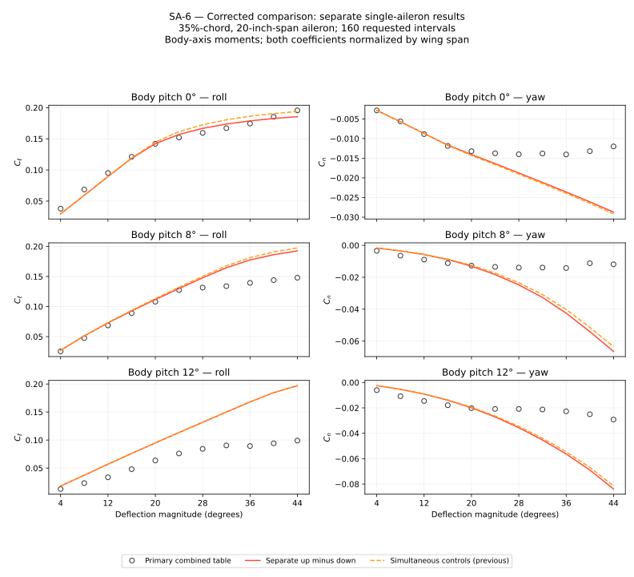
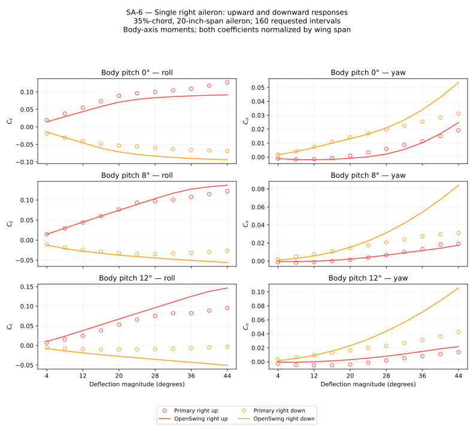

# ISAE SA-6: comparison with separate aileron tests

The corrected experimental procedure completes **966/966 states, with no
rejections**. It improves pooled roll RMSE by 2.73% but increases yaw RMSE by
5.33%. Substantial experimental discrepancies remain, especially at large
deflections. **SA-6 remains partially compared, not validated.**

This report supersedes the experimental interpretation of the earlier
[504-state comparison](isae-sa6-current.md). That calculation and the
[original study](isae-sa6.md) remain available as simultaneous-control results.
No production equations or aerodynamic parameters changed.

The subsequent [local-field diagnosis](isae-sa6-local.md) isolates the large
downward-deflection yaw contribution to the documented stall-drag term and
independently reconstructs all strip loads at 21 representative conditions.
Upward-deflection discrepancies also involve circulation. No force-law coding
error or experimentally justified coefficient change was established.

## Correct experimental procedure

The primary reports form their “combined” curves arithmetically from separate
single-aileron observations. They do not measure both ailerons deflected
simultaneously. This is explicit in [NACA TR-298](https://ntrs.nasa.gov/api/citations/19930091367/downloads/19930091367.pdf),
printed pp.6 and 11, and [NACA TR-343](https://ntrs.nasa.gov/api/citations/19930091412/downloads/19930091412.pdf),
printed pp.4 and 15. The appropriate prediction is

```text
Ccombined = (Cright-up − Cneutral) − (Cright-down − Cneutral)
          = Cright-up − Cright-down
```

for both body-axis roll and yaw. Each calculation retains the whole wing and
leaves the opposite aileron neutral. Reflection supplies the opposite-wing
contribution; both axial moment components reverse sign. Positive physical
deflection here raises the right aileron. The original file's signed control
derivative determines the corresponding F1 sign.

Only the opposite-side control derivatives are zeroed in derived inputs.
Original control knots, wing geometry, material properties and mass are retained.
The seven variants use the same documented 10-inch-span reconstruction as the
previous comparison. Exact mesh-array equality is checked before each sweep.

Conditions remain body pitch 0°, 8° and 12°, with the model's existing 4° wing
incidence, 20 m/s, zero PG Mach and current aerodynamic influences. Requested
meshes are 80/160 intervals, giving 84/164 actual strips. The 20 m/s speed is an
archived calculation setting: the primary tables combine faired observations
at three tunnel speeds. The experimental fuselage is absent from these wing-only
models. These limitations remain explicit.

## Source corrections and accounting

The [new primary transcription](isae-sa6-single-primary.json) records the
35%-chord, 20-inch-span single-right-aileron tables at all three pitches, with
printed values, page locations and source PDF hashes. Its nonzero entries give
66 single-control measurement locations, or 132 roll/yaw coefficient values.
The combined tables give 231 nonzero measurement locations across all seven
variants, or 462 coefficient values. Repeating them on two numerical meshes
does not add experimental observations. Zero-deflection anchors are excluded
from every experimental RMSE.

Review also identified three earlier transcription errors in the 35%-chord,
8°-pitch combined yaw table. The following are the source's **tail-normalized**
coefficients; they are multiplied by 25/60 for span-normalized comparisons.

| Deflection | Earlier transcription | Printed combined value |
|---|---:|---:|
| 20° | −0.0318 | −0.0305 |
| 28° | −0.0336 | −0.0335 |
| 32° | −0.0345 | −0.0335 |

These are explicit overrides in the new report. Both the previous simultaneous
predictions and the corrected predictions are compared against the reviewed
values, so the change in their reported errors isolates the procedure change.
Historical source data and results remain unchanged.

One primary inconsistency remains: at 12° pitch and 32° deflection, the printed
single yaw values sum to −0.0515, whereas the combined table prints −0.0510.
Both are retained: the combined comparison uses the printed combined value;
the separate comparisons use the printed singles. No uncertainty bound is
invented to reconcile them.

## Results

The table pools all 231 nonzero combined locations on the finer mesh, giving
each location equal weight. It is descriptive, not an experimental acceptance
criterion.

| Coefficient | Previous simultaneous-control RMSE | Separate-test RMSE | Change |
|---|---:|---:|---:|
| Roll, Cl | 0.027986 | 0.027223 | −2.73% |
| Yaw, Cn | 0.010126 | 0.010666 | +5.33% |

All 21 roll series improve slightly; yaw improves only in the seven 0°-pitch
series. The plots below show the 35%-chord, 20-inch-span variant. All variants
and mesh comparisons are retained in the data files.



At 12° body pitch and 44° deflection, this variant still predicts roll
**0.19700 versus 0.09900**, and yaw **−0.08390 versus −0.02917**: about 99%
excess roll and 188% excess yaw magnitude. This is one large-deflection point,
not an accuracy estimate for the full operating range.

The single-control comparison makes the disagreement more specific:

| 12° pitch, 44° deflection | Primary roll | OpenSwing roll | Primary yaw | OpenSwing yaw |
|---|---:|---:|---:|---:|
| Right aileron up | 0.09550 | 0.14655 | 0.01375 | 0.02169 |
| Right aileron down | −0.00350 | −0.05045 | 0.04292 | 0.10559 |

The measured downward roll response flattens and then loses magnitude as
deflection increases; the prediction continues growing in magnitude. This is
consistent with the primary reports' discussion of aileron separation and
asymmetric up/down effectiveness, but does not identify a unique missing
physical effect.



Agreement in a combined value can also conceal errors. At 12° pitch and 20°
deflection, combined yaw is −0.01992 versus −0.02021, while up-only yaw has the
wrong sign: +0.00306 versus −0.00396. The downward contribution offsets that
error. Separate measurements are therefore retained as validation targets.

## Numerical checks and physical interpretation

The 966 states comprise 42 neutral states and 924 signed-control states. All
pass the original residual limit of 1e-8 and independent strip-wrench limit
of 2e-10. Their maxima are 9.64e-13 and 1.81e-16 respectively. Every neutral
state exactly reproduces the five saved baseline coefficients. Maximum changes
from 80 to 160 requested intervals are 0.0004781 in combined roll and
0.0001150 in combined yaw, much smaller than the largest experimental errors.
Two meshes measure sensitivity; they do not establish a continuum error bound.

An independent [saved-data audit](isae-sa6-single-aileron-audit.json) passes
30,374 checks covering source identities, all cached states, neutral matching,
reference corrections, up-minus-down reduction, CSV and statistics. It also
recomputes total-wrench normalization and checks moment-component additivity.
Raw strip fields were not retained, so the component force construction is
source-reviewed rather than independently reconstructed from saved strip data.
The audit contains the exact executed checker and the section-law source review.

The saved moment decomposition helps locate the predicted yaw growth. At
12°/44° for this variant, combined circulatory yaw is +0.0136145 and the
profile contribution is −0.0975173, giving total −0.0839028. “Profile” here
includes the solver's stall-drag term, not just the constant section drag.
This decomposition is a diagnostic of the prediction, not an experimentally
measured force split or proof that all error comes from drag.

The supplied models extrapolate constant control derivatives to large angles
with fixed section lift limits and simplified drag. The reviewed control-angle
and stall-leakage prescriptions follow the corresponding documented ASWING
formulation ([theory](https://web.mit.edu/drela/Public/web/aswing/asw_theory.pdf),
equations 158–159 and 202–204); this comparison has not identified a justified
equation correction.
ASWING's [user guide](https://web.mit.edu/drela/Public/web/aswing/aswing_doc.txt)
also explains the limits of a linear control-to-drag derivative for conventional
ailerons. The retained Clark-Y 15%-chord polar contains no numeric rows, so it
cannot independently supply the missing finite-deflection behavior.

The next physical task is to recover independent Clark-Y section/control data
and assess its applicability to these tunnel conditions, while retaining the
separate up/down targets. Fuselage/support effects and experimental uncertainty
also remain unresolved. Altering coefficients to fit this same validation set
would not constitute an independent validation. ISAE coverage remains
**17 partial / 24 pending / 0 fully validated**; Daedalus matching is deferred
at the user's request.

## Reproduction and data

```sh
OPENBLAS_NUM_THREADS=1 OMP_NUM_THREADS=1 MKL_NUM_THREADS=1 NUMEXPR_NUM_THREADS=1 \
  .venv/bin/python scripts/compare-isae-sa6-single-aileron.py
.venv/bin/python scripts/plot-isae-sa6-single-aileron.py
```

The calculation pins 123 source/input files, including all 110 kernel modules,
and caches each state under the complete plan identity. The previous baseline's
source pins must also match. Per-state computation times sum to 197.55 seconds
in this native run; this is not an elapsed browser benchmark.

[Complete data and source identities](isae-sa6-single-aileron.json),
[independent audit and source review](isae-sa6-single-aileron-audit.json),
[462 combined comparison rows across two meshes](isae-sa6-single-aileron.csv),
[primary single-aileron transcription](isae-sa6-single-primary.json),
[combined plot PNG](isae-sa6-single-aileron-combined.png),
[single-aileron plot PNG](isae-sa6-single-aileron-single.png).
