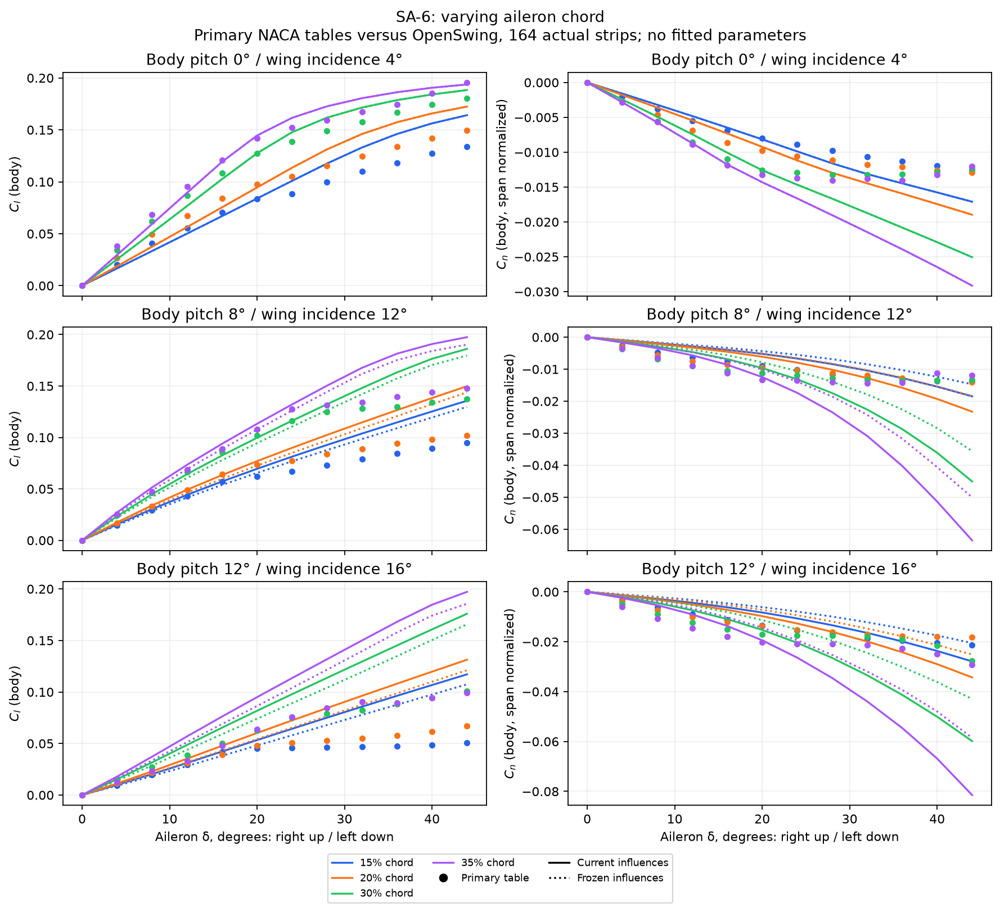
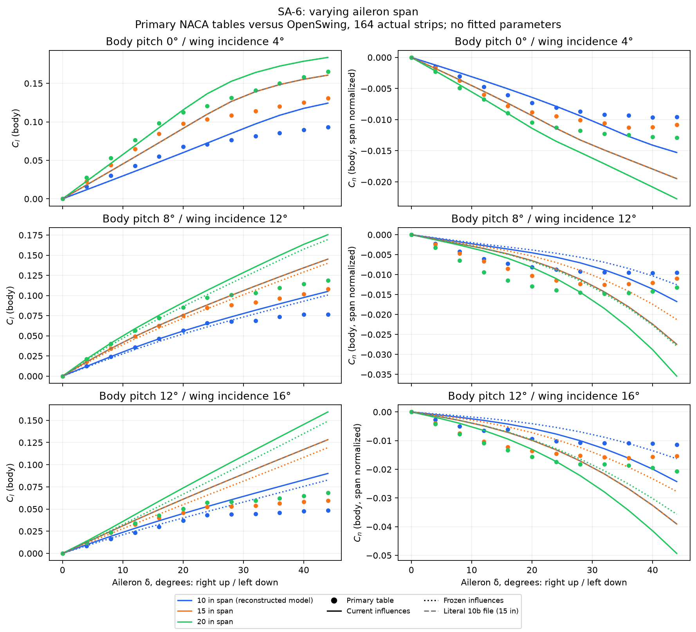

# SA-6: aileron rolling and yawing moments

**Experimental interpretation superseded:** the [separate-aileron comparison](isae-sa6-single-aileron.md)
now follows the primary combined tables' separate up/down test procedure and
records three corrected yaw transcriptions. The simultaneous-control results,
archived-ASWING comparisons and historical data below are preserved.

**Partial validation; experimental and archived-ASWING discrepancies remain.** All seven literal models and one explicit 10-inch control-span reconstruction are compared. No solver equations, tolerances or aerodynamic parameters were changed.

The later [native-table catalogue](isae-sa6-native-tables-20261101.md) separately
selects the author-labelled ASWING columns from the already audited ODS/MATLAB
tables. It adds 220 reference values beyond the raw `.fmat` moment scope and
re-scores this saved study with explicit historical/setup qualifications.
Printed level-flight response identities suggest control-gain differences
from three supplied decks. No registered pass or production change follows.

The sweep contains 1,728 requested states: **1,728 converged, 0 rejected**, across requested meshes 40/80/160 (44/84/164 actual strips after mandatory station breaks), body pitch 0°/8°/12°, aileron δ=0° to 44° in 4° steps, and current/frozen influence choices. Speed is 20 m/s and PG Mach is zero, as in the raw archived force files. The largest residual is 2.27e-11.

## Source and convention audit

The source is Jan’s [ISAE repository](https://github.com/rom1isae/ISAE_Aswing_Experimental_Validation/tree/f62943df20e9e4d7d9f50e070477b22426b5f865), pinned to `f62943df20e9e4d7d9f50e070477b22426b5f865`. Primary tables are independently transcribed from [NACA TR-298](https://ntrs.nasa.gov/api/citations/19930091367/downloads/19930091367.pdf) Tables V/VI (printed p.18, PDF p.20), and [NACA TR-343](https://ntrs.nasa.gov/api/citations/19930091412/downloads/19930091412.pdf) Tables V/VI and XIII/XIV (printed pp.21/27, PDF pp.23/29). PDF hashes and original data are retained in [the source audit](isae-sa6-sources.json).

- Primary moments use body axes. TR-343 p.4 defines yaw as N/(q S f), where f is the center-of-rotation-to-tail distance: 25 inches versus the 60-inch span. Multiplying the primary yaw coefficient by 25/60 gives the ASWING span normalization. The reported 0.417 ratio is rounded.
- Raw ASWING fmat moments use stability axes. For fixed body pitch α, Cl_s = cos(α) Cl_b + sin(α) Cn_b and Cn_s = −sin(α) Cl_b + cos(α) Cn_b. These are used only for the archived comparison; primary comparisons use body moments.
- The archived post-stall span measurements come from the 8° body-pitch table; chord measurements come from the 12° table. The model already has 4° incidence, so it is not added again to the flight condition.
- The file named 10b defines 15-inch ailerons. Its literal results remain recorded. The separate reconstruction changes only the doubled dCLdF1/dCMdF1 boundary stations from ±0.381 to ±0.508 m; it is never substituted for the literal input.
- Positive physical δ means right aileron up and left down. It maps to +F1 in chord files and −F1 in span files. Signed moments are retained.
- The data audit retains 21 MATLAB/primary numeric conflicts, 6 CSV/primary conflicts, 1 ODS/MATLAB conflicts and 12 invalid ODS numeric cells. In particular, the post-stall 20-inch yaw series repeats the level-flight values. No archive cells are silently repaired.
- The archived 15c model uses dCLdF=.040 whereas the report gives .039; 35c uses .071 whereas the report prints .71. Literal coefficients are retained. The original fmat mesh and frozen-influence startup state are unknown.
- The primary model includes a fuselage; the supplied aerodynamic models are wing-only. Tables were read from faired curves through observations at three speeds. The input reference area .3871 m² differs from the exact 600 in² area (.387096 m²) by about 0.001%; that input rounding is retained. The tunnel’s ±1% velocity uniformity is not treated as coefficient uncertainty.

## Primary comparison

Current-influence results at the finest mesh (160 requested, 164 actual strips) are shown below. RMSE includes all 12 deflections, including zero. “10b reconstructed” uses the explicitly changed control-span boundary. A small residual or agreement with ASWING is not an experimental pass.

| Aileron | Body pitch | Roll coefficient RMSE | Yaw coefficient RMSE |
|---|---:|---:|---:|
| 20b_15c | 0° | 0.017440 | 0.002188 |
| 20b_15c | 8° | 0.020771 | 0.002969 |
| 20b_15c | 12° | 0.032779 | 0.003894 |
| 20b_20c | 0° | 0.015290 | 0.002768 |
| 20b_20c | 8° | 0.022575 | 0.004071 |
| 20b_20c | 12° | 0.033417 | 0.006610 |
| 20b_30c | 0° | 0.009437 | 0.005548 |
| 20b_30c | 8° | 0.021926 | 0.012612 |
| 20b_30c | 12° | 0.038653 | 0.015132 |
| 20b_35c | 0° | 0.008208 | 0.007423 |
| 20b_35c | 8° | 0.025836 | 0.021125 |
| 20b_35c | 12° | 0.053058 | 0.022965 |
| 15b_25c | 0° | 0.018174 | 0.003877 |
| 15b_25c | 8° | 0.017622 | 0.006258 |
| 15b_25c | 12° | 0.034224 | 0.009569 |
| 20b_25c | 0° | 0.014881 | 0.004531 |
| 20b_25c | 8° | 0.027202 | 0.008672 |
| 20b_25c | 12° | 0.047244 | 0.011958 |
| 10b_25c reconstructed | 0° | 0.015315 | 0.002429 |
| 10b_25c reconstructed | 8° | 0.011955 | 0.003288 |
| 10b_25c reconstructed | 12° | 0.020245 | 0.005213 |

Signed control slopes fitted over δ=0°–20° give these percentage-error ranges across the seven physical variants (current influences). A negative percentage for a negative yaw slope means its magnitude is underpredicted. These are descriptive errors, not acceptance tolerances.

| Body pitch | Roll slope error | Yaw slope error |
|---|---:|---:|
| 0° | -10.3% to +3.6% | -13.7% to +7.9% |
| 8° | -2.6% to +7.9% | -45.0% to -7.3% |
| 12° | +11.7% to +54.0% | -38.1% to -4.2% |

Refinement from 80 to 160 requested intervals (84→164 actual strips) changes Cl by at most 0.000487 and Cn by at most 0.000104 over the sweep. These differences are substantially below the largest experimental discrepancies.


## Archived ASWING comparison

The 44 raw fmat outputs identify 12° body pitch, zero PG Mach and stability-axis moments. The table compares those signed moments after the explicit body-to-stability rotation. Original mesh and K/F startup settings are not recorded; both influence choices are retained.

| Aileron | Influences | Stability roll RMSE | Stability yaw RMSE |
|---|---|---:|---:|
| 20b_15c | Current | 0.002159 | 0.005818 |
| 20b_15c | Frozen | 0.003450 | 0.000693 |
| 20b_20c | Current | 0.002227 | 0.006978 |
| 20b_20c | Frozen | 0.003733 | 0.000894 |
| 20b_30c | Current | 0.002032 | 0.011501 |
| 20b_30c | Frozen | 0.004647 | 0.001640 |
| 20b_35c | Current | 0.002149 | 0.015031 |
| 20b_35c | Frozen | 0.005555 | 0.002181 |





## Numerical verification and remaining work

Independent strip-force/moment sums agree with the reported coefficients within 2.78e-17. All 48 signed-control reflection checks pass. Sixteen implicit control tangents agree with two centered nonlinear step sizes; mounted and rigid base coefficients agree. The 44 raw fmat roll/yaw pairs match their archived MATLAB values exactly. These checks validate calculations and conventions, not the experimental model.

The [numerical report](isae-sa6.json) retains every run, both influence settings, 40→80 and 80→160 differences and all archived-force comparisons. The [comparison summary](isae-sa6-comparison.json) also records signed least-squares slopes over δ=0°–20°; these summarize control effectiveness and do not tune the aerodynamic model. The [check report](isae-sa6-checks.json) retains source contradictions and derivative errors.

Actual Pyodide replays and the offline browser workflow are recorded separately in [WASM checks](isae-sa6-wasm.json) and [browser checks](isae-sa6-browser.json). They must not be confused with experimental validation.

Remaining work is to reconcile the literal control geometry and aerodynamic section properties with the actual apparatus, recover the original discretization/startup settings, assess the omitted fuselage and flap-dependent drag/stall model independently, and obtain measurement/setup uncertainty. Mesh sensitivity and derivative agreement alone cannot close these gaps. The full ISAE suite and the full ASWING feature goal remain incomplete.

## Reproduction

Restore the source-pinned ISAE cache with `scripts/fetch-isae-validation.py`. The optional SA-6 raw archive retains the pinned NASA PDFs, original inputs, all cached solves and test logs. Run with `OPENBLAS_NUM_THREADS=1 OMP_NUM_THREADS=1`:

```sh
.venv/bin/python scripts/fetch-isae-sa6.py
.venv/bin/python scripts/isae_sa6_reference.py
.venv/bin/python scripts/verify-isae-sa6.py
.venv/bin/python scripts/check-isae-sa6.py
node scripts/test-isae-sa6-wasm.mjs
.venv/bin/python scripts/summarize-isae-sa6.py
npx playwright test tests/browser/isae-sa6.spec.js
```

The PDFs are US-government works marked public-use permitted by NASA. The source ZIP carries summaries and scripts; the separate raw archive carries full primary scans and source-cache files.
