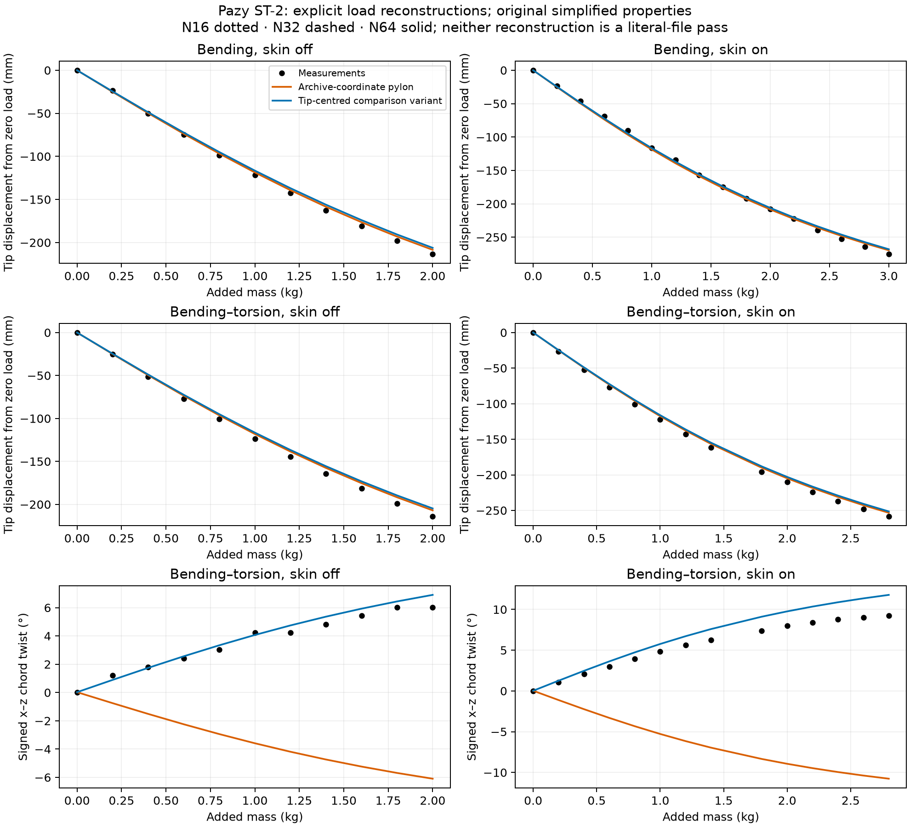
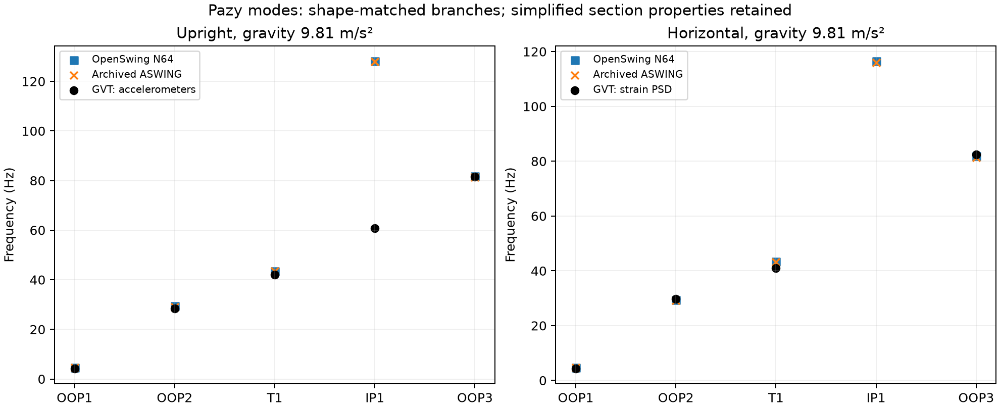

# Pazy wing ST-2 comparison

**Historical coverage correction, 2026-10-26:** the archived-profile reduction
below retained only 44 of the 46 rows in `temp.txt`. Its fixed header-skip count
omitted the root and next station. The reader now locates the table header and
retains all 46 rows; 21 parser regressions pass. The older JSON and plots remain
unchanged historical evidence, and their full-profile claim must not be treated
as an all-row comparison. A [corrected saved-data reduction](isae-suite-expanded-20261026/st2-restored-rows.json) now retains all 46 rows for the three historical grids; the original 44 predictions and tip differences are unchanged. This correction adds no literal ST-2 reference pass.

**Partial comparison complete; no experimental validation pass.** All 77 supplied static measurement rows were compared at N16/32/64 for two explicit load reconstructions. The 462 requests reduce to 246 distinct static solves; all computed. Sixteen air-free modal states cover two orientations, gravity off/on and N8/16/32/64. All 97 production modules and original upstream files are unchanged.

All six literal `.asw` files parse but fail network construction: their Weight anchors are at t=0.558, outside a beam ending at t=0.55. None is counted as a literal-file solve. The [source audit](isae-st2-source-audit.json) pins 146 ISAE files and 105 primary-author files; 97 corresponding files are byte-identical.

The ISAE source is [Jan’s structural validation repository](https://github.com/rom1isae/ISAE_Aswing_Experimental_Validation/tree/f62943df20e9e4d7d9f50e070477b22426b5f865/3%20-%20Structure/CASE%20-%20ST2%20Pazy_Wing). The primary model/data collection is [Riso and Cesnik’s AePW3 repository](https://github.com/UM-A2SRL/AePW3-LDWG/tree/396710a19a80004c65c767e9955fe60d59565c39).

## Load and measurement conventions

| Variant | Anchor | Physical load coordinates (m) | Interpretation |
|---|---:|---|---|
| Archive-coordinate pylon | .55 | y=.558; x=.05 bending, −.09/−.13 torsion | Retains archive coordinates on an explicit rigid tip extension |
| Tip-centred comparison (`measured_tip` in caches) | .55 | y=.55; x=0 bending, +.09/+.13 torsion | Primary chordwise locations; spanwise load position remains approximate |

The experiment describes midchord bending loads at y=558 mm, aft torsion loads and an additional reinforcing rod. Thus the tip-centred variant does **not** recover its complete setup. Original simplified stiffness and mass distributions remain unchanged; the two skin cases are not separately fitted. The static and modal distributed masses are 0.205975 and 0.3732785 kg, while the primary lumped beam files sum to 0.347330 and 0.356596 kg without/with skin. [Experimental setup, §IV.B](https://doi.org/10.2514/1.J060621); [low-order model study, §IV.B](https://doi.org/10.2514/1.C036869).

Vertical displacement is the midchord tip z change from the zero-added-mass state. Twist uses the chord projection in the x–z plane: `degrees(atan2(-Q[2,0], Q[0,0]))`, with positive nose-up sign. The initial raw report’s `twist_projected_deg` instead measures chord elevation using a horizontal-norm denominator. Its saved results are unchanged; the final angle is recomputed here from full rotations. The archive’s negated local section twist is a third quantity and remains a separate diagnostic. [Experimental angle reduction, §IV.B](https://doi.org/10.2514/1.J060621).

## Static discrepancies

| Data | Points | Archive-pylon N64 RMSE | Tip-centred N64 RMSE | Tip-centred max N32→64 change |
|---|---:|---:|---:|---:|
| Bending, skin off, displacement | 11 | 3.21643 mm | 5.01255 mm | 0.03894 mm |
| Bending, skin on, displacement | 16 | 3.62130 mm | 3.80044 mm | 0.03894 mm |
| Torsion, skin off, displacement | 11 | 5.07163 mm | 6.66100 mm | 0.03893 mm |
| Torsion, skin off, twist | 11 | 7.93923 ° | 0.42709 ° | 0.00076 ° |
| Torsion, skin on, displacement | 14 | 4.61235 mm | 6.11660 mm | 0.03910 mm |
| Torsion, skin on, twist | 14 | 13.43680 ° | 1.49475 ° | 0.00173 ° |



Mesh changes are substantially smaller than the experimental discrepancies. The archived torsion load location gives the opposite signed chord twist; applying its plotting sign reversal would conceal that setup difference. Neither a sign reversal nor a stiffness fit is used to improve the measured comparison. The skin-on MATLAB plotting block also reads a skin-off GFEM rotation file; that plotted curve is not used as skin-on evidence.

An independent continuous Kirchhoff rod shooting calculation uses quaternion kinematics, spatial force/moment balance and the rotating tip-pylon load. It imports no OpenSwing code. Eight selected states are compared at three meshes:

| Panels | Profiles | Max position-component difference | Max rotation-matrix-component difference |
|---:|---:|---:|---:|
| 16 | 8 | 0.233981 mm | 0.000508025 |
| 32 | 8 | 0.058800 mm | 0.000127292 |
| 64 | 8 | 0.014707 mm | 3.18409e-05 |

Each refinement reduces those differences by approximately four. This verifies the simplified nonlinear structural equations for the checked states, not the experimental material model.

The saved ASWING `temp.txt` was compared at 44 of its 46 printed stations; see the coverage correction above. Its force, positive twist and tip displacement suggest the final 3 kg bending case; that identification is an inference because the export omits the source file and mesh. At N32 the reconstructed tip is y=0.455903 m, z=−0.279142 m and local twist=5.11513°, versus printed 0.456 m, −0.279 m and 5.11°. Historical profile interpolation differences and source rounding limits are retained in the JSON; no exact archive replay is claimed.

## Modal discrepancies

Modes are assigned by physical shape, not table row. The supplied workbook and primary experiment identify the upright GVT as **skin on**; the ISAE summary caption says skin off. The summary also interchanges the primary UM/NAST in-plane and third-bending entries. The corrected type mapping is retained. [Primary GVT tables 3–5](https://doi.org/10.2514/1.J060621).

| Orientation | Mode | OpenSwing N64, gravity on (Hz) | Archived ASWING (Hz) | Measured (Hz) | Difference from measurement |
|---|---|---:|---:|---:|---:|
| upright | OOP1 | 4.630735 | 4.59 | 4.26 | +8.70% |
| upright | OOP2 | 29.323202 | 29.10 | 28.50 | +2.89% |
| upright | T1 | 43.542017 | 43.40 | 42.00 | +3.67% |
| upright | IP1 | 128.138726 | 128.00 | 60.70 | +111.10% |
| upright | OOP3 | 81.766077 | 81.40 | 81.50 | +0.33% |
| horizontal | OOP1 | 4.709405 | 4.67 | 4.39 | +7.28% |
| horizontal | OOP2 | 29.386299 | 29.20 | 29.80 | -1.39% |
| horizontal | T1 | 43.319634 | 43.20 | 41.00 | +5.66% |
| horizontal | IP1 | 116.494673 | 116.00 | — | — |
| horizontal | OOP3 | 81.813462 | 81.40 | 82.50 | -0.83% |

Horizontal measurements in this table use strain PSD. The primary displacement PSD and SPOD results differ and are separately recorded in the JSON. The in-plane experimental discrepancy is large and also present in the archived ASWING model. It remains unresolved.



Independent Hermite/Rayleigh beam calculations retain two coupled bending planes, distributed rotary inertia, torsion, and the stiffness break at 0.52 m. The 49/97/193-element reference refinements and native N8/16/32/64 results are saved. For upright gravity, the reference includes compressive geometric stiffness and neglects finite axial shortening. The horizontal gravity-loaded reference is used only to assign branches; it is not an independent loaded-frequency check. Its in-plane shape-assurance value is about 0.738, so that assignment is less certain than the other checked branches.

All four gravity-free orientation pairs agree after rotating displacements and rotation vectors, across eight positive-frequency modes each. Full descriptor A/M matrices and left/right eigenpair backward errors are retained. No aerodynamic apparent mass is included.

## Runtime checks and reproducibility

The [WebAssembly replay](isae-st2-wasm.json) passes eight full static-field comparisons, four modal A/M/frequency/shape comparisons and all six expected literal construction rejections. The [actual served browser app](isae-st2-browser.json), offline after boot, passes six static and four modal solves with exported input equality and all 97 source hashes checked. The mobile Plots view also passes its width check. These samples do not replay every native condition.

Raw calculations: [static](isae-st2-static.json), [modal](isae-st2-modes.json). Final postprocessing: [comparison JSON](isae-st2-comparison.json), [coverage audit](isae-st2-checks.json). Standalone figures: [static SVG](isae-st2-static-comparison.svg), [modal SVG](isae-st2-modal-comparison.svg).

From the repository root, after fetching the pinned source datasets:

```sh
OPENBLAS_NUM_THREADS=1 OMP_NUM_THREADS=1 .venv/bin/python scripts/audit-isae-st2-sources.py
OPENBLAS_NUM_THREADS=1 OMP_NUM_THREADS=1 .venv/bin/python scripts/verify-isae-st2-static.py
OPENBLAS_NUM_THREADS=1 OMP_NUM_THREADS=1 .venv/bin/python scripts/verify-isae-st2-modes.py
node scripts/test-isae-st2-wasm.mjs
# Run tests/browser/isae-st2.spec.js against the local served build and retain its JSON export.
OPENBLAS_NUM_THREADS=1 OMP_NUM_THREADS=1 .venv/bin/python scripts/summarize-isae-st2.py
```

## Work remaining

- Recover documented ASWING handling of out-of-domain attachments; literal construction remains rejected.
- Reconstruct full primary stiffness/inertia, skin-specific properties, exact spanwise/chordwise load geometry and instrumentation/rod masses.
- Compare the remaining primary FE/beam variant curves and measured shapes with matched quantities and setups.
- Resolve static and modal experimental discrepancies, calibration dependence and quantified measurement/setup uncertainty. No experimental pass threshold has been invented.
- Aerodynamic loaded modes, static aeroelasticity and flutter belong to separate AE cases; they are not validated by this air-free structural comparison.

The primary static and GVT measurements were used for model adaptation, so they are not an independent calibration holdout. The experimental paper gives an order-of-magnitude twist measurement error up to about 1.2°; it does not supply a statistical acceptance band for these comparisons. [Experimental uncertainty and adaptation](https://doi.org/10.2514/1.J060621).
