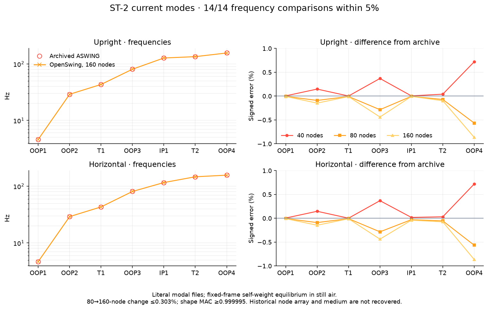

# ST-2 current modal results and attachment evidence

**All 14 archived modal frequencies pass at 5% on current OpenSwing.** Together
with the [77 passing static ordinates](isae-st2-static-curves-20261109.md), the
published mechanics scope is **91/91**. That scope is now the primary progress
measure, following the ST-1 mechanics approach. The original **56/490 archive
inventory remains separate**, with all unavailable values and raw-component
comparisons retained. Full ST-2 input/output compatibility remains open.

## Current frequencies

The two original modal `.asw` files are unchanged, including their physically
inactive null Weight records. The fixed-frame equilibrium includes gravity;
the horizontal wing sags 17.295 mm before linearization. Still-air density is
the source value, 1.23 kg/m³. The source's material, inertia, coupling and
property-break data are retained without fitting.

| Mode | Upright ASWING, Hz | OpenSwing, Hz | Error | Horizontal ASWING, Hz | OpenSwing, Hz | Error |
|---|---:|---:|---:|---:|---:|---:|
| OOP1 | 4.598348 | 4.597999 | 0.0076% | 4.676464 | 4.676122 | 0.0073% |
| OOP2 | 29.135139 | 29.092391 | 0.1467% | 29.197843 | 29.155179 | 0.1461% |
| T1 | 43.447725 | 43.443068 | 0.0107% | 43.226637 | 43.222173 | 0.0103% |
| OOP3 | 81.359224 | 81.002632 | 0.4383% | 81.406351 | 81.050156 | 0.4376% |
| IP1 | 128.142966 | 128.134046 | 0.0070% | 116.434820 | 116.387692 | 0.0405% |
| T2 | 135.527997 | 135.396761 | 0.0968% | 147.366675 | 147.256377 | 0.0748% |
| OOP4 | 158.571427 | 157.198704 | 0.8657% | 158.615841 | 157.244085 | 0.8648% |

OOP/IP denote out-of-plane/in-plane bending; T denotes torsion. The labels are
identified from OpenSwing's physical mode activity and order, independently of
the target frequencies. The first seven positive computed roots are paired in
frequency order with the seven original `.e00` rows. No nearest-target search
selects roots. Native mode vectors are unavailable, so native shape identity
is not independently recovered. All ten overlapping named values in Part III,
Table 4, p. 37 also pass; their maximum error is 0.4882%. They add no votes.

[Standalone SVG](isae-st2-modal-current-20261109.svg).

Maximum native-frequency error is **0.8657%**, median **0.08584%**. Prospective
cosine meshes have 40, 80 and 160 unique nodes, including the t = 0.52 property
break. Both 80- and 160-node frequency comparisons must pass. Their largest
frequency change is **0.3027%**, within the predeclared 1% mechanics mesh gate.
Mass-weighted shape assurance exceeds **0.999995** for every mode, and the
one-to-one shape assignment preserves frequency order. Every mode has a
dominant physical family with at least 68.19% activity.

The 40→80-node fourth-bending changes are 1.293% in both orientations and do
not pass that mesh gate. They are retained as coarse-grid limitations. Finer
meshes improve numerical convergence even when a frequency moves away from
the archived coarse result. The report specifies forty nodes; its exact node
array and medium settings remain unknown. Earlier alternative-spacing and
independent-continuum studies remain separate evidence. Their original gates
and recorded results are unchanged; this current mechanics scope declares its
own 1% mesh gate rather than replacing the older 0.1% refinement study.

All six current equilibria pass fresh residual, root clamp, global balance and
independent gravity force/moment checks. All **240 left/right eigen-equation
checks** pass on the original sparse A/M matrices, with worst relative action
residual 1.055e−12. All computed roots satisfy the predeclared undamped-mode
neutrality check; maximum |Re λ|/max(1,|Im λ|) is 1.163e−12. Their raw real
components remain in the results. None of the repeated original tiny-real
printed intervals passes; those strict archive comparisons are not used as a
frequency or stability tolerance and are not removed from the archive scope.

Six serial jobs took 37.63 seconds total after imports; the longest solve was
9.93 seconds, and peak RSS was 281,276 KiB. Each had one BLAS thread, 512 MiB
address space, 15 seconds CPU and 25 seconds wall limits. All 141 production
modules are unchanged. Browser/build testing remains held.

## Independent evidence for the static tip attachment

The original static model has an attachment parameter of 0.558 beyond its
0.55 beam endpoint. The preceding static replay explicitly anchored at the tip
and retained the physical mass coordinates. An audit of the original
`03_Static_Structural/temp.txt` now supports that physical reconstruction.

For this bending model the reference, elastic, tension and CG axes coincide,
and the jig pylon's normal offset is zero. Drela's steady description,
section 3.3, equations 87–90 and 95–96 give the local relations
`Mc = sp Fn` and `Ms = −cp Fn`. The archived last station reports
**Mc = −0.161 N m, Ms = 1.01 N m and Fn = −20.2 N**. Its separate exponent row
is essential: Mc and Fn have exponent 1, while Ms has exponent 0 despite the
generic column label. Propagating the original decimal print intervals gives:

| Effective pylon arm | Inferred interval | Used in reconstruction |
|---|---:|---:|
| Spanwise | 7.926–8.015 mm | 8 mm |
| Chordwise | 49.630–50.372 mm | 50 mm |

Both zero-arm alternatives are excluded under those stated assumptions. The
archived total weight also supports a 3 kg point load with the source's
distributed mass. Current 40- and 80-node reconstructed endpoints fall inside
**all three original printed resultant intervals**, without the 5% allowance.
This is independent evidence from forces and moments, beyond matching tip
deflection and twist.

It supports the effective load arm in this case. It does not prove which
generating input bytes were used, nor a universal native clamp/extrapolation
rule. Production handling of out-of-range attachments is unchanged. The audit
uses saved results and exact decimal arithmetic; it runs no solver.

## Scope and remaining work

The [explicit mechanics scope](isae-st2-mechanics-scope.json) includes every
ordinate in the six published static curves and every frequency in both native
modal exports: 77 plus 14. Static and modal observations are independent
scopes; repeats across meshes, alternative media, and the rounded Table 4 cells
are not added. Static values retain the disclosed pylon reconstruction; modal
source files are literal. No missing value is removed from the separate
490-slot archive denominator. The progress change represents this explicit
scope selection, not newly matching all those old archive fields.

Remaining work includes literal static-file attachment compatibility, exact
historical settings and the other archived output fields. The declared
mechanics comparisons pass; this is not full-family or full-project completion.

Evidence: [fixed modal plan](../../artifacts/isae/st2-modal-current-20261109/plan.json),
[all comparisons and mesh/shape checks](../../artifacts/isae/st2-modal-current-20261109/summary.json),
[numeric checks](../../artifacts/isae/st2-modal-current-20261109/checks.json),
[decimal attachment audit](../../artifacts/isae/st2-modal-current-20261109/tip-pylon-audit.json),
[modal replay script](../../scripts/verify_st2_modal_current.py),
[attachment audit script](../../scripts/audit_st2_tip_pylon.py).
