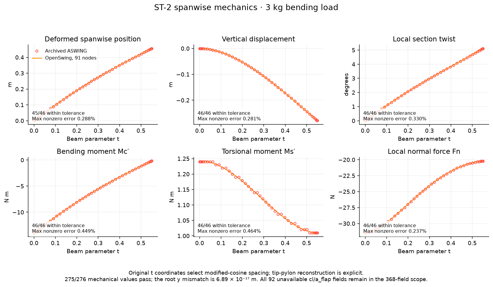

# ST-2 spanwise mechanics against the original ASWING output

**275/276 mechanical values pass at 5% on both meshes. All 138 internal-force
and moment values also match within the original printed precision.** The one
mechanical failure is the archived clamped-root y coordinate, 6.89e−17 m,
versus effectively zero. Its strict absolute gate is retained. The full scope
is **275/368**, including 92 unavailable legacy display values.

This comparison uses the same explicit tip-pylon reconstruction as the
[published static curves](isae-st2-static-curves-20261109.md). It supports the
structural mechanics and physical load arm, while literal handling of the
original out-of-domain attachment remains unresolved. No production equations,
material properties or original reference files changed.

| Original field | Passing on both meshes | Fine-mesh matches at printed precision | Maximum nonzero error |
|---|---:|---:|---:|
| Deformed y | 45/46 | 45/46 | 0.2883% |
| Vertical displacement z−z0 | 46/46 | 43/46 | 0.2811% |
| Local section twist | 46/46 | 39/46 | 0.3303% |
| Bending moment Mc′ | 46/46 | 46/46 | 0.4486% |
| Torsional moment Ms′ | 46/46 | 46/46 | 0.4641% |
| Local normal force Fn | 46/46 | 46/46 | 0.2372% |
| cl | 0/46, unavailable | — | — |
| a_flap | 0/46, unavailable | — | — |

Median nonzero mechanical error is **0.08652%**. Percentages below a printed
interval are not evidence of a resolved numerical discrepancy: the source
table often has only three significant digits.



[Standalone SVG](isae-st2-span-profile-20261109.svg).

## Mesh recovered from coordinates

The original `03_Static_Structural/temp.txt` contains 46 stations. All 46
printed t intervals agree with the existing **modified-cosine** spacing at
45 intervals; ordinary cosine agrees at three stations, uniform spacing at
two. This selection uses only coordinates, without consulting displacement
or load targets. For i = 0,…,45, the existing rule is

```
u = sin((2 i / 45 − 1) asin(1 − 2⁻²⁴))
t = 0.0001 + (0.55 − 0.0001) (1 + 0.7 u + 0.3 u³) / 2
```

The endpoints are exact. Doubling to 90 intervals retains these stations at
even indices, so each comparison uses a directly computed node. No field
interpolation is involved. This establishes a compatible grid within the
original print intervals, not uniquely recovered internal coordinates or a
universal ASWING default. Part III §4.2, p. 34 states forty nodes for its study;
the retained export has forty-six. That source discrepancy is preserved.

Both meshes pass the predeclared 1% field-refinement gate. The largest change,
scaled by the fine-mesh peak of each field, is **0.01112%** for displacement.
For Mc′, Ms′ and Fn the changes are respectively 0.00129%, 0.00341% and
0.00245% of their field peaks.

## Load and output conventions

The unchanged source beam properties and 3 kg total tip mass are used. As in
the prior study, the derived Weight attachment is t = 0.55 rather than the
original out-of-domain t = 0.558. Physical load coordinates remain
x = 0.05 m, y = 0.558 m, z = 0: a 50 mm chordwise and 8 mm spanwise rigid arm.
The [independent native-resultant audit](isae-st2-modal-current-20261109.md)
supports these arms from Drela's steady §3.3, Eqs. 87–90 and 95–96.

The original table reports absolute deformed y, z relative to the jig, and
unnegated local section twist. This differs from the published tip-deflection
curves' loaded-minus-unloaded convention. Local endpoint forces and moments
are compared directly. The bending model's elastic, tension and reference
axes coincide, making its prime moments equal to the local moments.

The exponent row is **1, 0, 1**: Mc and Fn scale by ten, while Ms does not,
despite the generic `/10` header. The original tokens, exponents and decimal
precision intervals are retained. Both meshes match every resultant within
those intervals, without needing the 5% allowance.

The structural result does not provide the archived `cl` and `a_flap` display
quantities. Their 92 slots remain unavailable even though their original
printed values are zero. No zeros are invented to make them pass. The root y
failure retains its 5e−20 m gate; its 6.89e−17 m absolute difference is numerical
roundoff for a clamped coordinate, not a meaningful structural discrepancy.

## Numerical checks and scope

Both equilibria pass residual, clamp, global balance and independent gravity
force/moment checks below 1e−7. Endpoint resultants are continuous at interior
nodes to 7.11e−15. The solves take 0.829 and 0.967 seconds after imports, with
peak RSS 277,520 KiB. They ran serially with one BLAS thread, 512 MiB address
space, 15-second CPU and 25-second wall limits. All 141 production modules are
unchanged. Browser/build testing remains held.

This is supplementary evidence, overlapping the original archive. It is not
added to the **91/91 primary mechanics scope** or substituted into the old
**56/490 registered archive scope**, whose input compatibility remains open.
The 276-field mechanical subset is not added to its 368-field parent. Exact
historical input bytes, native out-of-domain attachment semantics and missing
legacy outputs are still unresolved; full ST-2 compatibility is not declared.

Evidence: [fixed plan and coordinate audit](../../artifacts/isae/st2-span-profile-20261109/plan.json),
[all fields and mesh checks](../../artifacts/isae/st2-span-profile-20261109/summary.json),
[replay script](../../scripts/verify_st2_span_profile.py),
[plot script](../../artifacts/isae/st2-span-profile-20261109/plot.py).
Each job retains its complete request, physical result and comparison report.
