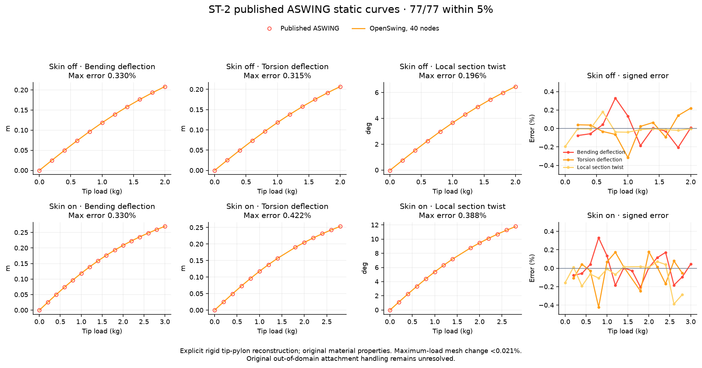

# ST-2 published static curves

**All 77 published ASWING static ordinates pass at 5%.** The worst error is
**0.4217%**, and the median among nonzero ordinates is **0.0645%**. This covers
all six Figure 23 curves: bending deflection, torsion deflection and torsion
angle, with both skin labels. The calculation uses the disclosed tip-pylon
reconstruction; native handling of the original out-of-domain attachment
remains unresolved. The original **56/490 archive score is retained separately**.

| Published curve | Matches | Maximum error |
|---|---:|---:|
| Skin off, bending deflection | 11/11 | 0.3303% |
| Skin on, bending deflection | 16/16 | 0.3301% |
| Skin off, torsion deflection | 11/11 | 0.3151% |
| Skin on, torsion deflection | 14/14 | 0.4217% |
| Skin off, local section twist | 11/11 | 0.1962% |
| Skin on, local section twist | 14/14 | 0.3877% |

[Standalone SVG](isae-st2-static-curves-20261109.svg).

## What is being compared

The authoritative source is Jan, *Experimental validation of ASWING, Part III*,
section 4.2, p. 34 and Figure 23, p. 36. The source index and checksummed catalog
were consulted. Original red ASWING vector paths, axis ticks and the MATLAB
producer supply the targets and definitions, as described in the
[initial source extraction](isae-st2-static-pilot-20261109.md). No experimental
or UM/NAST ordinates are used as ASWING targets. Original drivers name the
`ASWING_ISAE_ENAC` executable; this does not identify which modifications,
if any, affect these structural results.

All 77 original ordinates remain required. They represent **41 distinct load
states**, with shared bending conditions across the two skin-labelled curves
and both displacement and twist at torsion states. They are not 77 independent
physical cases. The six additional refinement states add no comparison votes.

The beam data and MATLAB load coordinates are unchanged. Bending uses load
position x = 0.05 m; torsion uses x = −0.09 m and −0.13 m for the two respective
skin labels. All load positions retain y = 0.558 m. Two equal weights reproduce
the producer's specified total mass. The original torsion stiffness break at
t = 0.52, coupling EIcn = −0.12 and elastic-axis offset Cea = −0.005 m are
retained. No stiffness, mass, load-coordinate or coupling parameter is fitted.

The original `.asw` files place the Weight attachment at **t = 0.558**, beyond
their **t = 0.55** endpoint. Derived inputs attach at t = 0.55 and retain the
physical point coordinates, creating an 8 mm spanwise rigid tip extension.
Drela's steady description, section 3.3, equations 87–90, and the user guide's
Weight block specify the rigid-pylon kinematics used here. The reviewed text
does not establish a rule for clamping or extrapolating an out-of-domain
attachment. The guide's explicit extrapolation discussion concerns a hinge
moment-angle law, not this attachment problem. Production input handling is
therefore unchanged; the literal static files still have an unresolved issue.

The report's qualitative descriptions of mid-chord loading and skin effects
do not exactly specify the retained simplified input. This comparison follows
the original `.asw` and MATLAB producer for those choices. The two skin labels
must not be interpreted as two recovered skin-specific stiffness models.

## Measurement and numerical checks

Displacement follows `Post_treatment.m`: minus loaded-minus-unloaded tip z.
The unloaded state includes gravity. Twist is **minus the local section twist**,
without subtracting its self-weight value. That small unloaded angle, about
−0.02444 degrees, is retained. Projected chord twist is a different quantity:
at the skin-on maximum load it would give 10.709 degrees, versus local twist
11.766 degrees and the ASWING plot's 11.80 degrees.

Every curve state uses forty unique nodes. Prospective cosine grids have 39
intervals for bending and 38 base intervals plus the inserted t = 0.52 break
for torsion. The report supplies the node count, but the exact historical array
is unavailable. Zero and maximum loads are recomputed on eighty-node grids for
each of the three configurations. Their largest changes are:

| Observable | Largest coarse-to-fine change |
|---|---:|
| Maximum-load deflection, including its own unloaded baseline | 0.02030% |
| Maximum-load local twist | 0.00367% |

All six refinement comparisons pass the predeclared 1% gate. Every equilibrium
passes fresh residual, clamp and global force/moment balance checks. Independent
gravity integration checks distributed weight, the rotated point-load arm and
the resulting total moment. These numerical gates are below 1e−7 and are not
replaced by the 5% reference allowance.

All 47 foreground jobs completed serially with one BLAS thread, a 512 MiB
address-space limit, 15-second CPU cap and 25-second wall cap. Total measured
solve time after imports is 32.49 seconds; maximum RSS is 269,904 KiB. All 141
production modules and original sources are unchanged. Browser/build tests
remain held. The [plot script](../../artifacts/isae/st2-static-curves-20261109/plot.py)
uses saved results and the application's VibeLattice color order; the rendered
figure was inspected.

## Remaining ST-2 work

This establishes the six published static curves for the disclosed
reconstruction. It does not establish literal-file compatibility, recover the
native attachment convention or complete every archived comparison. The
original archive's 56 near-zero real eigenvalue components and 378 unavailable
outputs remain required there. Its frequency comparisons and independent
modal studies are retained separately. The new static scope is not pooled
with that overlapping archive scope in progress totals.

Next is to finish the corresponding current modal comparison and reconcile
the literal attachment behavior without fitting the physics or silently
rewriting original files.

Evidence: [fixed plan](../../artifacts/isae/st2-static-curves-20261109/plan.json),
[all 77 comparisons and refinement checks](../../artifacts/isae/st2-static-curves-20261109/summary.json),
[source checks](../../artifacts/isae/st2-static-curves-20261109/checks.json),
[replay script](../../scripts/verify_st2_static_curves.py).
Each job retains its request, complete physical result and checked observables.
