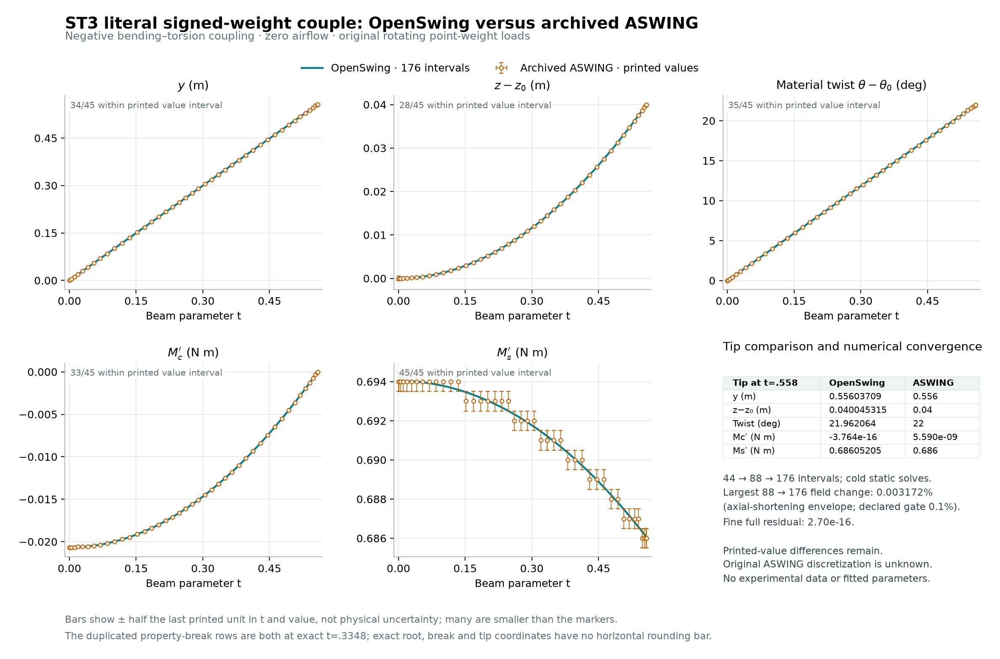

# ST-3: comparison with the archived ASWING static solution

Updated 2026-10-25. **This case is very close to the archived ASWING result.**
Experimental agreement is not required. The original `[m15_0].asw` model,
including its signed tip weights, is unchanged.

After accounting for the archive's rounded span coordinates, **269 of 270
structural entries are consistent with its printed output intervals** on all
three OpenSwing meshes. This comparison interpolates saved nodal fields at
one common allowed coordinate per row; it does not recover ASWING's original
mesh. The remaining entry is the tip chordwise moment: ASWING prints
5.59×10⁻⁹ N·m, while OpenSwing gives −3.76×10⁻¹⁶ N·m. The literal force pair
requires that component to be zero. The strict printed-value comparison
therefore remains incomplete; no tolerance was relaxed to erase that difference.

| Tip quantity | Archived ASWING | OpenSwing, 176 intervals |
|---|---:|---:|
| Spanwise position | 0.556 m | 0.556037088 m |
| Vertical deflection | 40.0 mm | 40.045315 mm |
| Material twist | 22.0° | 21.962064° |
| Chordwise moment Mc′ | 5.59×10⁻⁹ N·m | −3.76×10⁻¹⁶ N·m |
| Spanwise moment Ms′ | 0.686 N·m | 0.686052053 N·m |

All tip quantities except the tiny chordwise-moment residual fall within the
archive's printed rounding intervals at the exact tip coordinate.



## What was compared

The pinned reference is ISAE revision
`f62943df20e9e4d7d9f50e070477b22426b5f865`, under
`3 - Structure/CASE - ST3 Low aspect ratio/Static_Deflection_analysis`.
The original model, `temp_analysis3.sh` and `temp.txt` are identified in the
[target manifest](isae-st3-reference-target.json).

All **45 rows** are retained, including the root previously omitted by the
table reader and both rows at the flap-derivative break. The latter print
`t=0.335` but their exact source coordinate is `0.6 × 0.558 = 0.3348`.
The two rows use incoming and outgoing section traces separately.

The six computed structural quantities are y, z−z₀, material twist, Mc′,
Ms′ and Fn. Sectional moments are recovered in each **nodal** material frame;
element-midpoint moments are not substituted. Mc′ has the table's 10⁻²
scale; Ms′ and Fn have unit scale. Structural offsets are literally zero.
Parameter t differs from physical arc length: the undeformed axis runs from
y=0 at t=0.0001 to y=0.558 m at t=0.558.

The other **90 table entries** are conditional zeros. `cl=0` is ASWING's
zero-airflow reporting convention, not an independently exercised aerodynamic
prediction. `a_flap=0` follows from zero prescribed flap. Derived outputs
normally occupy interval-midpoint rows; the final row contains dummy zeros.

The literal −0.5451/+0.5451 kg weights, scaled by 9.81, form a dead-force
pair at the rotating tip pylons. No experimental torque-label correction,
material-property fit or model replacement is applied. There is no airflow.

## Numerical checks and coordinate rounding

Three independent cold public-API solves use nested **44/88/176 interval**
meshes containing every printed coordinate and the literal break. Each saved
state is restored into a fresh network for a residual evaluation. All residuals
are below 2.70×10⁻¹⁶. Force balance is exact to stored precision; moment
balance and the independently reconstructed tip-pair moment agree within
6.25×10⁻¹⁶ N·m. The root pose is fixed.

All ten successive-mesh field checks pass the predeclared 0.1% gate.
From 88 to 176 intervals, the largest vertical-position change is
6.28×10⁻⁸ m and twist change is 1.21×10⁻⁷ degrees. Native cold solves take
0.68–1.04 s. Passing these checks establishes numerical consistency, not
ASWING discrete parity.

At the printed station centers, **220/270 structural entries** and all 90
conditional zeros match their output intervals; 17/45 whole rows match.
Treating a rounded station as exact can therefore exaggerate differences.

An independent continuous Kirchhoff-rod solution checks whether **one shared
t** can satisfy all five nonzero output intervals in each row. Root, tip and
the doubled break retain their exact source coordinates. The common-coordinate
intersection is nonempty in **44/45 rows**. No different coordinate is fitted
for each output. Half-density interpolation checks differ by at most
2.04×10⁻¹⁰ of an output half-last-place interval.

Using one coordinate from each intersection, fixed across all three native
meshes, interpolation of OpenSwing's saved nodal fields also matches **44/45
rows**. With computed Fn included, this gives 269/270 structural entries.
These are permissible coordinate examples, not identified historical nodes.
The 176-interval nodal solution agrees with the independent continuum within
2.10×10⁻⁸ m, 4.04×10⁻⁸ degrees and 4.07×10⁻⁹ N·m.

## Browser and remaining scope

One actual built-UI run imported the unchanged model and exact 176-interval
mesh, then solved offline. Startup took **24.44 s** and the solve **3.68 s**.
All **18,421 numeric fields** agree with native output within 7.11×10⁻¹⁵.
The exported project reopens with a byte-identical result without solving
again; desktop and mobile geometry render successfully.

This establishes close reference agreement for **one static snapshot**. It
does not complete ST-3's modal/other-load cases or the whole ASWING suite.
The original producing mesh and automatic settings remain unknown. No
production kernel, default or model property changed. The full project goal
remains active.

The native-run plan originally omitted the twist-helper hash and raw fresh
residual vectors. Its retained execution snapshot and provenance supplement
identify the helper against an earlier recorded hash; an independent audit
reconstructs twist without that helper. Residual maxima were retained, and
the reusable runner now also records raw vectors and the helper hash.

[Machine-readable report](isae-st3-reference.json) ·
[Every output comparison](isae-st3-reference.csv) ·
[Standalone SVG](isae-st3-reference.svg) ·
[Evidence archive](isae-st3-reference-20261025-evidence.zip) ·
[Overall ASWING reference status](isae-aswing-reference-status.md)

Reproduce the native comparison from the repository root:

```sh
python3 scripts/verify-isae-st3-archived-output.py prepare --stage /tmp/st3-replay
OPENBLAS_NUM_THREADS=1 OMP_NUM_THREADS=1 .venv/bin/python \
  scripts/verify-isae-st3-archived-output.py run --stage /tmp/st3-replay
```

The rounding and browser scripts are retained alongside this runner. The
evidence archive contains their executed versions, saved states, source pins,
independent checks and the importable browser project.
