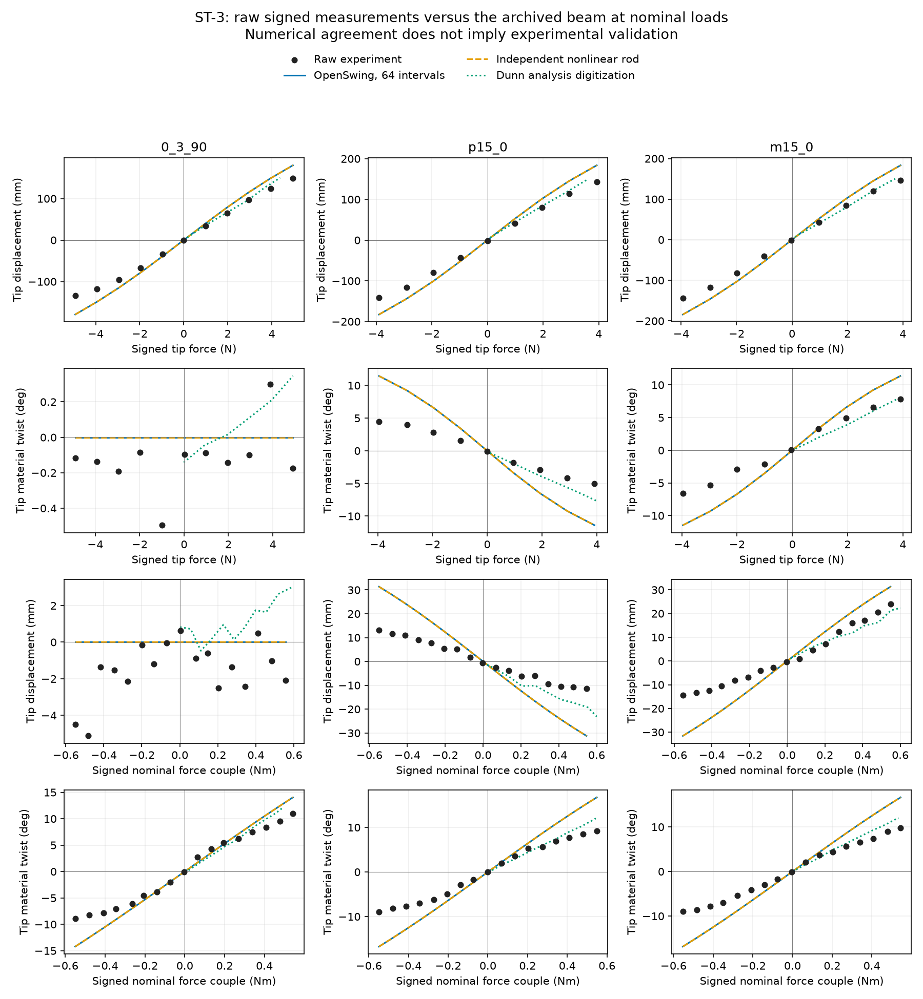

# ISAE ST-3 static validation

**Partial validation: numerical checks pass; experimental agreement does not.** Three composite cantilevers are compared under signed tip forces and tip force couples. The production kernel is unchanged. Earlier [modal comparisons](isae-st3.md) and the [dense solver repair](dense-staircase.md) remain separate evidence.

**Subsequent implementation:** the [direct static workflow](structural-static-workflow.md)
now supports the three literal signed-Weight files and the no-airflow browser
analysis, with 398 current-source replays. The unsupported-workflow statements
below describe this original study’s pinned revision. Its measured data,
experimental discrepancies and raw archive remain unchanged.

## Main findings

All **395 native solves** converge, including every one of the **160 raw experimental samples** at two meshes. At 64 requested intervals, the maximum difference from an independently implemented continuous nonlinear Kirchhoff rod is **0.0131 mm** in tip displacement and **0.000486°** in twist. These are discretization checks, not experimental errors.

The archived MATLAB scripts pass plotted torque values directly as kilograms in opposite Weight rows, with a 9.81 multiplier and 0.14 m arm separation. Their undeformed applied torque is therefore **1.3734 × the labeled torque**. The reconstructed archived setup and the correctly scaled nominal experimental force couple are kept separate; the original input and measured data are not edited.

OpenSwing closely reproduces the archived ASWING curves at the archived loads. Correcting the torque removes a setup error but leaves substantial disagreement with experiment. No stiffness, geometry, load offset or tolerance is fitted to measured responses.

## Experimental discrepancies

The table uses each CSV sample at its original signed load, including the digitized origin. Displacements are reported in mm and twist in degrees. Positive and negative branches are not folded or averaged. The angle reported is material Euler twist; the alternative vertical chord angle is retained in the checks because the exact pointer reduction is not fully specified.

| Laminate | Loading | Response | Samples | RMSE | Maximum absolute error |
|---|---|---|---:|---:|---:|
| 0_3_90 | Force | Displacement (mm) | 11 | 22.729 | 45.402 |
| 0_3_90 | Force | Twist (deg) | 11 | 0.211 | 0.496 |
| 0_3_90 | Force couple | Displacement (mm) | 17 | 2.140 | 5.122 |
| 0_3_90 | Force couple | Twist (deg) | 17 | 2.269 | 5.260 |
| p15_0 | Force | Displacement (mm) | 9 | 26.266 | 41.536 |
| p15_0 | Force | Twist (deg) | 9 | 4.405 | 6.995 |
| p15_0 | Force couple | Displacement (mm) | 17 | 11.470 | 19.867 |
| p15_0 | Force couple | Twist (deg) | 17 | 4.230 | 7.784 |
| m15_0 | Force | Displacement (mm) | 9 | 24.838 | 40.769 |
| m15_0 | Force | Twist (deg) | 9 | 2.953 | 4.903 |
| m15_0 | Force couple | Displacement (mm) | 17 | 8.218 | 17.140 |
| m15_0 | Force couple | Twist (deg) | 17 | 4.249 | 7.942 |



The independent rod uses the archived beam properties. Agreement with it verifies those beam equations, not whether those equations/properties represent the low-aspect-ratio composite specimens. The primary experiment used vertically clamped specimens and pulley loads; ISAE rotated the model horizontally and removed its distributed mass. Fairing/warping effects, fixture/load details, specimen differences, pointer reduction and measurement uncertainty remain unresolved.

## Archived ASWING comparison

Red ASWING polylines are decoded directly from the plain EPS vectors, using the saved tick positions and tick labels visually checked in ISAE Part 3 Figure 25. No PostScript or upstream MATLAB/shell code is executed. Clipped endpoints without a corresponding script sample are excluded and recorded. Five-significant-digit mass conversion is consistent with all three saved final input rows; the exact MATLAB version and intermediate input files are unavailable.

| Archived curve | Compared vertices | Maximum difference |
|---|---:|---:|
| NACA0012_T(F).eps | 11 | 0.0062 deg |
| NACA0012_T(M).eps | 30 | 0.0495 deg |
| NACA0012_Z(F).eps | 16 | 0.4510 mm |
| NACA0012_Z(M).eps | 21 | 0.0404 mm |

The final archived full output is consistent with the negative-coupling file at its saved weight values. Its printed tip `(y,z,twist)` is `[0.556, 0.04, 22.0]`; OpenSwing gives `(0.55603726 m, 0.04004549 m, 21.962064 deg)`. All 44 printed span rows are retained and compared. Printed station/response rounding and unknown archived discretization prevent a claim of exact ASWING discrete parity.

## Numerical and portability checks

Meshes of 8, 16, 32 and 64 intervals test refinement and load reversal. The independent rod solves force/moment balance by DOP853 integration and shooting, with no OpenSwing physics imports. **22 tests pass**, including small-load coupled compliance, the exact uncoupled dead-couple equation `theta=(M L/GJ) cos(theta)`, integration refinement and arbitrary-rotation load equivalence. Maximum equilibrium residual is 9.99e-13; force and moment imbalance are 4.44e-16 N and 2.5e-11 Nm.

**Eight actual Pyodide cases pass**, comparing every nodal position/rotation, applied loads, reactions and residuals. Maximum native/WASM position difference is 1.11e-16 m; the rotation-matrix difference is 4.44e-16. All three literal signed-weight rejections are also reproduced.

## Product limits and remaining work

All three literal static files parse but their negative Weight rows are rejected during network setup. For this study only, a negative weight at lever r is represented by a positive weight at -r plus a compensating central force. This gives exactly the same static force and moment for every wing rotation. Its mass/inertia is different: the derived files must not be used for modal or time analysis.

The runs call the production structured static solver with `condition=None`. The current browser bridge requires a positive-speed aerodynamic condition and does not expose this vacuum static workflow. Pyodide portability does not establish a browser UI workflow. Literal signed static-load compatibility and a vacuum-static UI remain to be implemented.

ST-3 remains partial. Resolve the physical/source discrepancies and uncertainty before assigning experimental acceptance. Across the entire ISAE suite, ten of 41 families have partial quantitative comparisons and 31 still lack them. The full ASWING feature goal remains incomplete.

## Sources and reproduction

[Primary Dunn thesis](https://dspace.mit.edu/entities/publication/55aa429a-7a4a-4908-87e6-7ecc1ece5ae5), static setup/results on printed pages 81–95; [pinned ISAE repository](https://github.com/rom1isae/ISAE_Aswing_Experimental_Validation/tree/f62943df20e9e4d7d9f50e070477b22426b5f865). The primary PDF, extracted text and screenshots are excluded from redistribution.

Run the fetch scripts first, then:

```sh
OPENBLAS_NUM_THREADS=1 OMP_NUM_THREADS=1 .venv/bin/python scripts/verify-isae-st3-static.py
OPENBLAS_NUM_THREADS=1 OMP_NUM_THREADS=1 .venv/bin/python scripts/extract-isae-st3-static.py
OPENBLAS_NUM_THREADS=1 OMP_NUM_THREADS=1 .venv/bin/python -m pytest -q tests/test_isae_st3_static_reference.py > /tmp/st3-static-tests.log
node scripts/test-isae-st3-static-wasm.mjs
.venv/bin/python scripts/summarize-isae-st3-static.py --test-log /tmp/st3-static-tests.log
```

Evidence: [native runs](isae-st3-static.json), [checks and errors](isae-st3-static-checks.json), [source audit](isae-st3-static-sources.json), [archived vectors and replays](isae-st3-static-eps.json), [WASM](isae-st3-static-wasm.json). Source/input/module hashes identify every run; caches resume only identical runs. Raw evidence is in `isae-st3-static-20261014-raw.zip`.
