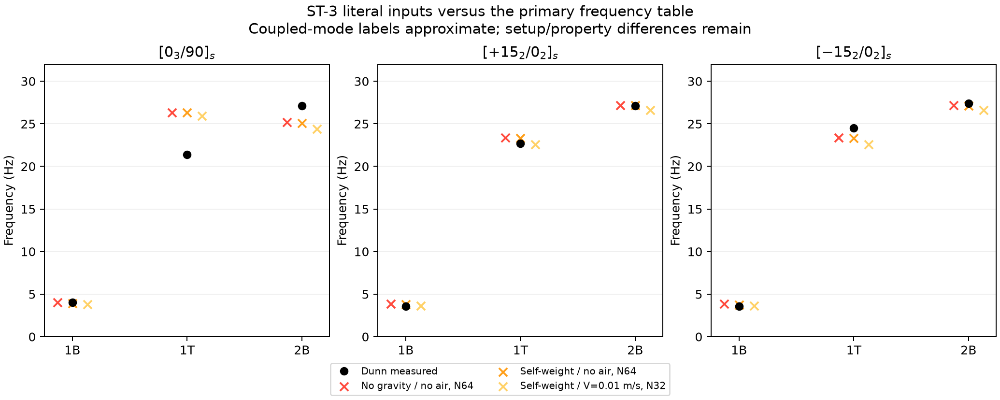

# ISAE ST-3 composite-wing modal comparisons

**ST-3 is partially compared, not fully validated.** This study uses the three literal vertical-wing files. Static force/moment deflection comparisons remain pending. The production kernel is unchanged.

The native study contains 41 computed operating-point/solver records and 7 rejected records. Each computed record reuses one A/M assembly for two eigenvalue searches. All failures are retained in [the checks](isae-st3-checks.json).

## Primary-source audit

[Dunn’s 1992 MIT thesis](https://dspace.mit.edu/entities/publication/55aa429a-7a4a-4908-87e6-7ecc1ece5ae5), Table 2 on printed page 99 (PDF page 125), was checked visually. Its coupled-laminate mode order is 1B, 1T, 2B. The ISAE workbook/report instead labels those same experimental columns 1B, 2B, 1T. It also changes the author-analysis first-bending frequencies from 3.9/4.0 Hz to 4.5/3.6 Hz. Both transcriptions are retained in [the source audit](isae-st3-sources.json). No scalar-frequency relabeling is used to manufacture agreement.

The primary pluck tests used upright clamped specimens between wind-tunnel runs. They were not described as evacuated tests. The stated FFT resolution is about 0.1 Hz; this is not a complete uncertainty estimate. Dunn explicitly cautions that bending/torsion labels become approximate for strongly coupled laminates.

OpenSwing modes are matched to an independent beam solution using physical shapes with kinetic-energy weights. Reference branches are followed from zero coupling in 48 increments; measured frequencies do not choose the labels. The independent beam uses cubic Hermite bending, linear torsion, rotary inertia and self-weight geometric stiffness. It imports no OpenSwing physics.

## Frequencies against primary measurements

| Layup | Branch | Measured Hz | No gravity/no air Hz | Self-weight/no air Hz | Self-weight, 0.01 m/s Hz | Last error % |
|---|---|---:|---:|---:|---:|---:|
| 0_3_90 | 1B | 4.00 | 4.0117 | 3.9235 | 3.7990 | -5.03 |
| 0_3_90 | 1T | 21.40 | 26.3423 | 26.3423 | 25.9163 | +21.10 |
| 0_3_90 | 2B | 27.10 | 25.1634 | 25.0867 | 24.3688 | -10.08 |
| p15_0 | 1B | 3.60 | 3.8664 | 3.7752 | 3.6302 | +0.84 |
| p15_0 | 1T | 22.70 | 23.3988 | 23.3360 | 22.6042 | -0.42 |
| p15_0 | 2B | 27.10 | 27.1642 | 27.1485 | 26.6063 | -1.82 |
| m15_0 | 1B | 3.60 | 3.8579 | 3.7666 | 3.6219 | +0.61 |
| m15_0 | 1T | 24.50 | 23.3564 | 23.2930 | 22.5607 | -7.92 |
| m15_0 | 2B | 27.40 | 27.1539 | 27.1386 | 26.5986 | -2.92 |

Air-free values use 64 requested intervals per beam; air-loaded values use 32. Required distribution stations may add intervals. The 0.01 m/s column is a small-positive-speed sensitivity, not an exact zero-flow solution. Separate 0.1 m/s and 16-interval air runs quantify speed and mesh changes in the checks. No physical parameter or acceptance tolerance is fitted to measurements.



## Literal inputs and remaining setup differences

The literal uncoupled file uses 0.283 kg/m while ISAE Table 10 gives 0.231 kg/m. The negative-coupling file uses EIcc=1.29, GJ=1.2 and EInn=0 (the documented rigid-direction convention); the report gives 1.2947, 1.4 and 2.2775e4. Other extension, coupling and axis-offset differences remain. All three files share the same internal Name despite different properties, so records are identified by source path/hash. Files are not repaired or retuned.

The archived ASWING table is retained with its supplied labels. Its scalar frequencies alone cannot establish branch correspondence after the primary/secondary label conflict. Exact archived ASWING parity is not claimed. The primary plate model also includes fairing/warping effects outside this centered beam reference.

## Numerical checks and retained failures

Component-check status: **PASS_COMPONENT_CHECKS_WITH_RETAINED_SOLVER_FAILURES**. Maximum independent 96→192-element change is 0.00192%; maximum native 32→64 change is 0.32628%; maximum finest native/reference frequency difference is 0.10913%. Minimum finest physical-shape assurance is 0.999992263.

The difference-step comparison changes selected roots by at most 5.55e-15 relative. Independent axial self-weight shortening agrees within 7.54e-17 m. Original-pencil left/right backward errors are checked below 1e-9; shifted searches must agree within 1e-7 relative. These numerical gates do not establish experimental agreement.

The dense constraint-reduction solver rejects all three models at its default 1e-9 rank tolerance. The uncoupled and positive-coupling models also fail at 1e-11 and 1e-12. The negative-coupling model succeeds at those two smaller tolerances and agrees with the full descriptor roots within 5.4e-14 relative. This remains a product limitation; selecting a different tolerance is not a general fix. A separate scaling probe is diagnostic only and is not integrated into the kernel.

An additional ascending-frequency-set comparison against the archived ASWING triples is retained in the checks. It can quantify differences between the three scalar frequencies without assigning disputed mode labels. It does not verify modal identity or reproduce the unknown archived startup state.

Sources and all raw outcomes: [native study](isae-st3.json), [checks and differences](isae-st3-checks.json), [primary/workbook audit](isae-st3-sources.json). Portability records are separate: [WebAssembly](isae-st3-wasm.json).

## Browser and WebAssembly checks

The [WebAssembly replay](isae-st3-wasm.json) repeats four computed points and three default dense rejections. Its maximum native frequency difference is 2.2e-13 Hz; 1,296 physical shape values are checked with phase-independent shape assurance.

All three literal models also solve and export through the [offline browser](isae-st3-browser.json), which preserves the dense rejection. These checks verify portability, not agreement with the experiment.

## Reproduce

```sh
.venv/bin/python scripts/fetch-isae-validation.py
.venv/bin/python scripts/fetch-isae-st3.py
OPENBLAS_NUM_THREADS=1 OMP_NUM_THREADS=1 .venv/bin/python -m pytest -q tests/test_isae_st3_reference.py
OPENBLAS_NUM_THREADS=1 OMP_NUM_THREADS=1 .venv/bin/python scripts/verify-isae-st3.py
.venv/bin/python scripts/summarize-isae-st3.py
.venv/bin/python scripts/plot-isae-st3.py
node scripts/test-isae-st3-wasm.mjs
npm run test:browser -- tests/browser/isae-st3.spec.js
```

Completed native records are cached by full source/module/input/settings identity under `.reference/isae-st3-runs`. Re-running resumes matching records; changed settings or source create new identities. Upstream scripts are read as setup evidence and never executed. The primary PDF remains excluded from distributions.
