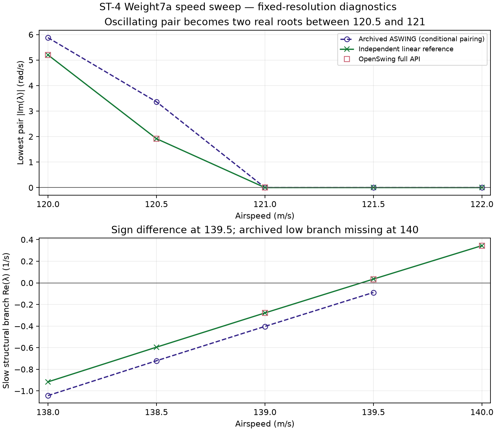

# ST-4 Weight7a airflow speed sweep

The independent linear reference now covers **all 41 speeds** in the original
`Weight7a/Flutter_analysis.sh` (120–140 m/s in 0.5 m/s increments). Seven complete
OpenSwing public-API anchors cover 120, 120.5, 121, 130, 139, 139.5 and 140 m/s.
Six are fresh solves; U=120 reuses the verified fine-grid study.

Both implementations reproduce the oscillating pair becoming two real roots
between **120.5 and 121 m/s**, and both predict the tracked slow structural branch
changing sign between **139 and 139.5 m/s**. At 139.5 the archived branch is still
negative. This is a consequential native-ASWING discrepancy, not a passing
validation result. The archived 140 point omits the low branch, so it does not
establish a native critical-speed bracket.

## Scope and original-source limitations

The unmodified input is `Weight7a/7a_b17.asw`. Current declared conditions remain
zero incidence and sideslip, density 1.0771417304 kg/m³, gravity −9.81 m/s² in
body z, fixed-frame perturbations, enabled unsteady aerodynamic lag and Mach zero.
Only airspeed changes. OpenSwing uses 128 requested cosine intervals; the
independent reference uses 256 cosine aerodynamic and 128 uniform structural
intervals. Both retain the literal concentrated-weight station. Neither uses a
truncated modal basis or fitted physical parameters.

The original driver specifies the speed sequence and modal shift, with anchored
and unsteady/all-points commands. The user manual explains the inherited-point
`+` operation and those menu controls. The accompanying structure/aeroelasticity
reports describe the mass dipole and experimental installation, but the reviewed
sources do not authenticate the exact startup pose, gravity orientation,
discretization or other inherited settings that produced this `eig.txt`.
An experimental hanging-wing description is not used to silently rotate this
native input or alter its gravity.

All **300 archived eigenvalue rows** are retained. Point 40 (139.5 m/s) has two
additional tiny complex roots without native eigenvectors or established
fixed-frame identities; they remain unclassified and account for four unavailable
scalar slots. Point 41 (140 m/s) contains only three higher oscillating roots.
Missing rows are not invented or treated as zero. These limitations prevent
claims about the archived system's overall stability.

## Tracked low pair

Eigenvalues have units 1/s; the imaginary component is angular frequency in rad/s.
The two real values are the slow and fast branches. At 120 and 120.5 the archive
lists the positive-frequency root; its conjugate is inferred only for pair
diagnostics, not counted as another native reference value.

| Speed (m/s) | Archived ASWING low pair | OpenSwing low pair | Independent low pair |
|---:|---|---|---|
| 120 | -24.822467 ± 5.876936i | -24.887793 ± 5.200713i | -24.886385 ± 5.201440i |
| 120.5 | -25.040334 ± 3.363233i | -25.106536 ± 1.915706i | -25.105116 ± 1.917948i |
| 121 | -21.754921, -28.765110 | -20.846009, -29.808188 | -20.845653, -29.805679 |
| 130 | -7.021434, -52.038162 | -6.860979, -52.366877 | -6.860013, -52.364515 |
| 139 | -0.402977, -68.397545 | -0.279304, -68.726794 | -0.278268, -68.724006 |
| 139.5 | -0.088874, -69.287170 | +0.033820, -69.617558 | +0.034861, -69.614747 |
| 140 | Missing in archive | +0.343306, -70.508198 | +0.344351, -70.505363 |

Native pole assignments are injective proximity matches, not authenticated mode
identities. OpenSwing/reference assignments are additionally checked using
span-weighted mechanical displacement/rotation shapes, including the elastic-axis
to beam-axis transformation. Their minimum shape MAC is
**0.999999605** across the paired archive-target modes.

At 120.5 m/s, OpenSwing's lowest frequency differs from the archive by about
**43.0%**. For the same pair, the polynomial
`λ² − (λ₁+λ₂) λ + λ₁λ₂` differs by only
**+0.2644%** in its linear
coefficient and **-0.6770%**
in its constant coefficient. This explains why a small pair-level difference can
produce a much larger frequency error near critical damping; it does not identify
the source of that difference or relax the comparison threshold. The oscillation
disappearing near 121 is not itself evidence of flutter.

## Native comparison scores and typical errors

The 41-point independent-reference diagnostic yields
**116/600 strict scalar matches**:
596 available comparisons and
4 unavailable slots. The seven full OpenSwing anchors
yield **14/92 strict scalar matches**:
88 available comparisons and
4 unavailable slots. Complete native root matches:
**0** reference and **0** OpenSwing.
The scalar matches are the nominally zero imaginary components of real roots.

These are separate, conditional airflow diagnostics. They do not replace ST-4's
registered vacuum baseline of **0/3,749** or imply that the independent model is
the OpenSwing implementation. All comparisons retain the original half-printed-
precision native gate; the SA-only 3% allowance is not applied here.

For the seven OpenSwing anchors, higher oscillating-frequency errors are
**0.1062% median**, spanning
**0.0447–0.3458%**.
Real-component errors outside the low pair are
**0.4829% median**,
maximum **2.4908%**.
The two low oscillating-frequency errors are about **11.51% and 43.04%**.
Slow-real-branch percentage errors grow near zero; the signed raw values above
are the clearer diagnostic there. At 139.5 the branch-sign disagreement must not
be concealed by an average percentage.

## Numerical controls and remaining resolution questions

All 41 reference points complete with **656**
equation-residual checks, maximum
**1.82e-14** against 1e-8.
These are checks performed by the independent reference solver. Separately,
the saved unscaled OpenSwing A/M matrices verify all left and right vectors:
**224** checks, maximum normwise backward error
**1.87e-15** against 1e-8. Both totals include
the retained U=120 case (16 reference and 32 public-vector checks).

Across the archive-target modes at the seven anchors,
**81/88**
OpenSwing/reference pole components agree within the existing 0.1% engineering
comparison gate (5e-8 absolute for zero imaginary components). The following
rows contain at least one component outside that gate; no failed component is
relabeled as passing because its mechanical shape agrees:

| Speed | Archive ordinal | Re, Im component differences | Shape MAC |
|---:|---:|---|---:|
| 120.5 | 1 | 0.00566%, 0.11693% | 0.999999999 |
| 130 | 4 | 0.13918%, 0.01182% | 0.999999974 |
| 139 | 1 | 0.37252%, absolute near-zero gate | 0.999999999 |
| 139 | 4 | 0.27008%, 0.01152% | 0.999999970 |
| 139.5 | 3 | 2.98557%, absolute near-zero gate | 0.999999999 |
| 139.5 | 6 | 0.28624%, 0.01150% | 0.999999970 |
| 140 | 2 | 0.30463%, 0.01149% | 0.999999970 |

Only U=120 has the completed production and independent mesh studies linked
below. New speed points are fixed-resolution diagnostics; this sweep does not
certify their individual spatial convergence, a precise critical speed or complete
mode coverage. The nearby sign crossing warrants targeted refinement before it
is reported as a converged instability boundary.

All new jobs ran serially, one BLAS thread, with 180-second and 512-MiB limits.
The six fresh full API runs took **547.17 s** total
(imports, solve, output and matrix capture); the 40 new specialized reference
solves took **170.84 s** after imports.
These totals measure different workloads and are not a solver speedup ratio.

Production kernels are unchanged. Their source/public/dist copies remain the
previously verified application; no new application build or browser test was
needed for this reference-only study. Newly written reports are not claimed to
be included in older distribution ZIPs.

## Evidence and next work

- [Portable comparison data](isae-st4-speed-sweep-20261104.json) retains the exact
  native decimal values, setup, source pins, counts, component errors and pair diagnostics.
- [Independent formulation and U=120 reference mesh study](isae-st4-flow-reference-20261104.md).
- [Production U=120 spatial convergence and sparse modal verification](isae-st4-spatial-convergence-20261103.md).
- [Source audit](../../artifacts/isae/st4-speed-sweep-20261104/source-audit.json)
  and [complete local assessment](../../artifacts/isae/st4-speed-sweep-20261104/assessment.json).

Next, refine the two sensitive regions without changing the physical inputs:
the low oscillating pair at 120.5 and the near-zero structural branch at
139–139.5. Compare the full pair and mechanical shapes, not only relative
frequency errors. Native settings and extra-root identities remain unresolved;
the broader ST-1–ST-6 and full ASWING requirements remain open.
