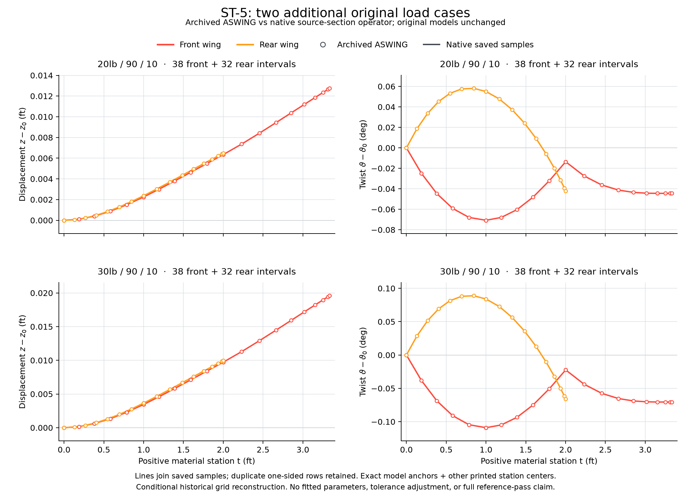

# ST-5: two more original ASWING load cases

The original rigid-joint **20 lb 90/10 and 30 lb 90/10** snapshots now have
full-output comparisons using the source structural equations. On the archived
node locations, tip deflections differ by less than **0.004%** and tip twists
by less than **0.014%**. These are close finite-grid comparisons, not complete
printed-precision reference passes. Experimental agreement is optional.

Both original models, run scripts and output listings survive in the pinned
[ISAE archive](https://github.com/rom1isae/ISAE_Aswing_Experimental_Validation/tree/f62943df20e9e4d7d9f50e070477b22426b5f865/3%20-%20Structure/CASE%20-%20ST5%20Joined%20Wing/Rigid_Joint).
The output headers establish the static, zero-airflow operating state.
Both models retain rear-wing self-weight, unlike the previously compared
20 lb 80/20 model. Each file's signed load distributions are used unchanged;
loads are not rescaled from filenames or experimental labels.

## Agreement on the archived node locations

Each mesh has 38 forward and 32 rear intervals. Known model anchors are exact;
other stations use their printed centers. Both sides of duplicate output rows
are retained. The original unrounded node coordinates remain unavailable.

| Case / positive wing tip | Archived dz, ft | OpenSwing dz, ft | dz difference | Twist difference |
|---|---:|---:|---:|---:|
| 20 lb, forward | 0.012745 | 0.0127448952 | −0.000822% | −0.013435% |
| 20 lb, rear | 0.006482 | 0.0064818786 | −0.001872% | −0.012187% |
| 30 lb, forward | 0.019584 | 0.0195845684 | +0.002902% | −0.013034% |
| 30 lb, rear | 0.009947 | 0.0099473705 | +0.003725% | −0.012298% |

Percentages are `(OpenSwing − archive) / abs(archive)`. The negative twist
differences mean slightly greater negative twist. All four absolute twist
differences are below 0.000010°.



Across all 80 rows per case, the largest absolute error divided by its
channel's archived absolute envelope is **0.025052%** for 20 lb and
**0.014589%** for 30 lb, both in chordwise displacement. These descriptive
figures cover all 14 computed structural channels. Absolute-y and absolute
angle envelopes include jig geometry; this normalization is not an acceptance
tolerance or proof that every printed value matches.

Strict structural matches are **392/1,120** and **396/1,120**. No complete
structural row passes that criterion. Every case also accounts separately for
800 conditional no-motion/no-airflow zeros, 160 chord/Cm input echoes, 80
unresolved scalar reaction-display values, and all 80 span coordinates.
At printed coordinate centers, 153/160 chord/Cm echoes match their printed
intervals, versus 4/80 scalar reaction-display values. The latter display is
retained as a diagnostic, not counted as validated.

Six of seven global load/header comparisons match printed intervals in each
case, including total vertical force, pitching moment about the body origin,
and signed weight. The remaining tiny roll-moment values differ: archived
values are about ±0.000004 lb·ft, while OpenSwing is near zero. They remain
explicit differences rather than being fitted or discarded.

## Numerical checks and mesh sensitivity

Six cold native solves and six fresh saved-state restorations pass the existing
residual, force/moment balance, clamp and rigid-joint gates. Maximum fresh
residuals are 1.92×10⁻¹⁴ for 20 lb and 1.08×10⁻¹³ for 30 lb. The first-grid
solves take 0.98 and 3.13 seconds on this host.

| Case | Intervals, forward/rear | Solve time, s | Strict structural matches |
|---|---|---:|---:|
| 20 lb | 38 / 32 | 0.98 | 392 / 1,120 |
| 20 lb | 76 / 64 | 1.10 | 124 / 1,120 |
| 20 lb | 152 / 128 | 1.81 | 110 / 1,120 |
| 30 lb | 38 / 32 | 3.13 | 396 / 1,120 |
| 30 lb | 76 / 64 | 3.11 | 110 / 1,120 |
| 30 lb | 152 / 128 | 4.56 | 99 / 1,120 |

Refinement moves these results away from the archived finite-grid values.
The first refinement passes 0/14 of the unchanged 0.1% mesh measures in each
case; the second passes 6/14 and 8/14. A converged-continuum claim is therefore
not established by these runs.

Endpoint-averaged distributed load also changes with refinement. The 20 lb
case's total upward force changes from 38.07284 to 38.10437 lb, and the 30 lb
case from 58.07326 to 58.12062 lb. The coarse totals reproduce the printed
38.07/58.07 lb headers; the finer totals do not. This is quadrature sensitivity
under the same literal load distributions, not a changed operating setting.

## Decoder and equation scope

The [source audit](isae-st5-load-cases-source-audit.json) passes 252 checks.
Each archive supplies its own exponent row for moments, forces, strain and
stress. In particular, the rear normal-axis moment multiplier is 10 in the
30 lb case and 1 in the 20 lb case. Independent root balances and all rear
shell strain/stress rows support this selective decoding. A blanket application
of the historical MATLAB scaling would corrupt several geometry/display fields.

The explicit policies are `drela-segspl-v1` and `drela-steady-section-v1`.
They use the existing endpoint transformation/stiffness/load rules described
in the [source-discrete study](isae-st5-source-discrete.md) and
[general-section implementation](isae-source-section.md). No production kernel,
default, material input or numerical tolerance changed for these comparisons.
The precise historical spline caller, unrounded grid and finite-strain length
convention remain unproved.

Chord/Cm echoes use endpoint-value averages across consecutive archived rows,
including zero-width intervals and final dummy zeros. Earlier independent
saved-data evidence supports that interpretation; it does not recover the
original exporter's source. The scalar reaction-display law remains unresolved.

## Browser and reproduction

Both cases also solve through the offline browser, taking **3.46 and 3.36 s**
after a separate 26.71 s runtime initialization. All **1,111 checks** pass.
The 33,534 native numerical values agree under the existing
`2e-8 + 2e-8*abs(reference)` gate; the maximum absolute difference is
6.57×10⁻¹¹. Both result and project exports reopen byte-for-byte without a
second solve. No page errors, external requests or offline HTTP requests occur.

Open the checked [20 lb project](../../examples/isae-st5-20lb-90-10-project.json)
or [30 lb project](../../examples/isae-st5-30lb-90-10-project.json) in the app
and open its computed solution to inspect saved results. The projects retain
the original source, explicit mesh, general-section equation choice and result.
Browser/native agreement establishes portability, separately from the archived
ASWING comparison above.

The [machine report](isae-st5-load-cases.json), [vector plot](isae-st5-load-cases.svg)
and [evidence archive](isae-st5-load-cases-20261026-evidence.zip) retain the
unchanged source files, decoded targets, generated verifier differences,
all six states, fresh fields, per-row errors, failed precision/mesh checks and
independent saved-output reviews. Earlier ST-5 reports keep their original
source identities and results.

With the pinned ISAE reference cache available, fresh directories reproduce
the native comparison:

```sh
.venv/bin/python scripts/extract-isae-st5-load-cases.py --stage /tmp/st5-targets
.venv/bin/python scripts/verify-isae-st5-load-cases.py prepare --stage /tmp/st5-runs --targets /tmp/st5-targets
.venv/bin/python scripts/verify-isae-st5-load-cases.py run --stage /tmp/st5-runs
```

These two additional static snapshots strengthen the existing 20 lb 80/20
comparison. Remaining strict output/display differences, broader structural
and aeroelastic reference coverage, and full ASWING feature parity remain open.
