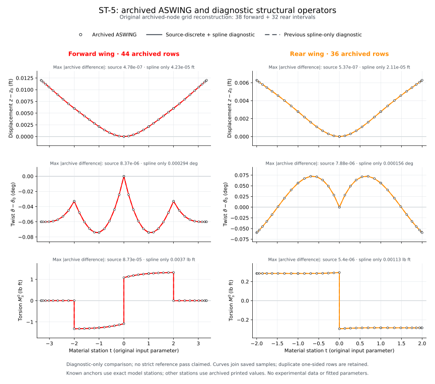

# ST-5: reproducing the source discrete equations

Updated 2026-10-26. **The isolated source-discrete solver now closely matches
the selected archived ASWING solution on its output-node grid.** Forward/rear
tip-deflection differences are 0.00084% / 0.0086%; twist differences are about
0.013%. Strict agreement with every printed digit is not established. This
candidate is not yet integrated into the production browser app.

The target remains the original `JW_1_20lb_80_20` rigid-joint model and its
archived ASWING output. No geometry ordinate, load, stiffness, attachment or
solver tolerance was fitted. Experimental agreement is not a requirement.

## What changed in the isolated calculation

The prior [spline diagnostic](isae-st5-spline-diagnostic.md) used the candidate
segmented cubic with zero third derivatives at segment ends, but retained
OpenSwing's SO(3) midpoint structural equations and midpoint material sampling.
This follow-up also implements the source discrete structural equations:

- Arithmetic endpoint transformation and Euler curvature matrices, with body
  resultants averaged before transforming to local axes.
- **Inverse of endpoint-averaged bending stiffness** in Eq. 54.
- Endpoint-averaged signed weight per length, with conservative symmetric
  endpoint forces and zero distributed gravity couple for this zero-offset case.
- Absolute compatibility Eq. 48, keeping its sampled-jig geometry defect
  visible rather than subtracting it silently.

The rendered [ASWING theory](https://web.mit.edu/drela/Public/web/aswing/asw_theory.pdf),
printed page 13, shows `E_a^-1` in Eq. 54. This corrects the preceding source
review's text-extraction reading as an average of inverse stiffness matrices.
Those operations are different. The preferred Euler form in Eqs. 53–54 is
used; the source's matrix cross-dot alternative has a separately documented
factor-of-two inconsistency under its literal printed definition.

Eq. 48 explicitly specifies unloaded arc length. This diagnostic sets the
other equations' interval length to that same accurate spline arc. The exact
historical finite-strain length algorithm is unavailable. The axial strain
uses averaged local axial force divided by averaged EA; the source does not
print that scalar averaging rule as explicitly as its bending rule.

## Archived-grid result

The comparison uses 38 forward and 32 rear intervals, retaining every output
station and both sides of duplicate rows. Known source anchors are exact;
other stations use their printed centers. This does not reconstruct unknown
unrounded historical coordinates.

| Positive endpoint quantity | Archived ASWING | Source-discrete candidate | Signed difference / absolute reference |
|---|---:|---:|---:|
| Forward vertical displacement, ft | 0.012013 | 0.0120128990 | −0.000841% |
| Forward twist, degrees | −0.060040 | −0.0600480973 | −0.013486% |
| Rear vertical displacement, ft | 0.006272 | 0.0062725372 | +0.008565% |
| Rear twist, degrees | −0.059695 | −0.0597026497 | −0.012815% |

Across all 80 rows, each of the 14 computed structural channels has a maximum
absolute error below 0.025% of that channel's maximum absolute archived value.
The largest such ratio is 0.02429% for chordwise displacement. This is a
descriptive normalized error, not a newly selected pass tolerance; the angle
and absolute-y channels include undeformed geometry in their denominators.
Dimensional maximum and RMS errors are retained in the
[machine-readable record](isae-st5-source-discrete.json); the evidence archive
contains every per-row difference.

The cold solve takes **1.26 seconds**. All equilibrium, support balance, clamp
and rigid-joint checks pass. Maximum fresh residual is 1.08×10⁻¹⁴. Strict
printed-output intervals contain 403/1,120 structural entries; no full row
passes that strict criterion. The 800 prescribed/zero-airflow entries are
separate and do not validate aerodynamics or dynamics.



## Refinement explains the earlier gap

| Forward/rear intervals | Solve time | Forward tip dz, ft | Forward twist, degrees | Strict structural matches |
|---|---:|---:|---:|---:|
| 38 / 32 | 1.26 s | 0.0120128990 | −0.0600480973 | 403/1,120 |
| 76 / 64 | 1.99 s | 0.0119532782 | −0.0585082934 | 129/1,120 |
| 152 / 128 | 3.65 s | 0.0119383161 | −0.0581221634 | 120/1,120 |

All three solves converge numerically. Only 0/14 and 4/14 measures pass the
predeclared 0.1% successive-mesh gate, respectively. Refinement moves this
solution away from the archived output and toward the earlier finely resolved
calculation. Thus matching the archive's finite discretization and estimating
the continuous-model limit are different comparisons. No converged-continuum
claim is made for these three source-discrete meshes.

## Independent evidence

The archived data satisfy all 70 finite-interval force and moment balance
triples within propagated printed uncertainty. The eight zero-width intervals,
root constraints and rear endpoint joints are tracked separately. Both rigid
joint action/reaction pairs and global force/moment balance are consistent.

Independent unloaded-arc integration gives total force 38.5802339653 lb; the
candidate gives the same value. The decoded archived root traction is
38.5802297867 lb. Chord-length integration also lies within printed uncertainty,
so the archive does not justify replacing the documented arc length with it.

A separate source-operator diagnostic evaluates all 70 intervals for two fixed
spline rules and three saved states, under both explicitly labeled length
variants. With the candidate spline, the archived curvature-equation defect
is at most 1.25×10⁻⁷ rad using inverse averaged stiffness, versus 4.20×10⁻⁶
using averaged inverse stiffness. Twenty-four independent algebra/limiting
checks pass. These are operator checks, not additional aircraft solves.

Before solving, the candidate's sparse colored Jacobian was compared against
all 876 individual columns and its full fallback at one declared nonsolution
state. Both matrices agree exactly. Both solver paths explicitly disable the
production analytic mechanical block, so the candidate cannot silently reuse
derivatives of the previous constitutive equations.

## Reproduction and remaining work

```sh
.venv/bin/python scripts/diagnose-isae-st5-source-discrete.py prepare --stage /tmp/st5-discrete-new
OPENBLAS_NUM_THREADS=1 OMP_NUM_THREADS=1 MKL_NUM_THREADS=1 NUMEXPR_NUM_THREADS=1 \
  .venv/bin/python scripts/diagnose-isae-st5-source-discrete.py run --stage /tmp/st5-discrete-new
```

This adapter explicitly supports the pinned zero-offset ST-5 static model
only. General section offsets/couplings, other load types, dynamic consistency,
production tangents and browser integration remain work. A production policy
must identify its interpolation and structural equations before building a
model, preserve older saved-state semantics, and reject incompatible restarts
and derivative caches.

All candidate states are sealed as diagnostic-only from their first disk
write. The separate endpoint comparison is authoritative; inherited midpoint
Section/SO(3) recovery fields are explicitly labeled as production diagnostics,
not the candidate strain law. Earlier midpoint display hypotheses are retained
unchanged and distinguished from the separately tested endpoint display rule.

The [evidence archive](isae-st5-source-discrete-20261026-evidence.zip) retains
the source correction, declared operators, original inputs, all three states,
fresh fields, audits, and preparation history. No production kernel or browser
behavior changed in this increment. The full ST-5 family, aeroelastic reference
comparisons and full OpenSwing goal remain incomplete.
