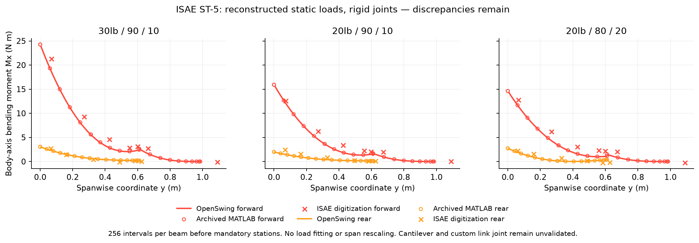

# ISAE ST-5 joined-wing structural validation

**Partial comparison, not a validation pass.** Three rigid-joint load cases now
have nonlinear static comparisons at 16, 32, 64, 128 and 256 intervals per beam,
plus required attachment and property-break stations. All 15 reconstructed
solutions converge. The cantilever case remains rejected at all five settings.
No production kernel, material property or experimental datum was changed.

**Subsequent implementation:** the [literal distributed-load study](distributed-static.md)
now solves the three original rigid-joint inputs without reconstruction and
checks desktop/mobile operation. The negative-`Dmg` rejections below describe
this original study’s pinned revision. The experimental discrepancies,
cantilever attachment errors and custom link-joint gap remain.

**Current acceptance target:** reproduce the original tested ASWING outputs;
experimental agreement is optional. The newer [original-output comparison](isae-st5-reference.md)
uses an independently checked column-specific decoder and retains the unresolved
geometry and mesh differences. The older MATLAB-reduced statistics below do
not establish that reference match.

The pinned source is Romain P. Jan's
[ISAE validation repository](https://github.com/rom1isae/ISAE_Aswing_Experimental_Validation/tree/f62943df20e9e4d7d9f50e070477b22426b5f865),
specifically *Experimental validation of ASWING, Part III: Structure*, pp. 40–44,
the ST-5 models, MATLAB postprocessor, output tables and experimental CSVs.
The original experiment is attributed to
[Lin, Jhou and Stearman, SAE 891060](https://doi.org/10.4271/891060).
Its publisher abstract was checked; its complete experimental apparatus and
uncertainty description have not been independently recovered. The numerical
comparison therefore uses the **ISAE experimental digitization**, with that
limitation explicit.

## Load reconstruction and literal compatibility

The report describes an upward pulley load represented in ASWING by negative
additional weight, `Dmg`. OpenSwing's inertia checks reject negative mass.
The study retains that rejection and makes a separate, explicit static load
reconstruction: integrate `-Dmg ds` into upward forces on the material nodes,
and remove the negative additional mass from an in-memory copy. The original
files, positive structural mass, geometry, stiffness, grounded roots and rigid
offset joints remain unchanged. These particular load distributions have zero
centroid offset and zero additional rotational inertia; the reconstruction
asserts those conditions rather than silently discarding either.

Eight-point Gauss quadrature is split at the input property knots. Linear
nodal weights conserve total force. The application points move with the
structural nodes while force direction remains vertical. Both the load
approximation and nonlinear beam discretization are refined. This is not an
assertion of identical finite-mesh equations to ASWING's signed-mass approach.
There is no aerodynamic condition, nonzero flight speed or dynamic mass model.

The “30 lb, 90/10” input integrates to about **59.995 lb over the full mirrored
model**: 53.989 lb on the forward wing and 6.007 lb on the rear. Its net upward
force after structural weight is about 58.070 lb, consistent with the archived
58.07 lb total. The “20 lb” cases integrate to about 40 lb. These are the loads
actually encoded in the files; they were not renormalized from the filenames.

All **38** ST-5 model files were checked through literal network construction:

| First rejection | Files |
|---|---:|
| Negative distributed weight/inertia | 20 |
| Attachment outside the beam domain | 16 |
| Numeric input syntax | 2 |

Thus 36 files parse, but **none constructs a literal static network**. In the
selected cantilever, even zero-weight point records include stations beyond
the beam tip. Those records were not deleted or moved to make it run.

The report explicitly states that the link-joint case required modified ASWING
code. Its custom joint releases x/y translation and z rotation. That law is
different from standard Joint type 2, despite the archived input using that
number. The custom link-joint comparison remains unimplemented.

## Quantitative comparison

At 256 intervals, body-axis bending moment `Mx` has the following RMSE. Values
are in N·m. The archived comparison uses the original MATLAB reduction; the
experimental comparison uses dimensional span coordinates without rescaling
each curve to its own tip.

| Input label | Archived forward / rear | Experimental forward / rear |
|---|---:|---:|
| 30 lb, 90/10 | 0.04412 / 0.01559 | 1.707 / 0.2544 |
| 20 lb, 90/10 | 0.02776 / 0.01063 | 1.093 / 0.5273 |
| 20 lb, 80/20 | 0.02574 / 0.01000 | 1.378 / 0.4927 |

Each experimental statistic uses six forward-wing and five rear-wing samples.
Missing CSV values and samples outside the available span remain explicitly
excluded, with reasons. No extrapolation or interpolation across a joint jump
is used. The plot shows the out-of-span measurements too. Error statistics
over these surviving samples do not validate the omitted points.



The reference decoding has a material qualification. Applying the text header
exponents reproduces the companion MATLAB arrays exactly, but some resulting
angles conflict with the grounded geometry. The rear root's raw dihedral is
−14.657057°, matching the input's −14.657060°; the MATLAB-scaled value is
−1.465706°. For the forward root, raw 4.777737° is close to, but differs from,
OpenSwing's natural-cubic geometry value of 4.886146°; the scaled value is
0.477774°. The original spline convention and this scaling inconsistency are
unresolved. Both raw columns and the MATLAB reduction are preserved, with
separate moment comparisons. Close agreement with the reduced curves is
therefore **not verified executable parity or displacement validation**.

The original MATLAB figures also normalize experimental and model span
coordinates separately. This study retains the dimensional coordinates. It
does not infer an exact match of the input geometry to the physical apparatus.
The report's 20 lb cantilever experimental curve is an extrapolation of 30 lb
measurements; it is not counted as another experiment.

## Numerical checks and remaining work

The full force and moment balances pass at 1e-7 in input units, and physical
equilibrium residuals pass at 1e-8. The integrated applied load changes by less
than 1e-10 lb between meshes. From 128 to 256 intervals, the largest tip-position
change is 0.00276 mm, about 0.046% of its displacement. This is a measured
refinement trend, not a proof of continuum accuracy.

The [numerical checks](isae-st5-checks.json) compare the structured solver with
the general dense production path: 1,952 physical values agree within 1.1e-10.
Independent tests check analytic total
force and first moment, preservation of source inputs, and convergence to a
separate nonlinear planar-elastica boundary-value solution. The
[WebAssembly replay](isae-wasm-st5.json) checks all 38 literal rejection outcomes,
three reconstructed 64-interval solutions (20,256 physical values agree within
2.3e-12), and the rejected cantilever.
Numerical/platform agreement is distinct from experimental agreement.

Remaining work includes literal signed static-load handling without admitting
nonphysical dynamic mass matrices, the custom link-joint law, attachment/input
issues, reference output scaling, spline and geometry correspondence, and
independently verified experimental setup and uncertainties. ST-5 and the
full ASWING goal remain incomplete.

Raw numerical evidence: [study](isae-st5.json),
[comparison samples and exclusions](isae-st5-comparison.json),
[plot SVG](isae-st5-comparison.svg), and the
[frozen source, run caches and gate logs](isae-structure-20261014-raw.zip).
The archive retains failed harness attempts and pre-refinement results too.

```sh
OPENBLAS_NUM_THREADS=1 OMP_NUM_THREADS=1 .venv/bin/python scripts/verify-isae-st5.py
OPENBLAS_NUM_THREADS=1 OMP_NUM_THREADS=1 .venv/bin/python scripts/summarize-isae-st5.py
OPENBLAS_NUM_THREADS=1 OMP_NUM_THREADS=1 .venv/bin/python scripts/check-isae-st5.py
OPENBLAS_NUM_THREADS=1 OMP_NUM_THREADS=1 .venv/bin/python -m pytest -q tests/test_isae_st5.py
node scripts/test-isae-validation-wasm.mjs st5
.venv/bin/python scripts/plot-isae-st5.py
.venv/bin/python scripts/summarize-isae-validation.py
```
