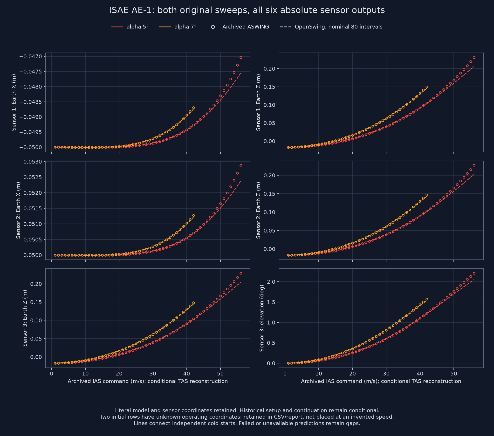

# ISAE AE-1: both complete native sensor sweeps

Batch completed, 2026-10-27. The acceptance target remains archived tested
ASWING calculations across the complete ISAE collection. Experimental agreement
is not required; no complete-family validation is claimed.

AE-1 now registers all **100 original rows and six sensor outputs**, on two
prospectively declared nominal 40/80 interval meshes. This gives 200 jobs and
1,200 required scalar slots. The 98 positive-speed rows produce 196 conditional
worker jobs. Both initial rows have finite targets but unknown operating
conditions, so their four mesh records retain 24 unavailable targets.

All 200 jobs reached terminal outcomes in **474.08 seconds** with four workers:
196 computed, four unsupported and no failed or timed-out solves. Every started
process was reaped. All 5,684 physical checks pass. All 1,200 output slots are
accounted for: 1,176 finite and 24 unavailable. **98 scalar comparisons match
native printed precision**, representing 49 distinct native cells across the
two meshes. These are sensor 1/2 X positions; no complete six-channel row matches.



The plot uses the predeclared finer mesh and all 98 known operating coordinates.
Both unknown initial rows remain in the [600-value CSV](isae-ae1-sensor-sweeps-20261027.csv)
and report, without an invented horizontal coordinate.
[SVG](isae-ae1-sensor-sweeps-20261027.svg) and
[plot provenance](isae-ae1-sensor-sweeps-20261027.json) are available.

The last source-commanded state in each sweep gives:

| Series / archived speed command | Output | Archived ASWING | OpenSwing, nominal 80 | Relative difference |
|---|---|---:|---:|---:|
| alpha 5°, 56 m/s | Sensor 3 Earth Z (m) | 0.228980 | 0.204023 | −10.90% |
| Same | Sensor 3 elevation (deg) | 2.207530 | 2.049268 | −7.17% |
| alpha 7°, 42 m/s | Sensor 3 Earth Z (m) | 0.148393 | 0.144170 | −2.85% |
| Same | Sensor 3 elevation (deg) | 1.575030 | 1.543732 | −1.99% |

All 98 positive-coordinate mesh pairs are compared; both unknown initial pairs
remain unavailable. The largest current 40-to-80 mesh changes are 0.1015 mm in
sensor 3 Z and 0.000678° in elevation. These measured refinement changes do not
account for the endpoint discrepancies. No mesh acceptance threshold is added,
and historical node arrays and setup remain qualified below.

The original `Pazy_wing.asw` remains byte-identical, including both zero-load
Weight records. Its physical properties, sensor positions and stiffness coupling
are unchanged. The [null-point correction](source-null-point-objects-20261027.md)
permits analysis of these original records without silently deleting them or
relocating an active attachment.

Both source drivers request `NODE I40`. Current nominal intervals 40/80 are
declared refinement settings, not recovered historical node arrays. The `.52`
property break produces 41/81 current elements. Positive IAS commands are
conditionally reconstructed as TAS at the literal sea-level density of 1.23,
with mounted constraints, gravity, ground image G1, updated aerodynamic
influences and explicit startup settings. Historical atmosphere, K/F, frame
pose and nonlinear continuation remain unresolved. Neither initial row is
assigned an invented speed or incidence.

Each computed worker must pass 29 physical checks, including the fresh restored
residual, source operator and condition identity, gravity, force/moment balance,
and independently reconstructed Earth sensor positions and elevation. Outputs
remain absolute: no initial-sag subtraction, sensor relocation or local-twist
substitution is used. All six native printed-precision gates remain unchanged.
Mesh changes are descriptive and cannot establish a historical grid match.

The complete catalog/runner/summary/AE-1/AP-2 test run passes **379 checks**.
[Receipt](isae-suite-ae1-20261027/integration-receipt.json),
[JUnit](isae-suite-ae1-20261027/integration-junit.xml) and
[log](isae-suite-ae1-20261027/integration-pytest.log) retain the evidence.
All 123 numerical modules stayed unchanged. The isolated first-positive-row
pilot takes 10.01 seconds, passes 29 physical checks and matches two of six
printed values; it is separate from the full batch.

Repeated source verification in independent reports now uses a per-call
canonical context, while preserving every per-job and physical-output check.
Unique sources, helpers, kernel files and parsed inputs are rehashed before
publication, including the kernel inventory. The terminal AP-2 report summarizes
in **5.65 seconds** with identical numerical and reference data. The only added
fields are AE-1 documentation and its empty diagnostic list in that selected
AP-2 report. [Timing and comparison receipt](isae-suite-ae1-20261027/summary-fast-receipt.json)
records the earlier metadata-only wrapper assertion failure and its correction.
No numerical solve or tolerance changed.

At this checkpoint the [full default plan](../../artifacts/isae/default-plan-ae1-20261027/plan.json)
has **13 adapters, 3,942 jobs and 65,061 scalar slots across selected scopes in
23 families**. Eighteen families lack adapters. The
[ST-6 source audit](isae-st6-readiness-20261027/report.md) identifies no archived
ASWING output there; its analytical and experimental curves do not become
invented solver targets. The [backlog](isae-suite-backlog.md) keeps that boundary
separate from missing implementation.

The [P-3 source audit](isae-p3-readiness-20261027/report.md) identifies 84
ASWING-labelled force/moment targets at 28 conditions. Independent power/setup
inputs and coefficient conventions remain missing. Those targets stay separate
from the experimental and Leng-BEMT curves; no input is fitted from the outputs.

[Machine report](isae-suite-ae1-20261027.json),
[independent audit](isae-suite-ae1-20261027/independent-audit.json),
[frozen batch](../../artifacts/isae/ae1-20261027/report.md), and
[independent combined AP-2/AE-1 summary](../../artifacts/isae/ap2-ae1-summary-20261027/summary.md)
retain the results. The combined summary contains 437 selected jobs on the same
123-module kernel, with 1,448 required slots, 1,418 finite comparisons and 30
unavailable values. It is separate from older batches using different kernels
and from the global default registry.

To repeat the bounded AE-1 scope:

```sh
npm run test:isae -- --adapters ae1 --cases AE-1 --workers 4 --timeout-seconds 180 --output-dir /tmp/isae-ae1-new-run
```

The default `npm run test:isae` selects every registered comparison. All failures,
timeouts, unknown initial states and output differences remain in the denominator.
