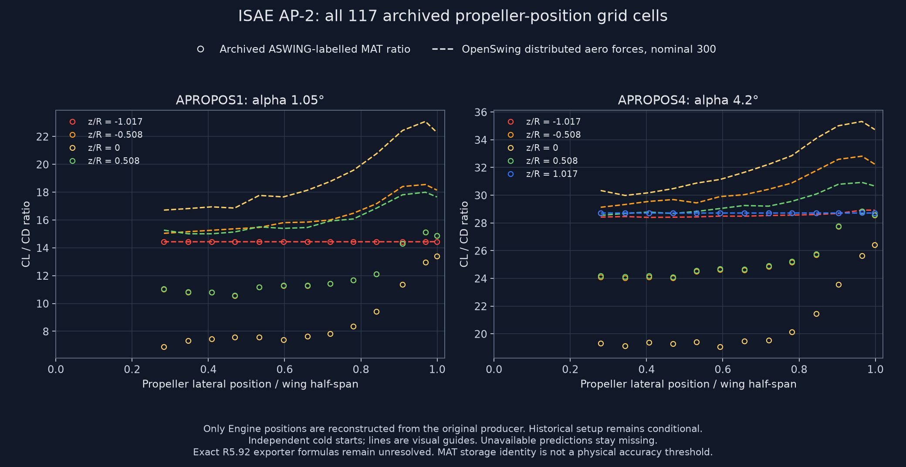

# ISAE AP-2: complete archived position grids

Completed 2026-10-27. Comparing the complete ISAE collection against archived
tested ASWING outputs remains the highest validation priority. All 41 present
families and 279 original models remain in the inventory. No whole family is
declared validated.

This expansion adds all **117 archived propeller-position cells**: 52 at
alpha 1.05° and 65 at alpha 4.2°. Each runs on prospectively declared nominal
150/300 interval meshes. Both retained endpoint CSV tables contribute their
original CL and CD targets. Three unpaired TXT exports retain six unavailable
coefficient targets. The [source catalog](isae-ap2-reference.md) documents every
original input, target and reconstruction.

All **237 jobs reached terminal outcomes in 688.23 seconds** with four workers:
234 computed and three unsupported. Every started subprocess was reaped. All
234 computed states pass their 25 physical checks, including a fresh restored
residual, independent force/moment reconstruction and literal Engine positions.
There are 248 required scalar slots: 242 finite, six unavailable, none missing
from the accounting and **zero archived-precision matches**.

The 234 ratio comparisons test exact stored MAT binary64 identity. Their
original CL/CD printing precision is unrecovered; this identity check is not a
physical accuracy threshold. The eight computed endpoint coefficient slots use
the unchanged native printed half-last-place gates. Neither mesh matches those
gates. Numerical convergence does not establish reference agreement.



The plot retains all 117 fine-mesh predictions and all archived grid cells.
[SVG](isae-ap2-position-sweeps-20261027.svg),
[values](isae-ap2-position-sweeps-20261027.csv), and
[provenance](isae-ap2-position-sweeps-20261027.json) are available.
Lines connect independent cold starts for display. Ratio RMSE is 5.92456 for
APROPOS1 and 5.88186 for APROPOS4. The largest 150-to-300 mesh change in ratio is
4.26469%; mesh changes are descriptive, without an invented pass threshold.

| Saved endpoint | Output | Archived ASWING | OpenSwing, nominal 300 |
|---|---|---:|---:|
| APROPOS1, z/R=.508, last lateral position | CL | 0.165345 | 0.163743370 |
| Same | CD | 0.0111232 | 0.009274545 |
| APROPOS4, z/R=1.017, last lateral position | CL | 0.551779 | 0.554379432 |
| Same | CD | 0.0192063 | 0.019306878 |

Only the original producer's two Engine rows vary between grid points. The two
retained endpoint inputs are byte-identical to their original models; the other
115 inputs are explicit reconstructions. Each series preserves its own original
profile-drag constant. No original model file, physical property, accuracy gate
or output target was fitted or silently repaired. Historical atmosphere, node
arrays, K/F/core settings, PG policy and continuation remain unresolved.

The comparison explicitly uses distributed aerodynamic force projections.
Theory Eq185 supports that lift definition; §8.1 distinguishes Trefftz quantities
from integrated forces. The exact R5.92 OPER exporter formula is not recovered,
so agreement with its CL/CD convention remains qualified. The original CSV
headers establish the output labels; selector numbers alone are not universal
across builds. There is no source justification for substituting `CDi + CDp`
because it happens to be closer. All measured differences remain recorded.

The default registry at this checkpoint contains **12 adapters, 3,742 jobs and
63,861 scalar slots across selected scopes in 22 families**. Nineteen families
still need their first adapter. Registration is not a completion percentage;
remaining variants and outputs inside registered families also remain required.
The [complete backlog](isae-suite-backlog.md) prioritizes these missing scopes.

The production kernel includes the independently tested
[exact-zero point-object correction](source-null-point-objects-20261027.md).
All 123 numerical modules stayed unchanged throughout this batch. This report
is kept separate from historical batches using older kernels. AP-2 has 18
passing adapter tests; 254 runner/summary tests pass. The null-point change has
152 passing native checks and six offline WASM groups. These are implementation
checks, not additional archived ASWING passes. The local public kernel matches
the tested source; distribution builds, downloads and hosted deployment are
unchanged.

[Machine report](isae-suite-ap2-20261027.json),
[frozen execution report](../../artifacts/isae/ap2-20261027/report.md),
[independent summary](../../artifacts/isae/ap2-summary-20261027/summary.md), and
[full default plan](../../artifacts/isae/default-plan-ap2-20261027/plan.json)
retain the full evidence. For a bounded rerun:

```sh
npm run test:isae -- --adapters ap2 --cases AP-2 --workers 4 --timeout-seconds 180 --output-dir /tmp/isae-ap2-new-run
```

The default `npm run test:isae` selects every registered comparison. The next
missing-family adapter is AE-1: both original sensor sweeps, every row and all
six channels. Its 43 source-accounting tests pass. A separate first-positive-row
pilot completes in 10.01 seconds and passes all 29 physical checks; two of six
values match native printed precision. The complete sweeps are not registered
or run in this AP-2 checkpoint. [Staging and pilot evidence](isae-suite-ap2-20261027/ae1-staging/receipt.json)
remain separate from AP-2's batch counts.
