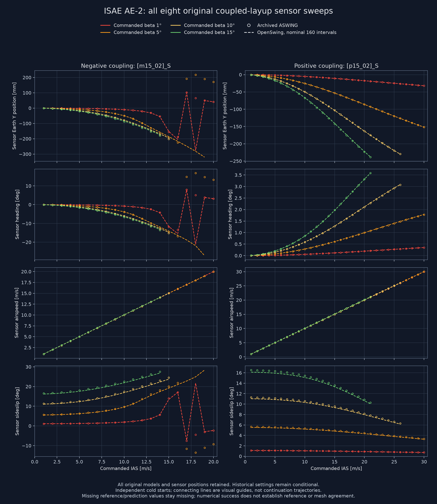

# ISAE ST-5 and AE-2 coverage expansion

Completed 2026-10-27. All **41 present ISAE families and 279 original models** remain in the full inventory. Matching archived tested ASWING calculations is the highest current validation priority. The full goal remains incomplete; no whole-family pass is claimed.

The default suite now registers **3,505 jobs and 63,613 scalar output slots** across selected scopes in **21 families**. Twenty families still lack an adapter. Jobs include repeated meshes and are not distinct ISAE cases or a completion percentage.

This expansion adds the original ST-5 rigid-joint **30 lb, 80/20** snapshot: 80 rows and 27 output fields on three nested grids. The original 28th column supplies the row coordinate. It also adds **both AE-2 coupled layups**, all eight sweeps, all 184 archived rows, and four sensor outputs on two meshes. Sixteen repeated initial-row records retain 64 unavailable scalar slots. No original model, solver equation or accuracy gate was altered.

All 369 new jobs reached terminal outcomes. Every started subprocess was reaped. Their 7,952 required slots include 7,880 numerically valid values and 3,471 strict printed-precision matches. Computation and partial output matches do not establish family validation.

| Family | New jobs | Outcomes | Required slots | Numerically valid | Strict matches |
|---|---:|---|---:|---:|---:|
| ST-5 | 1 | 1 computed | 6480 | 6480 | 3469 |
| AE-2 | 368 | 16 unavailable reference rows, 350 computed, 2 convergence failures | 1472 | 1400 | 2 |

ST-5 retains the source audit's two small printed-data inconsistencies, along with unresolved reaction/display conventions. Its 6,480 slots include **240 explicitly unresolved scalar-weight display diagnostics**; their printed-number comparisons do not validate reaction-force output semantics. Its final mesh gate fails. AE-2 retains the original stiffness coupling and sensor positions. Missing initial values, failed solves, unknown historical settings and mesh sensitivity remain explicit.

The AE-2 mesh checks report 174 passes, 1 measured failure and 9 unavailable comparisons across 184 original row pairs. The negative-coupling beta=5° sweep follows a different branch from the archive at IAS 17–19 m/s, and both grids fail to converge at 20 m/s. These runs use independent cold starts; the historical continuation/setup correspondence remains unresolved. The [saved row comparison](isae-suite-st5-ae2-20261027/ae2-beta5-branch-discrepancy.json) retains the discrepancy without selecting a branch by agreement.



The figure uses the predeclared finer mesh and all original rows; gaps remain gaps. [SVG](isae-ae2-coupled-sweeps-20261027.svg), [values](isae-ae2-coupled-sweeps-20261027.csv), and [plot provenance](isae-ae2-coupled-sweeps-20261027.json) are available. Lines connect independent solutions for display and do not represent a continuation calculation.

[Machine report](isae-suite-st5-ae2-20261027.json), [full family backlog](isae-suite-backlog.md), [frozen execution report](../../artifacts/isae/st5-ae2-20261027/report.md), [independent summary](../../artifacts/isae/st5-ae2-summary-20261027/summary.md), and [full default plan](../../artifacts/isae/default-plan-20261027/plan.json) retain the evidence. All **346 distinct regression checks** pass across the recorded focused runs; the initial two incorrect fixture assertions and their corrected rerun remain in the [test receipt](isae-suite-st5-ae2-20261027/test-receipt.json).

The default `npm run test:isae` still selects every registered comparison. For a reproducible bounded rerun:

```sh
npm run test:isae -- --adapters structure aeroelastic --cases ST-5 AE-2 --job-pattern 'ST5-30LB_80_20-*' 'AE-2-m15_02-*' 'AE-2-p15_02-*' --output-dir /tmp/isae-new-run
```

Selections are pinned in the plan and checked on resume. A selected report now distinguishes families omitted from that run from families missing a comparison adapter. The full 41-family catalog is retained in both cases.
