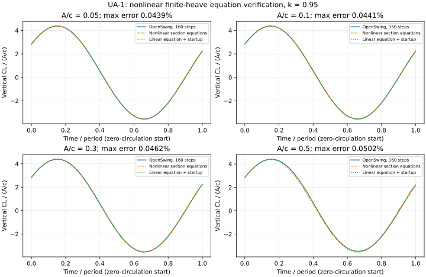

# UA-1: finite-amplitude prescribed heave

Updated 2026-11-01. **Four additional timestep-refinement checks pass**, one
for each published peak-to-peak amplitude at `k=0.95`. Nine production time
runs and all 1,009 saved snapshots are audited. This extends the
[small-amplitude time checks](isae-ua-time-20261101.md); it does not add native
ASWING comparisons or change the registered 148/148 harmonic equation count.
The full UA-1 and UA-2 families remain incomplete.

| Peak-to-peak A/c | Error, 80 steps/cycle | Error, 160 steps/cycle | Fine/coarse error ratio | Result |
|---:|---:|---:|---:|---|
| 0.05 | 0.18013% | 0.04388% | 0.24360 | Pass |
| 0.10 | 0.18097% | 0.04408% | 0.24359 | Pass |
| 0.30 | 0.18972% | 0.04620% | 0.24351 | Pass |
| 0.50 | 0.20613% | 0.05017% | 0.24340 | Pass |

Error is the largest absolute vertical-CL difference across the first cycle,
divided by the largest absolute reference CL in that cycle. The declared
gates require a fine/coarse error ratio below 0.35 and a fine-grid error below
0.1%. The additional 40-step pilot at A/c=0.5 has 0.86670% error; its 40-to-80
step ratio is 0.23784. This is consistent with second-order time convergence.
Fine-grid circulation and circulation-rate errors are also retained: at most
0.07581% and 0.05833%, respectively, normalized by their reference waveform peaks.

The reference follows the documented nonlinear section equations. In
[Drela's steady description](../../.reference/asw_theory.txt), Eqs. 155–157
place a thin-airfoil control point half a chord downstream along the
instantaneous wind. For horizontal flight speed V and upward heave velocity
w, let `U = sqrt(V² + w²)`. In the infinite-span limit, the vertical velocity
induced there by the bound vortex is `−Γ V/(π c U)`. Substituting this into
Eq. 49 of the [unsteady description](../../.reference/asw_uns_theory.txt)
gives

`Γ̇ + V Γ/(2c) = −π U w/2`.

The vertical force from circulation, circulation-rate lift and apparent mass
(unsteady Eqs. 34–35 and 43), normalized by the fixed freestream dynamic
pressure, is

`CL = 2Γ/(Vc) + 2Γ̇/(VU) − π c z̈/(2V²)`.

The independent reference uses quadrature to convolve the first equation
with the prescribed motion, starting at Γ=0. A separate DOP853 ODE integration
audits that reference at every saved time: maximum disagreement in CL is
1.66e-12. Seven new tests pass, covering the small-amplitude limit, production
flow-tangency residual and each force contribution at finite heave velocity,
and discrimination between live and frozen influence control points.

As w/V tends to zero these equations recover the linear UA-1 formula. At
finite amplitude their first-cycle waveforms differ by approximately 0.038%,
0.151%, 1.337% and 3.594% for the four amplitudes. OpenSwing converges toward
the nonlinear reference. The linear differences are retained in every report;
they are neither removed by a fitted factor nor labelled native-ASWING errors.
These percentages describe whole startup waveforms, not periodic harmonic
amplitude errors.

All runs use the existing production JSON time action, source-airflow
structural operator and source Euler/BDF2 temporal policy. Settings are unit
chord, AR200000, four circulation unknowns, V=10, zero mean incidence, Mach
zero and stall disabled. The requested motion is `z=(A/2) cos(2Vk t)`;
acceleration is supplied at each requested BDF knot and motion is integrated
by the production solver. Initial circulation and vertical velocity are zero.
The largest amplitude reaches an effective incidence of about 25.4°, so this
attached-flow check does not validate stall, separation or experiment.

The nine runs take **10.13–29.04 seconds each**, with zero rejected steps.
Every accepted residual is below the unchanged 1e-10 tolerance. Numerical
processes run serially with one BLAS thread and a 45-second process cap.
All 136 production files are unchanged; no empirical correction, tolerance
relaxation, browser run or WASM rebuild is included.

Evidence: [machine summary](isae-ua-finite-heave-20261101.json),
[complete run artifacts and frozen sources](../../artifacts/isae/ua-finite-heave-20261101),
[nonlinear reference](../../scripts/isae_ua_section_reference.py),
[trajectory auditor](../../scripts/summarize-isae-ua-finite-heave.py),
and [permanent tests](../../tests/test_isae_ua_section_reference.py).
All nine complete trajectories are retained. The original terminal exit code
of the A/c=0.5, 80-step run was unavailable after session recovery; its complete
report and raw trajectory pass the same independent audit. It was not rerun.

The later [periodic study](isae-ua1-periodic-20261101.md) passes four eight-cycle
amplitude/phase, waveform and zero-incidence mean-lift checks at k=0.95, covering
all four amplitudes. The [phase-average source binding](isae-ua1-phase-sources-20261101.md)
is also recovered. Remaining UA-1 work includes other frequencies/incidences
and numerical comparison to those exact k=0.47/0.94 linear plot curves.
The [UA-2 AR10 time follow-up](isae-ua2-time-20261101.md) now passes four
integrated-lift refinement and two mesh checks. Four additional [local startup checks](isae-ua2-startup-20261101.md)
pass with explicit variable-step refinement; finite/periodic response remains
unfinished. Its 222 native comparison slots stay blocked by unresolved
source provenance; the report describes 3D runs but the stored harmonic curves
equal a scaled 2D formula. The plotting factors remain outside production.
