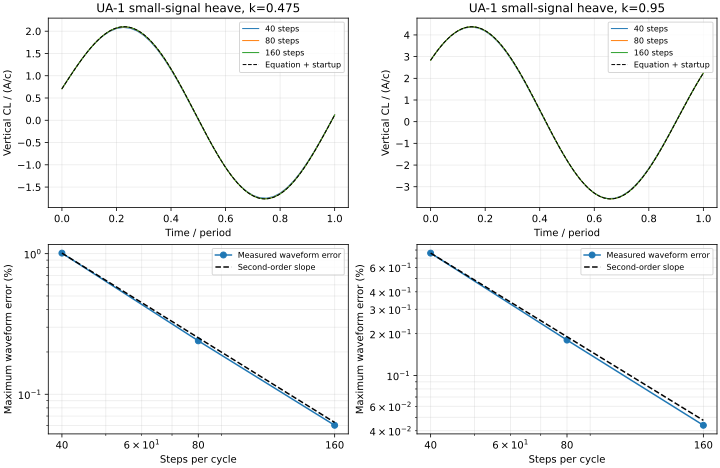

# UA prescribed-heave time validation

Updated 2026-11-01. **Two UA-1 timestep-refinement checks pass**, covering six
completed source-equation time runs. The earlier 148/148 harmonic equation
checks remain separate. The [finite-amplitude extension](isae-ua-finite-heave-20261101.md)
adds four passing refinement checks at k=0.95 for all four published amplitudes. The full UA-1/UA-2 families and project remain incomplete.

| Reduced frequency k | 40 steps/cycle | 80 steps/cycle | 160 steps/cycle | Successive error ratios |
|---:|---:|---:|---:|---|
| 0.475 | 1.00883% | 0.23983% | 0.06017% | 0.2377, 0.2509 |
| 0.950 | 0.76034% | 0.17983% | 0.04380% | 0.2365, 0.2435 |

Errors are the maximum absolute difference in the complete lift waveform,
normalized by the maximum absolute analytical lift over the sampled cycle.
Halving the timestep reduces error by approximately four, as expected for
BDF2. The preregistered gates require both error ratios below 0.35 and the
finest waveform error below 0.1%. Both frequencies pass without changing
production equations or tolerances.

These tests call the production JSON `time` action with
`drela-moving-airflow-v1` and `drela-euler-bdf-v1`, rather than integrating an
isolated fitted lag equation. The complete frame, structural constraints,
circulation, circulation-rate lift and apparent mass participate. The wing is
rigid, unit chord, aspect ratio 200,000, zero incidence, incompressible, with
stall disabled. The diagnostic peak-to-peak amplitude is `A/c=0.001`, chosen
to test the small-signal equations; it is below the published finite-amplitude
range of 0.05–0.5 and does not validate that entire range.

One period is prescribed with `z(t)=(A/2) cos(ωt)`. Exact acceleration samples
are supplied in an ASWING `time Az` table at each requested BDF knot. The
actual motion is integrated by the solver. Acceleration matches those values
at every accepted state; the trajectory contains no forcing cutoff beyond
the final sample. Initial circulation and vertical velocity are zero, so the
reference includes the physically required startup transient. Comparing this
first cycle directly to an already-periodic Bode phasor would be incorrect.

For unit chord the independent reference integrates

`τ Γ̇ + Γ = −π ż`, with `τ=2/V`,

and evaluates `CL = 2Γ/V + 2Γ̇/V² − π z̈/(2V²)`.
Lift is resolved along the fixed plunge direction and normalized with the
freestream dynamic pressure, rather than the time-varying wind-axis CL.
The retained raw trajectories allow both outputs to be inspected.

All six jobs finish in **6.97–12.62 seconds**, with zero rejected steps and
two Jacobian builds per trajectory. The largest normalized nonlinear residual
is **3.78e-12**. An independent convolution integral verifies the analytical
reference at all **566 stored snapshots**. All 136 production Python files
retain their prior hashes. Seven targeted tests pass, including a permanent
40/80-step source-time regression and an independent quadrature check of the
reference. No browser/WASM run or bundle rebuild is included.

The original papers resolve two input conventions:

- **A is peak-to-peak displacement, A=2a**, and `k=πfc/U`. The `A/2` motion
  mapping used in the harmonic adapter is therefore confirmed, not a fitted
  normalization. See the nomenclature and Eq. 1 of the
  [original airfoil paper](https://purehost.bath.ac.uk/ws/files/152831878/aiaa_2017_Nicola_Chiereghin_BathUni_full_paper.pdf).
- The finite-wing paper specifies **semi-aspect ratio 5** and defines `b` as
  half-span. This supports a symmetric **full-wing AR10** reconstruction. The
  actual ISAE native deck and root-wall treatment remain unverified. See the
  nomenclature and §II of the
  [original finite-wing paper](https://purehost.bath.ac.uk/ws/portalfiles/portal/157565057/aiaa_2017_FULL_PAPER.pdf).

The [primary-source record](isae-ua-primary-sources-20261101.json) records the
URLs, DOI and reviewed pages. The PDFs were readable through the web tool;
direct download into this workspace returned HTTP 403, so no local PDF hash
is claimed.

The new UA-2 AR10 harmonic reconstructions complete on 20 and 40 panels in
3.54 and 5.07 seconds. Maximum amplitude change between meshes is **0.05091%**,
and phase change **0.01465°**; the harmonic residual is below **1.84e-15**.
Relative to the archived corrected 2D formula, the fine-grid amplitude differs
by **−8.54% to +13.42%**, and phase by **−1.59° to +6.86°**. These remain
descriptive differences, not errors against verified native ASWING results.
The earlier full-span AR5 reconstruction is retained as a separate diagnostic;
its geometry is not substituted for the primary paper's semispan definition.
The 222 native UA-2 comparison slots remain blocked by source provenance. The
[UA-2 time follow-up](isae-ua2-time-20261101.md) now passes four integrated-lift
refinement checks and two mesh checks. A later [startup study](isae-ua2-startup-20261101.md)
passes four additional local-rate checks with explicit variable-step refinement;
the uniform-grid baseline and app defaults remain unchanged.

Evidence: [machine summary](isae-ua-time-20261101.json),
[time-run and reconstruction artifacts](../../artifacts/isae/ua-time-20261101),
[time verifier](../../scripts/verify-isae-ua-time.py),
[independent summarizer](../../scripts/summarize-isae-ua-time.py).
The six time requests, complete compressed trajectories, scalar comparisons,
progress records and their 138 source files are retained. Numerical work was
serial, with one BLAS thread and a 45-second process cap per time run.

The later [periodic study](isae-ua1-periodic-20261101.md) verifies eight-cycle
waveform, amplitude, phase and zero-incidence mean lift for all four amplitudes
at k=0.95. The [phase-average source binding](isae-ua1-phase-sources-20261101.md)
is recovered; its exact-frequency numerical comparisons remain unfinished.
Remaining work: extend finite-amplitude/periodic checks to other frequencies
and incidences. Extend the UA-2 AR10
time verification to finite/periodic response. Native 3D
ASWING parity still requires a trustworthy native target; the plotting script's
0.85/0.90 corrections are not production physics or acceptance substitutes.
