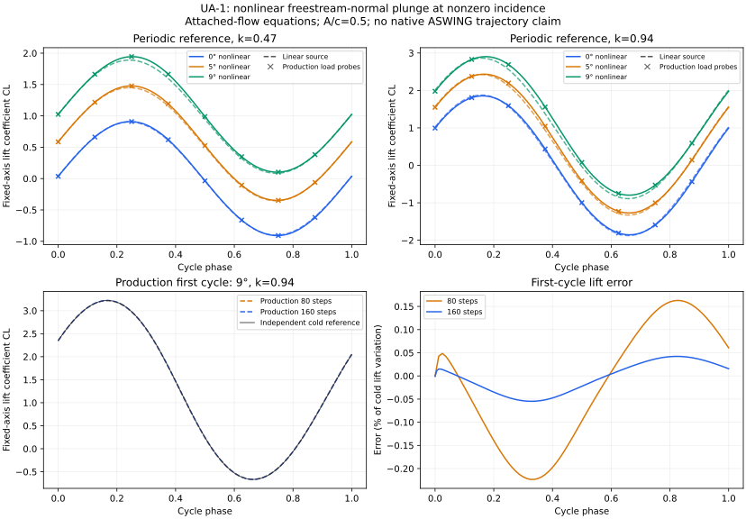

# UA-1: nonlinear section response at nonzero incidence

Updated 2026-11-01. **96/96 instantaneous production-state checks pass**, and
**1/1 nonzero-incidence first-cycle time-refinement check passes** at 9°,
k=0.94, A/c=0.5. All **242 unique time snapshots** are audited. This extends
the earlier [linear phase-curve checks](isae-ua1-phase-20261101.md) using the
[independently derived nonlinear section equations](isae-inclined-section-heave-reference.md).
Nonzero-incidence production periodic response remains unfinished.

| Steps in first cycle | Lift waveform error | Per-strip circulation error | Per-strip circulation-rate error |
|---:|---:|---:|---:|
| 80 | 0.22342% | 0.30439% | 0.25175% |
| 160 | 0.05477% | 0.07666% | 0.06189% |

Lift and circulation errors use the cold reference's maximum departure from
its pre-motion steady value, so the nonzero mean does not hide dynamic error.
Rate uses its reference peak. Every strip and every original sample time is
checked. Fine/coarse error ratios are 0.2451,
0.2518 and 0.2459.
The predeclared gates require all fine errors below 0.1% and ratios below 0.35.
The provisional SA 3% tolerance does not apply.

The [primary paper](https://purehost.bath.ac.uk/ws/files/152831878/aiaa_2017_Nicola_Chiereghin_BathUni_full_paper.pdf),
Sections II and II.B, specifies plunge and measured lift normal to the fixed
freestream. The reconstruction follows that direction at each mean incidence.
Acceleration is projected onto the section normal before applying apparent
mass; force is then projected onto the fixed measurement direction. This
produces a cos²α factor in the apparent-mass contribution to fixed-axis lift.

The independent circulation ODE has a time-dependent coefficient because the
control point follows the instantaneous incident wind. An integrating-factor
quadrature and independently integrated DOP853/Radau solutions agree within
**3.262e-11 of the relevant peak** over both a steady-initialized
first cycle and a periodic cycle for all six frequency/incidence combinations.
All 24 method comparisons pass. Periodic closure is below
3.131e-16. The implementation uses no
production mesh, vortex, residual, force or time-integration function.

## Instantaneous production checks

Both 4- and 8-unknown AR200000 reconstructions are checked at eight phases for
each of the six cases: k=0.47/0.94, mean incidence 0°/5°/9°, A/c=0.5. Each state
is evaluated in chord axes and in an equivalent rotated-wing/wind-axis
representation. Circulatory, circulation-rate and apparent-mass force vectors
are checked separately. The direction and dynamic pressure used by the
production instantaneous CL output are also checked explicitly.

| Circulation unknowns | Passing states | Max absolute force-coefficient error | Max normalized tangency residual | Max coordinate-rotation difference |
|---:|---:|---:|---:|---:|
| 4 | 48/48 | 8.973e-06 | 9.954e-06 | 4.441e-16 |
| 8 | 48/48 | 1.132e-05 | 3.830e-05 | 6.661e-16 |

These probes impose infinite-section circulation on a finite-span reconstruction;
they do not solve its finite-wing circulation equations. The small residuals
therefore include finite-tip effects. Their declared gates are 5e-5 for force
coefficients and tangency residual, 1e-12 for apparent force, and 2e-12 for
coordinate covariance. The closer tip sampling on the finer mesh can increase
the maximum local residual. This is a section-limit check, not a demonstrated
spatial-continuum convergence limit or a native model reconstruction.

Thirteen focused tests pass, including the existing zero-incidence limit,
steady `CL=2π tan α`, zero-amplitude periodic behavior, sign-reversal/half-cycle
symmetry, three-method integration agreement, and force-component covariance.
A frozen-wind variant fails the same finite-motion tangency test as expected.

## Production time pilot

The production JSON time path starts from its own solved steady state at 9°.
No analytic circulation is inserted. Ax and Az jointly prescribe the physical
plunge direction, with exact cosine accelerations at all requested time knots.
Both trajectories run continuously for one cycle; the full forcing table is
present from startup. Six serial 40-step segments retain the BDF predecessor,
complete frame state and original forcing. All joins are exact, with no rejected
steps or repeated solves. Solver time is **6.80–10.29
seconds per segment**, totaling 50.42 seconds.
Each process has one BLAS thread and a 45-second cap.

The largest accepted nonlinear residual is 9.749e-11.
The initial finite-wing circulation differs from the infinite-section steady
value by up to 0.000170;
that spatial difference is retained in every history comparison.
The fine first-step rate error is **0.560%**,
larger than the whole-waveform rate error because it uses that first sample's
own small reference value. Maximum heave velocity error is
0.002486 m/s; maximum position error is
0.0002834 chords;
position error is 0.1134% of heave amplitude.
These startup/motion diagnostics are explicit and have no additional pass gate
in this pilot. The accepted lift/circulation/rate gates are unchanged.

## Difference from the published linear curves

The source phase curves use linear superposition. The nonlinear attached-flow
reference has finite-motion changes in mean lift, phase and higher harmonics.
The following are **differences between approximation levels**, not failures
against verified native ASWING output. Waveform difference uses the linear
oscillatory amplitude; mean differences are in absolute CL units.

| k | Mean incidence | Max waveform difference | Nonlinear mean CL | Mean change from linear source | Fundamental amplitude change | Phase change |
|---:|---:|---:|---:|---:|---:|---:|
| 0.47 | 0° | 1.433% | 0.000000 | +0.000000 | +0.700% | -0.548° |
| 0.94 | 0° | 2.531% | -0.000000 | -0.000000 | -0.426% | -1.269° |
| 0.47 | 5° | 4.195% | 0.560603 | +0.012291 | +1.091% | -0.906° |
| 0.94 | 5° | 5.849% | 0.582831 | +0.034520 | -0.543% | -1.723° |
| 0.47 | 9° | 8.033% | 1.014906 | +0.027945 | +1.988% | -1.700° |
| 0.94 | 9° | 9.816% | 1.055134 | +0.068174 | -0.775% | -2.741° |

For example, at 9° and k=0.94, the nonlinear reference mean is 1.05513 versus
0.98696 from the linear source, and the complete waveform differs by 9.82% of
the source oscillatory amplitude. The independent nonlinear reference agrees
with production instantaneous loads and the first-cycle solver. Forcing those
nonlinear results to equal the linear curve would change the verified equations.
These means are model predictions with stall disabled; they do not reproduce
or fit the experimental leading-edge-vortex mean offsets.

All 136 production Python files remain unchanged. Native output provenance,
stall, other amplitudes/frequencies, nonzero-incidence production periodic
response, and browser/WASM verification remain unfinished. The existing UA-1
and UA-2 passing scopes remain intact; all 222 native UA-2 slots remain blocked.

Evidence: [machine summary](isae-ua1-incidence-20261101.json),
[reference and instantaneous-probe artifacts](../../artifacts/isae/ua1-incidence-20261101),
[complete time trajectories, plans and audit](../../artifacts/isae/ua1-incidence-time-20261101),
[derivation](isae-inclined-section-heave-reference.md),
[reference/probe runner](../../scripts/verify-isae-ua1-incidence.py), and
[time runner](../../scripts/verify-isae-ua1-incidence-time.py).
