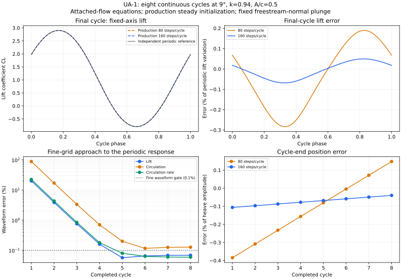

# UA-1: nonlinear periodic response at nonzero incidence

Updated 2026-11-01. **The periodic-response check remains unpassed** at 9°, k=0.94, A/c=0.5.
Two continuous eight-cycle production trajectories use 80/160 steps per cycle
and four circulation unknowns in the AR200000 section reconstruction.
**All 1,922 unique snapshots are audited.** This extends the
[first-cycle and instantaneous-load checks](isae-ua1-incidence-20261101.md).
It is an attached-flow equation comparison, not a native ASWING trajectory.

| Steps/cycle | Periodic lift error | Periodic circulation error | Periodic rate error | Fundamental amplitude error | Phase error | Mean CL error, % dynamic scale |
|---:|---:|---:|---:|---:|---:|---:|
| 80 | 0.28333% | 0.52278% | 0.23802% | -0.11846% | +0.11067° | -0.036780% |
| 160 | 0.06846% | 0.12732% | 0.05926% | -0.03071% | +0.02721° | -0.006975% |

Periodic lift and circulation errors use maximum departures from their
reference cycle means; rate uses its reference peak. Every strip is checked.
This prevents the nonzero mean from reducing the reported relative dynamic
error. Harmonic amplitude uses its own reference amplitude. The mean-lift error
uses the periodic lift-variation scale. Failed gates: periodic_circulation.

The independent reference predicts mean CL
**1.05513395**; production gives
**1.05500478** on the fine grid. The largest final
cycle-to-cycle change is **0.003560%**
across lift, circulation and rate. The fine/coarse error ratios are retained
for both the complete cold history and the final periodic cycle in the machine
summary; no initial-cycle samples are discarded from the cold audit.

## Equations, initialization and acceptance

The [independent inclined-section equations](isae-inclined-section-heave-reference.md)
retain the instantaneous wind direction, nonlinear velocity magnitudes,
circulation-rate lift and the apparent-mass force projection. The periodic
boundary comes from integrating-factor quadrature. The cold solution adds
the exact homogeneous transient from the pre-motion steady circulation.
A direct adaptive integration of the entire eight-cycle cold history agrees
within **2.841e-12 of the relevant peak**.
The prior three-method periodic reference also remains pinned; its 512-interval
harmonics and the present 160-interval reference differ by at most
2.220e-16 in coefficient units.

OpenSwing starts from its own steady equilibrium. No reference circulation,
periodic state or mean correction is supplied to it. The complete eight-cycle
Ax/Az table is present before the first step. The original first-cycle pilot
had a shorter forcing table; the present first cycle reproduces its production
states within **0.000e+00**
in the audited quantities, despite the additional future forcing.

Declared gates require fine periodic and whole-cold-history lift, circulation
and rate errors below 0.1%; corresponding fine/coarse error ratios below 0.35;
fundamental amplitude error below 0.1%; phase error below 0.1°; mean-lift error
below 0.1% of periodic lift variation; and last-cycle changes below 0.01% for
lift, circulation and rate. Nonlinear residuals remain below 1e-10.
The provisional SA 3% tolerance does not apply.

Fine whole-cold-history lift/circulation/rate errors are
**0.05702% /
0.08452% /
0.06189%**.
All checkpoints preserve both the accepted state and the BDF predecessor;
the first step is backward Euler and all remaining steps are second order.

## Additional diagnostics and scope

The fine first-step circulation-rate error is
**0.560%** relative
to that sample's own small reference value. Maximum heave velocity error is
0.002486 m/s. Maximum position
error over eight cycles is 0.0004031
chords, or **0.1613% of
heave amplitude**. These remain separate diagnostics, without additional
acceptance gates in this pilot.

| Harmonic | Fine amplitude error | Fine phase error |
|---:|---:|---:|
| 1 | -0.03071% | +0.02721° |
| 2 | -0.12847% | +0.02982° |
| 3 | -0.30331% | -0.00036° |

Only the fundamental has separate amplitude/phase gates; the higher harmonics
also contribute to the complete-waveform gates. Their individual errors remain
visible here. Finite-tip effects remain in the high-aspect-ratio reconstruction;
this single spatial mesh does not prove spatial convergence or general-wing accuracy.

The 48 serial 40-step segments all terminate successfully with no rejected
steps. Solver time is **6.39–12.41
seconds per segment**, totaling 381.86 seconds.
Worker wall times including imports, source checks and artifact handling are
12.32–20.48
seconds. Each process uses one BLAS thread and has a 45-second cap. Three
focused tests verify the full forcing direction, long-horizon transient and
cycle-boundary continuity. All 136 production Python files are unchanged.

Remaining work includes 5° production time histories, other periodic frequencies
and amplitudes, stall, native ASWING provenance and browser/WASM verification.
The full project goal remains incomplete. This result neither fits the
experimental mean shifts nor changes the 222 blocked native UA-2 comparisons.

Evidence: [machine summary](isae-ua1-incidence-periodic-20261101.json),
[full trajectories, plans, receipts, reference and audit](../../artifacts/isae/ua1-incidence-periodic-20261101),
[periodic setup and reference](../../scripts/isae_ua_incidence_periodic.py),
[bounded segment runner](../../scripts/verify-isae-ua1-incidence-periodic-segment.py), and
[complete-history audit](../../scripts/audit-isae-ua1-incidence-periodic.py).
