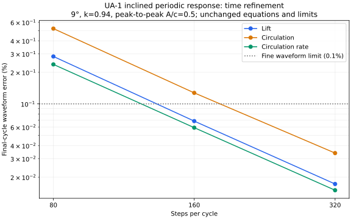

# UA-1: inclined periodic time refinement

Updated 2026-11-01. **1/1 inclined periodic check passes** at 9°, k=0.94, A/c=0.5.
All original acceptance gates pass. The [original 80/160-step comparison](isae-ua1-incidence-periodic-20261101.md)
is retained, including its 0.1273% circulation error above the 0.1% limit.
This follow-up adds 320 steps per cycle using the same equations, initialization,
geometry and limits. It adds no production correction or tolerance change.
The resulting evidence is an attached-flow equation check, not native ASWING output.

| Steps/cycle | Periodic lift error | Circulation error | Circulation-rate error | Fundamental amplitude error | Phase error |
|---:|---:|---:|---:|---:|---:|
| 80 | 0.28333% | 0.52278% | 0.23802% | -0.11846% | +0.11067° |
| 160 | 0.06846% | 0.12732% | 0.05926% | -0.03071% | +0.02721° |
| 320 | 0.01719% | 0.03391% | 0.01499% | -0.00762% | +0.00682° |

Lift and circulation errors use the peak departure from the reference cycle mean;
rate uses its peak. Every strip is checked. A nonzero mean therefore does not
dilute the reported dynamic error. The error ratios between 160 and 320 steps
are 0.2511, 0.2664, 0.2530
for lift, circulation and rate respectively.

The 320-step run starts from its own production steady equilibrium, with the
complete eight-cycle forcing table present from startup. All 2,561 new snapshots
are retained. The audit rereads the retained 160-step raw history as well:
3,842 snapshots in this comparison, or 4,483 unique snapshots across all three
grids. The shared 160-step trajectory is not counted as a new production run.
Its recomputed rows and metrics exactly reproduce the earlier audit.

The [independent reference](isae-inclined-section-heave-reference.md) uses
integrating-factor quadrature plus the exact homogeneous startup transient.
Direct DOP853 integration of the full cold history agrees within
2.916e-12 of the relevant peak.
The refined reference is exactly identical at the old grid's sample times.

## Acceptance and remaining numerical errors

All original gates remain: fine lift/circulation/rate errors below 0.1% in both
the complete cold history and final periodic cycle; fine/coarse ratios below
0.35; fundamental amplitude below 0.1%; phase below 0.1°; mean lift error below
0.1% of dynamic lift variation; final cycle changes below 0.01%; and normalized
nonlinear residual below 1e-10. The SA 3% tolerance is not used here.

Fine whole-cold-history lift/circulation/rate errors are
**0.01442% /
0.02291% /
0.01563%**.
Reference mean CL is **1.05513395**; production
mean CL is **1.05509901**. Mean error is
-0.001887% of dynamic lift variation.
The largest final cycle-to-cycle change is
0.003560%.

Additional diagnostics: first-step rate error
0.269% of its own small
reference value; maximum heave velocity error
0.0006128 m/s; maximum position
error 0.03140% of heave
amplitude. These have no separate acceptance gates in this pilot.

| Harmonic | Fine amplitude error | Fine phase error |
|---:|---:|---:|
| 1 | -0.00762% | +0.00682° |
| 2 | -0.02931% | +0.00757° |
| 3 | -0.07374% | -0.00233° |

Only the fundamental has separate harmonic gates. Higher harmonics also enter
the full-waveform comparison. This is one spatial mesh with four circulation
unknowns and AR200000; finite-tip effects remain and general spatial accuracy
is not established by this time-refinement check.

The 32 new segments each advance 80 steps, preserving both BDF predecessors.
All converge without rejected steps. Solver time is
4.78–11.48 seconds per segment (323.13 seconds
total); worker wall time is 10.23–22.11 seconds. Jobs run
serially with one BLAS thread and a 45-second cap. All 136 production Python
files remain unchanged. No browser/WASM or application-default validation is claimed.

Broader nonzero-incidence frequencies/amplitudes, the 5° production histories,
stall and native reference provenance remain unfinished. UA-2's previous
equation checks and 222 blocked native comparisons are unchanged. This refines
one existing UA-1 periodic case; it does not add a second physical case or
complete either validation family or the full project goal.

Evidence: [machine summary](isae-ua1-incidence-periodic-refined-20261101.json),
[saved plans, reference, trajectories and receipts](../../artifacts/isae/ua1-incidence-periodic-refined-20261101),
[refinement audit](../../scripts/audit-isae-ua1-incidence-refined.py).
