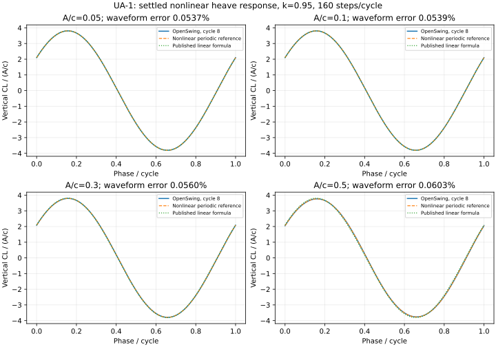
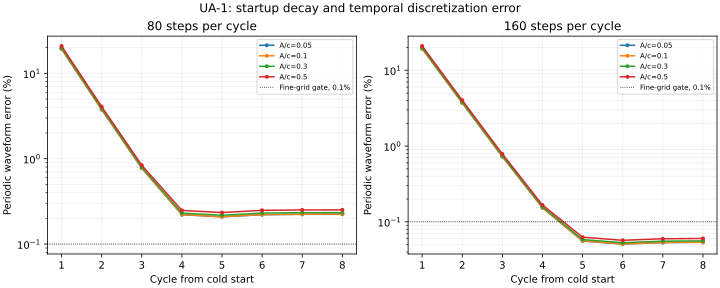

# UA-1: periodic finite-amplitude time response

Updated 2026-11-01. **Four periodic-response checks pass**, one for each published
amplitude at k=0.95. Eight continuous trajectories cover 80/160 steps per cycle
and eight cycles from zero circulation. An independent ODE integration audits
all **7,688 unique snapshots**. These are attached-flow equation checks, not
native ASWING executable comparisons or complete UA-1 validation.

| Peak-to-peak A/c | Cycle-8 waveform error, 80 steps | Cycle-8 waveform error, 160 steps | First-harmonic amplitude error | Phase error | Mean error, % of reference peak |
|---:|---:|---:|---:|---:|---:|
| 0.05 | 0.22362% | 0.05365% | −0.02815% | +0.02460° | −0.00229% |
| 0.10 | 0.22449% | 0.05386% | −0.02816% | +0.02467° | −0.00230% |
| 0.30 | 0.23379% | 0.05604% | −0.02830% | +0.02545° | −0.00239% |
| 0.50 | 0.25169% | 0.06028% | −0.02860% | +0.02694° | −0.00257% |

Amplitude, phase and mean columns use the 160-step results. Waveform error is
the maximum absolute lift error over the complete eighth cycle, divided by
that cycle's reference peak. The signed amplitude error is relative to the
reference fundamental. Mean error uses peak lift because the zero-incidence
reference mean is zero. No endpoint, initial transient or near-zero sample is
removed to improve agreement.

The gates were recorded before execution: fine-grid waveform and amplitude
errors below 0.1%, phase error below 0.1°, mean error below 0.1% of peak, final
cycle-to-cycle change below 0.01% of peak, and waveform error reduction below
0.35 when halving the timestep. The actual reduction ratios are 0.2395–0.2399.
Final cycle-to-cycle changes are 0.000767–0.000831%. The coarse grid's
0.224–0.252% waveform errors remain visible; it does not meet the fine-grid
accuracy requirement. These time-integration gates do not change the earlier
harmonic-equation tolerances or inherit the SA 3% policy.

The independent reference uses the previously derived live-wind section
equations from the [finite-heave study](isae-ua-finite-heave-20261101.md):

`Gamma_dot + V*Gamma/(2c) = -pi*sqrt(V^2+w^2)*w/2`.

The periodic initial circulation follows from its decay kernel:

`Gamma_periodic(0) = Gamma_cold(T)/(1-exp(-V*T/(2c)))`.

This is a reference boundary condition only. Production always starts from
zero circulation and marches through all eight cycles. The verifier computes
the reference with quadrature; the independent auditor uses DOP853 for both
the cold eight-cycle solution and periodic boundary solution. A separate
complex Fourier integral checks the measured mean, amplitude and phase. A
4,096-interval reference cycle checks Fourier sampling error.

The lift reference includes circulation, circulation-rate force and apparent
mass with instantaneous relative speed. At A/c=0.5, its periodic fundamental
differs from the published **linear** formula by −0.4553% in amplitude and
−1.2728° in phase; its third harmonic is 0.7293% of the fundamental. These
finite-amplitude differences are larger than the measured timestep error.
They are retained as differences between the nonlinear equations and linear
plot formula, not fitted away or called errors against native ASWING output.

Settings retain the rigid AR200000 section limit, four circulation strips,
unit chord, V=10, zero mean incidence, Mach zero, gravity zero and stall disabled.
The prescribed acceleration is cosine-valued at every timestep. Each of the
64 serial jobs advances one cycle, retaining the original eight-cycle forcing
table and BDF predecessor in the checkpoint. There are no new cold starts,
forcing replacements, periodic state corrections or dropped initial cycles.
All post-checkpoint steps remain BDF2. Every join preserves force, circulation
and circulation rate exactly in the retained data.

All jobs finish in **5.21–24.87 seconds**, with one BLAS thread and a 45-second
cap each. There are no failed jobs, timeouts, retries or rejected steps. Total
solver time is 795.12 seconds; persistence takes 0.13–0.41 seconds per job.
Maximum normalized residual is 9.9904e-11, below the unchanged 1e-10 tolerance.
All 136 production files and app defaults remain unchanged. Seven new targeted
tests pass. Browser/WASM verification is outside this batch.

The [phase-average/mean source review](isae-ua1-phase-sources-20261101.md) also
recovers the exact k=0.47/0.94 phase-average formulas and identifies experimental
offsets. Those six linear plot curves still need their own numerical checks.
The mean-lift check here verifies zero-incidence attached-flow symmetry; it
does not adopt experimental LEV shifts.

Evidence: [machine summary](isae-ua1-periodic-20261101.json),
[all plans, complete trajectories, execution receipts and frozen sources](../../artifacts/isae/ua1-periodic-20261101),
[cycle driver](../../scripts/verify-isae-ua-periodic-cycle.py),
[serial runner](../../scripts/run-isae-ua-periodic.py),
[independent auditor](../../scripts/audit-isae-ua-periodic.py),
[periodic reference](../../scripts/isae_ua_periodic.py), and
[targeted tests](../../tests/test_isae_ua_periodic.py).

Remaining work includes other frequencies and nonzero mean incidence, the exact
phase-average targets, and finite-amplitude/periodic UA-2 response. Native UA-2
reference provenance remains unresolved. Neither full unsteady validation nor
the full project goal is complete.
