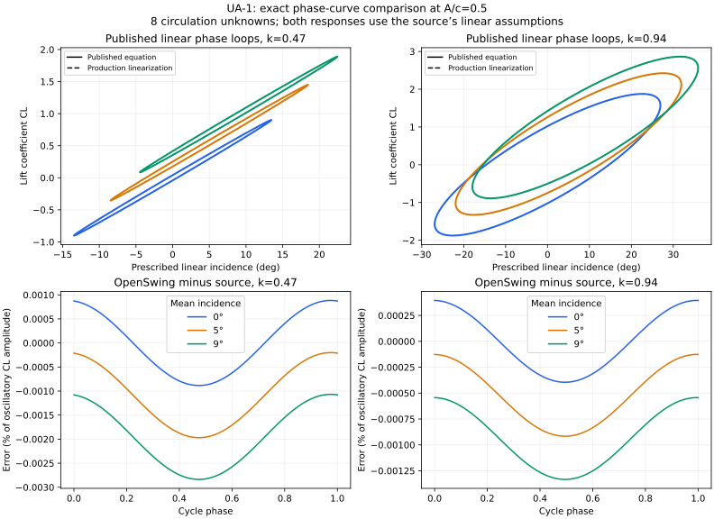

# UA-1: exact published phase-curve comparison

Updated 2026-11-01. **12/12 linear phase-curve checks pass**, covering the six
published curves on two meshes, with **1,200/1,200 lift samples** within their
declared tolerance. The largest waveform error is
**0.002837% of oscillatory lift amplitude**.
This closes the numerical comparison left open by the
[phase-source review](isae-ua1-phase-sources-20261101.md).

These are equation comparisons. The MATLAB source constructs its 0°, 5° and
9° curves by linear superposition about zero incidence. Accordingly, this
comparison verifies the production linearized oscillatory response **and the
production steady-incidence derivative**. It does not validate nonlinear
finite-amplitude motion at 5° or 9°, nor recover native ASWING trajectories.

| Circulation unknowns | k | Mean label | Passing samples | Max waveform error | Signed mean CL error |
|---:|---:|---:|---:|---:|---:|
| 4 | 0.47 | 0° | 100/100 | 0.000701% | +0.00000000 |
| 4 | 0.47 | 5° | 100/100 | 0.001560% | -0.00000775 |
| 4 | 0.47 | 9° | 100/100 | 0.002248% | -0.00001396 |
| 4 | 0.94 | 0° | 100/100 | 0.000313% | +0.00000000 |
| 4 | 0.94 | 5° | 100/100 | 0.000726% | -0.00000775 |
| 4 | 0.94 | 9° | 100/100 | 0.001057% | -0.00001396 |
| 8 | 0.47 | 0° | 100/100 | 0.000884% | +0.00000000 |
| 8 | 0.47 | 5° | 100/100 | 0.001969% | -0.00000979 |
| 8 | 0.47 | 9° | 100/100 | 0.002837% | -0.00001761 |
| 8 | 0.94 | 0° | 100/100 | 0.000395% | +0.00000000 |
| 8 | 0.94 | 5° | 100/100 | 0.000917% | -0.00000979 |
| 8 | 0.94 | 9° | 100/100 | 0.001334% | -0.00001761 |

The source uses exactly k=0.47/0.94, A/c=0.5 (peak-to-peak), and 100 equally
spaced phase samples including both endpoints. These frequencies differ from
the earlier k=0.475/0.95 time studies. The incidence coordinate is the source's
prescribed linear coordinate; it is not counted as an independent output test.
Mean errors are compared in absolute CL units; relative waveform errors use
the oscillatory amplitude so a larger mean offset cannot conceal dynamic error.

## Prediction and reference remain independent

The predictor centrally differentiates the actual production aerodynamic
residual and load routine with respect to circulation, circulation rate,
heave velocity, heave acceleration and incidence in radians. One derivative
matrix per mesh supplies one static solve and two complex harmonic solves.
The mean slope is obtained by solving `K Gamma_alpha = -R_alpha` and applying
the production load derivatives. No 2π lift slope is inserted into prediction.
The computed slopes are **6.2830964496** and
**6.2830731714 per radian**, compared with 2π in the source.

For the oscillatory component, displacement amplitude is 0.25 chords and
`omega=2Vk/c`; its velocity and acceleration phasors are `i omega h` and
`-omega² h`. Circulation-rate lift and apparent mass participate. The comparison
side separately transcribes the pinned MATLAB bracket and linear mean offset.
The reference formula is never used to assemble or solve the production system.

The rigid rectangular AR200000 reconstruction uses V=30, unit chord, Mach zero,
stall disabled, and 4/8 circulation unknowns. This approaches the section limit
while retaining finite-tip effects. Mesh change is
**0.000589% of oscillatory amplitude**; two meshes do not establish
an infinite-span or spatial-continuum convergence limit.

Acceptance was declared before the runs: every lift sample must differ by at
most 0.01% of oscillatory amplitude; harmonic amplitude by at most 0.01%; phase
by at most 0.01°; and mean CL by `max(1e-9, 1e-4*abs(reference mean))`.
The provisional SA 3% policy does not apply. Actual maximum amplitude and phase
errors are **0.000205%** and
**0.000503°**.

Both meshes are repeated with half-sized differentiation steps. The largest
normalized waveform change is
**2.236e-11**, below the
predeclared 1e-7 derivative-sensitivity gate. These repeats add no curve or
sample acceptance counts. Six focused tests pass, including deliberate omission
of the mean-incidence response or apparent mass, a wrong phase origin, and a
doubled physical amplitude. Those incorrect variants fail the appropriate curves.

Four small serial jobs take **3.09–3.45
seconds** each after source pinning, with one BLAS thread and a 45-second cap.
All exit successfully. All 136 production Python files and the earlier UA-2 and
steady results remain unchanged. No browser build or background numerical batch
is needed for this comparison.

## Remaining scope

This supplements the existing 148/148 harmonic equation checks and four
passing nonlinear periodic checks at zero incidence and k=0.95. The latter
remain separate from this linear source comparison. Nonlinear periodic motion
at nonzero mean incidence, other frequencies, and browser/WASM behavior still
require validation. The next useful step is an independently derived section
reference at nonzero incidence, checked against production instantaneous loads
before running bounded time histories.

Experimental CSVs, empirical mean-lift offsets, Theodorsen curves and the
hand-written static polar are separate source curves and are excluded from
these ASWING-equation counts. The UA-2 native-reference provenance issue remains;
none of its 222 blocked comparison slots is converted into a pass.

Evidence: [machine summary](isae-ua1-phase-20261101.json),
[plans, derivative matrices, full curves, receipts and frozen sources](../../artifacts/isae/ua1-phase-20261101),
[production-derivative comparison](../../scripts/isae_ua_phase.py),
[bounded runner](../../scripts/verify-isae-ua1-phase.py),
[focused tests](../../tests/test_isae_ua_phase.py), and
[pinned source manifest](isae-ua1-phase-sources-20261101.json).
