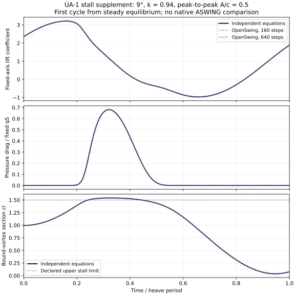

# UA-1 supplement: stall leakage with unsteady circulation

Updated 2026-11-02. The independent reference and **72/72 instantaneous checks
pass**. The three-grid first-cycle study **passes**, with **11/11 gates passing**. This is supplemental equation verification, not
native ASWING output or recovered original UA-1 stall settings.

## Physical model and independent reference

The test combines the leakage function in [Drela's steady description,
§5.7, Eqs. 202–204](https://web.mit.edu/drela/Public/web/aswing/asw_theory.pdf)
with the local circulation-lag term in the [unsteady extension, §7.1,
Eqs. 48–49](https://web.mit.edu/drela/Public/web/aswing/asw_uns_theory.pdf).
The model retains the documented smooth post-stall slope; it does not introduce
a separate separation-state or vortex-shedding model.

The declared case is a rigid rectangular wing with AR200000, unit chord,
speed 10, Mach zero, mean incidence 9°, reduced frequency 0.94 and peak-to-peak
heave amplitude A/c=0.5. Heave follows the fixed mean-freestream normal.
The section slope is 2π, CLmax/CLmin are +1.5/−1.5, stall strength is 40,
and transition width is 0.05. Both file-specified skin-friction and profile-drag
coefficients are zero, isolating the pressure drag generated by leakage.

For heave velocity w, define
`vx = V cos(alpha) + w sin(alpha)`,
`vz = V sin(alpha) - w cos(alpha)` and `v = hypot(V,w)`.
The infinite-span circulation equation reduces to

```
cl = 2 Gamma / (c v)
f(cl) = delta [softplus((cl-clmax)/delta) - softplus((clmin-cl)/delta)]
Gamma_dot = (pi/2) v vz - vx Gamma/(2c) - (Ks/4) v^2 f(cl)
```

The independent implementation imports no production solver code. It solves
the nonlinear steady root before integrating from rest with DOP853 and Radau.
Their maximum discrepancy, normalized by each quantity's own peak, is
**1.025e-10**, below the declared 1e-9 limit. Reference section cl ranges from
**0.03679 to 1.54175**, so the motion actually enters and leaves positive stall.
The reflected instantaneous states test the negative-stall branch as well.

The load reference includes circulation lift, circulation-rate lift and
apparent mass. Pressure drag uses the control-point normal velocity after
subtracting the circulation-lag contribution. On the differential solution,
that velocity equals the stall leakage. Thus nonzero circulation rate alone
does not create separation drag. Lift and forces use fixed mean dynamic
pressure; pressure drag is projected onto the instantaneous incident wind and
then converted to the same fixed pressure normalization.

## Instantaneous checks

There are 36 states on each of two meshes, with 4 and 8 circulation unknowns.
Each is evaluated in chord axes and in a rotated wind-axis representation.
The states include both signs of stall and deliberately off-equation
circulation rates. The latter check the residual and pressure-drag law away
from a converged state, rather than only checking a zero residual.

All **72 states pass**. Maximum force-coefficient error is **8.903e-6**;
maximum pressure-drag error is **0.001946% of its independent reference peak**.
The residual error is **3.020e-5** in fixed-mean-speed units. These small
finite-wing differences remain subject to the preregistered instantaneous
limits; they are not subtracted or fitted away.

All **16 reference tests pass**, covering the attached-flow limit, signed
steady roots, pressure-drag identity, positive/negative reflection, nonlinear
tangent and agreement of the two integrators through the stall transition.

## First-cycle study

The production runs use 160, 320 and 640 steps per cycle, four circulation
unknowns, and the complete acceleration table from startup. Each starts from
its own steady equilibrium. No reference state initializes production.
The declared fine-grid limits are 0.1% for lift, circulation, circulation rate
and pressure drag. Lift and circulation errors use departures from the
pre-motion steady value; rate and pressure drag use their own peaks. Every
strip participates. Halving the timestep must reduce each error by a factor
below 0.35. Motion has a separate 0.1% limit and the nonlinear residual remains
below 1e-10.

Jobs run serially, one BLAS thread, 40 steps per segment and a 45-second cap
per subprocess. Complete snapshots and restart states are retained. Separate
readers check the entire history and both BDF predecessors across each join.

## First-cycle results

| Steps/cycle | Lift error | Circulation error | Rate error | Pressure-drag error |
|---|---:|---:|---:|---:|
| 160 | 0.10645% | 0.10282% | 0.32567% | 0.39329% |
| 320 | 0.02910% | 0.02596% | 0.09042% | 0.09869% |
| 640 | 0.00868% | 0.00724% | 0.03068% | 0.02780% |

The 160-step history exceeds the 0.1% accuracy limit for all four quantities;
its failures remain recorded. The accepted result uses the finer grids, with
the same production equations and accuracy limits.

The retained study audits **1,123 unique snapshots**, **1,120 accepted steps** and **0 rejected steps**. All **25 continuation boundaries** are checked. Fine/coarse error ratios range from **0.25094 to 0.33927** (limit 0.35). Fine velocity and position errors are **0.00324%** and **0.00721%** of their respective heave amplitudes. Maximum normalized residual is **9.9548e-11**.

A separate first-step diagnostic normalizes rate error by that sample's own
small rate, rather than the history peak. Its errors are 0.5605%, 0.2693% and
0.1319% on the three grids. These are diagnostic values, not extra passing
gates; the first step uses Euler before subsequent BDF2 steps.

| Gate | Result |
|---|---|
| probe-n4-part000 | Pass |
| probe-n4-part001 | Pass |
| probe-n8-part000 | Pass |
| probe-n8-part001 | Pass |
| CL | Pass |
| circulation | Pass |
| circulation_rate | Pass |
| CDp_fixed | Pass |
| refinement | Pass |
| residual | Pass |
| motion | Pass |



Evidence: [machine summary](isae-ua1-stall-20261102.json), [complete-history audit](../../artifacts/isae/ua1-stall-20261102-r1/audit.json).

## Scope and evidence

Production solver modules and physical acceptance limits are unchanged.
Periodic stalled response, browser execution of this stalled case, finite-span
UA-2 stall coverage and native-ASWING agreement remain unfinished.

The initial reference preparation is retained. Before production started, code
review corrected the off-equation comparison to convert the solver's
instantaneous-speed residual normalization to the reference's fixed-speed
normalization. The successor plan preserves the same physical equations,
parameters and limits. This was a verifier-unit conversion, not a solver fix.

Evidence: [plan](../../artifacts/isae/ua1-stall-20261102-r1/plan.json),
[independent references](../../artifacts/isae/ua1-stall-20261102-r1/reference.json),
[reference implementation](../../scripts/isae_ua_stall_reference.py),
[serial runner](../../scripts/run-isae-ua1-stall.py),
[reference tests](../../tests/test_isae_ua_stall_reference.py).

To reproduce the numerical study, use a fresh evidence directory and the
repository virtual environment. Run these stages in order; the `run` command
executes only one bounded subprocess at a time and reuses verified completed
segments if invoked again.

```sh
mkdir -p artifacts/isae/ua1-stall-rerun
export OPENBLAS_NUM_THREADS=1 OMP_NUM_THREADS=1 MKL_NUM_THREADS=1
nice -n 10 .venv/bin/python scripts/run-isae-ua1-stall.py prepare --base artifacts/isae/ua1-stall-rerun
nice -n 10 .venv/bin/python scripts/run-isae-ua1-stall.py run --base artifacts/isae/ua1-stall-rerun --phase probe
nice -n 10 .venv/bin/python scripts/run-isae-ua1-stall.py run --base artifacts/isae/ua1-stall-rerun --phase production
nice -n 10 .venv/bin/python scripts/run-isae-ua1-stall.py run --base artifacts/isae/ua1-stall-rerun --phase audit
nice -n 10 .venv/bin/python scripts/run-isae-ua1-stall.py combine --base artifacts/isae/ua1-stall-rerun
```
