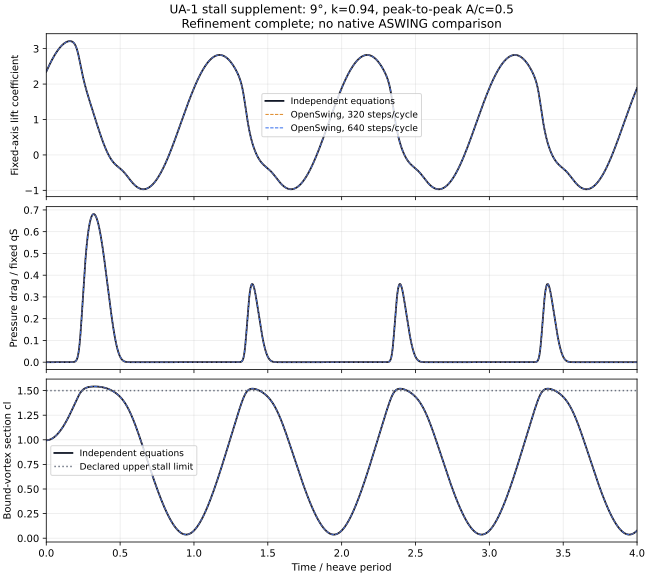

# UA-1 repeated-cycle stall comparison

Updated 2026-11-02. The study **passes all declared gates**. This is a supplemental comparison against independently implemented equations, not native ASWING output.

## Physical setup

The airfoil limit uses the retained AR 200,000 wing with four circulation unknowns, mean incidence 9°, reduced frequency k=0.94, and peak-to-peak A/c=0.5. The section limits are ±1.5, leakage strength 40, and smoothing width 0.05. These explicit settings exercise the documented smooth stall leakage; they are not recovered native UA-1 settings. Circulation lag is enabled, with pressure drag evaluated from the lag-corrected tangency velocity.

The reference implements the [steady description](https://web.mit.edu/drela/Public/web/aswing/asw_theory.pdf) (Eqs. 202–204) and [unsteady description](https://web.mit.edu/drela/Public/web/aswing/asw_uns_theory.pdf) (Eqs. 34–35, 43, 48–49) independently of production. This is instantaneous stall leakage plus circulation lag; it does not introduce a separate dynamic separation state.

Both production grids start from their own steady equilibrium. The entire four-cycle acceleration table is supplied before startup. Every job advances at most 40 steps with one BLAS thread and a 45-second cap. Complete snapshots and restart states are retained; continuation audits verify both BDF predecessors. Production equations, source files and solver tolerances are unchanged during this study.

The 320/640 steps-per-cycle grids and accuracy gates were recorded before production runs. Fine waveform error must be below 0.1%, fine/coarse error ratios below 0.35, and final-cycle change below 0.01%. Motion, residual, mean lift, amplitude, phase and startup-rate gates are also fixed. The previous first-cycle study remains separately recorded.

## Reference and recorded results

Two independent integration methods (DOP853 and Radau) agree within **7.054e-11** on the declared scales. The eighth-to-seventh reference cycle changes by at most **1.859e-09%**. The eighth reference cycle supplies the periodic target; the cold history supplies the full-history target.

| Steps/cycle | Scope | Lift error | Circulation error | Rate error | Pressure-drag error |
|---|---|---:|---:|---:|---:|
| 320 | Full cold history | 0.05870% | 0.03296% | 0.12150% | 0.13587% |
| 320 | Fourth cycle vs periodic reference | 0.06465% | 0.04025% | 0.12100% | 0.25636% |
| 640 | Full cold history | 0.01532% | 0.00943% | 0.03344% | 0.03512% |
| 640 | Fourth cycle vs periodic reference | 0.01688% | 0.01152% | 0.03332% | 0.06629% |

Cold lift/circulation errors use peak departure from the independent steady state. Periodic lift/circulation errors use peak departure from the reference cycle mean. Rate and pressure drag use their own reference peaks. Every strip is checked separately.

| Steps/cycle | Largest fourth/third-cycle change | Velocity error | Position error |
|---|---:|---:|---:|
| 320 | 0.000018% | 0.01304% | 0.02871% |
| 640 | 0.000019% | 0.00324% | 0.00721% |

The first 40-step fine-grid job exited 124 at its 45-second cap while writing the compressed trajectory, after the solver had returned. The incomplete gzip/JSON and original failure receipt are retained and are not used as a restart. Fine-grid execution uses **20-step jobs** from the original cold start. This changes only the job partition: the complete forcing table, all 640 physical steps per cycle, equations, tolerances and saved fields are unchanged. The successful coarse grid is reused.

**3,840 steps**, **3,842 unique states**, **158 continuation boundaries**, and **0 rejected steps** are covered by the completed grids. All **9 setup/audit tests** pass. Tests specifically reject nonfinite data, wrong sample times, an erroneous individual strip, cycle drift and a nonconverging error plateau.

The first 321 states reproduce the retained first-cycle physical outputs within **2.551e-12** on their recorded scales. This checks the extended forcing history and the preceding exact-derivative matrix change; it adds no separate physical pass count.

The first **640 fine-grid steps / 641 states** have a separate continuation cross-check. First-cycle lift/circulation/rate/pressure-drag errors are **0.00868% / 0.00724% / 0.03068% / 0.02780%** against the independent cold-history equations. All 31 joins pass, and the largest scaled difference from the earlier validated first-cycle run is **5.863e-09**. These are first-cycle results; they add no new periodic case pass.

| Gate | Result |
|---|---|
| reference | Pass |
| cold_waveforms | Pass |
| periodic_waveforms | Pass |
| settling | Pass |
| refinement | Pass |
| residual | Pass |
| motion | Pass |
| mean_lift | Pass |
| lift_amplitude | Pass |
| lift_phase | Pass |
| first_rate | Pass |
| persistent_stall | Pass |

Fine/coarse error ratios range from **0.25847 to 0.28621** (limit 0.35), covering both the complete cold history and the periodic response.

## Remaining scope

Browser repeated-stall coverage, broader physical conditions, UA-2 stall, and native ASWING agreement remain unfinished.

[Machine-readable results](isae-ua1-stall-periodic-20261102.json). [Complete evidence and frozen sources](../../artifacts/isae/ua1-stall-periodic-20261102). [Runner](../../scripts/run-isae-ua1-stall-periodic.py). [Recovery runner](../../scripts/run-isae-ua1-stall-periodic-recovery.py).
