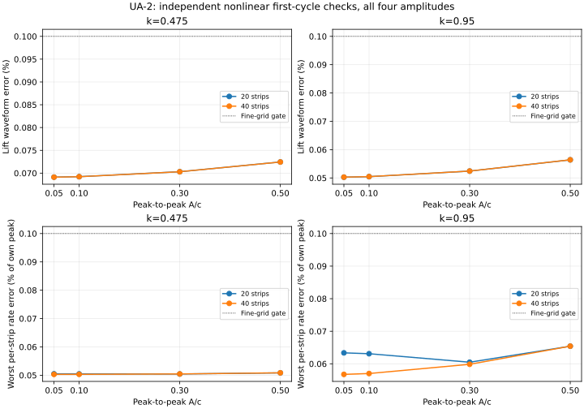

# UA-2: finite-amplitude first-cycle grid

Updated 2026-11-01. **16/16 time-refinement checks and 8/8 mesh checks pass**
across A/c=0.05, 0.1, 0.3 and 0.5 at k=0.475 and 0.95. Both 20/40-strip meshes
use nominal 80/160 time grids. The audit covers **5,152 unique snapshots**
from 32 continuous trajectories. These independently verify the reconstructed
straight-wing equations and time integration; native ASWING comparison remains
blocked and full UA-2 validation is unfinished.

| k | A/c | Fine lift error, 20 / 40 strips | Fine per-strip rate error, 20 / 40 strips | Mesh lift change |
|---:|---:|---:|---:|---:|
| 0.475 | 0.05 | 0.06912% / 0.06911% | 0.05050% / 0.05030% | 0.04945% |
| 0.475 | 0.1 | 0.06922% / 0.06922% | 0.05047% / 0.05031% | 0.04946% |
| 0.475 | 0.3 | 0.07031% / 0.07030% | 0.05044% / 0.05045% | 0.04950% |
| 0.475 | 0.5 | 0.07245% / 0.07244% | 0.05083% / 0.05085% | 0.04958% |
| 0.95 | 0.05 | 0.05027% / 0.05028% | 0.06336% / 0.05675% | 0.04471% |
| 0.95 | 0.1 | 0.05046% / 0.05047% | 0.06310% / 0.05701% | 0.04474% |
| 0.95 | 0.3 | 0.05242% / 0.05243% | 0.06049% / 0.05985% | 0.04506% |
| 0.95 | 0.5 | 0.05639% / 0.05640% | 0.06541% / 0.06542% | 0.04570% |

Fine lift errors are maximum absolute errors divided by the cycle's reference
peak. Rate errors use each strip's own reference peak before maximizing over
strips and times. Every strip and accepted time is retained. The mesh column
compares production lift histories between 20 and 40 strips at the fine time grid.
This measures stability over two meshes; the spatial continuum limit remains
unverified.

The unchanged gates require fine lift/rate waveform errors below 0.1%, first-step
relative rate errors below 1%, and a lift-error reduction ratio below 0.35 when
halving the maximum timestep. Mesh lift changes must be below 0.2%. Coarse lift
errors are 0.2418–0.3403% and remain explicit failures of the
fine-grid accuracy requirement. Fine first-step rate errors are
0.0664–0.5167%; fine circulation waveform errors are
0.0851–0.0948% of their reference peaks. These numerical gates
do not inherit the provisional SA 3% policy.

The [independent straight-wing reference](isae-straight-wing-heave-reference.md)
integrates the bound vortices and both trailing legs separately from production
code, then applies Drela's nonlinear circulation-lag and instantaneous load
equations. It retains the induced bound-point speed and rotates influences with
the live wind. DOP853 and Radau check each reference independently; their largest
difference over the grid is 8.56e-09 of the relevant reference peak,
below the unchanged 1e-8 reference-agreement gate. No fitted 0.85/0.90 factors
enter the equations.

The [completed largest-amplitude pilot](isae-ua2-nonlinear-20261101.md) is reused
for A/c=0.5, k=0.95. Its original producer sources, reports and trajectories are
preserved. A saved-only audit rechecks those histories with the generalized
auditor and verifies unchanged production hashes; it performs no new production
solve. The other seven combinations add 154 serial segments and 28 trajectories.
Each numerical job remains capped at 45 seconds with one BLAS thread. New solver
segments take 1.64–23.15 seconds, totaling 1248.30 seconds.
All production jobs finish without retries, timeouts or rejected steps; all
checkpoint joins preserve forces, circulation and circulation rate.

The grids retain `dt_max/256` at startup and growth at most 1.125, resulting in
120/200 accepted steps per cycle for nominal 80/160 resolution. Segments contain
at most 32 steps and preserve the original forcing table and BDF predecessor.
This explicit grid choice does not change app defaults. All 136 production
files remain unchanged. Only validation parameter handling, auditing and
reporting expand in this batch.

Evidence: [machine summary](isae-ua2-amplitude-grid-20261101.json),
[plans, execution receipts, complete trajectories, references and frozen sources](../../artifacts/isae/ua2-amplitude-grid-20261101),
[serial grid runner](../../scripts/run-isae-ua2-amplitude-grid.py), and
[generalized trajectory auditor](../../scripts/audit-isae-ua2-nonlinear.py).

Remaining work includes other published frequencies, periodic 3D amplitude/phase
and mean lift, and nonzero mean incidence. The model is a declared straight,
rigid AR10 reconstruction with Mach zero and stall disabled. Native model/driver
provenance is unresolved, so all 222 native UA-2 comparison slots remain blocked.
Browser/WASM verification, broader model coverage and the full project goal
remain unfinished.
