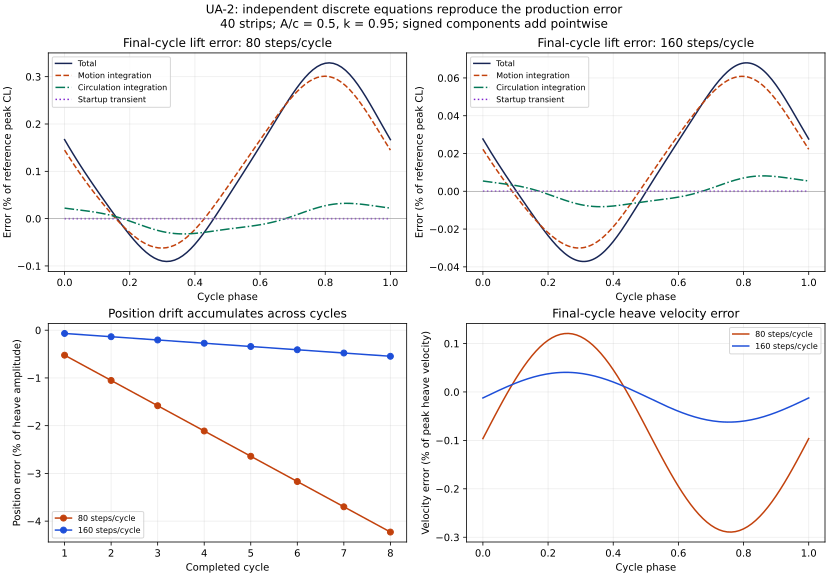

# UA-2: discrete-equation and error attribution audit

Updated 2026-11-01. **All four saved trajectories agree with an independent
implementation of Drela's documented time discretization.** The largest
normalized state/load difference is **7.658e-10**, and the largest
reconstructed normalized circulation residual is **9.916e-11**.
The remaining periodic lift error is dominated by time discretization of the
prescribed motion. This checks the equations on this particular straight-wing
case; it does not establish native ASWING parity.

The audit reuses every one of the **4,004 snapshots** in the
[eight-cycle pilot](isae-ua2-periodic-20261101.md). It adds no production solves
or ISAE pass counts. The existing **16/16 first-cycle and 2/2 periodic checks**,
**8/8 first-cycle and 1/1 periodic mesh checks**, and **222 blocked native
comparison slots** remain unchanged. All 136 production Python files are unchanged.

| Strips | Nominal steps/cycle | Largest normalized identity difference | Periodic lift error | Motion component | Circulation-integration component |
|---:|---:|---:|---:|---:|---:|
| 20 | 80 | 6.587e-10 | 0.32925% | 0.30102% | 0.03236% |
| 20 | 160 | 7.118e-10 | 0.06799% | 0.06084% | 0.00816% |
| 40 | 80 | 7.182e-10 | 0.32922% | 0.30101% | 0.03233% |
| 40 | 160 | 7.658e-10 | 0.06799% | 0.06085% | 0.00816% |

Lift errors use the maximum periodic reference lift as denominator. Components
are separate maximum norms: **they add pointwise, not as table percentages**.
The residual cold-start transient contributes at most 0.00001035% of peak lift
in the final cycle. Doubling the time resolution reduces the total lift error
from about 0.329% to 0.0680%; the two strip counts give essentially the same
attribution.

## What is independently implemented

The [unsteady technical description](../../.reference/asw_uns_theory.txt),
Section 12.1–12.2, Eqs. 123–129, defines backward derivatives and a Newton solve
with matrix `r_x + k0 r_xdot`. The independent helper derives derivative weights
from polynomial moment conditions on the actual nonuniform sample times,
without importing production coefficient or integrator code. The first step
is backward Euler; all subsequent steps use the second-order formula.

For this nonrotating, acceleration-driven frame, the motion equations are
`BDF(w)=a(t)` and `BDF(z)=w`. The nonlinear circulation equation is
`BDF(Gamma)=(pi/2) U_perp [-w-e_x C Gamma]`, with
`U_perp=sqrt(V^2+w^2+(H Gamma)^2)` and `e_x=V/sqrt(V^2+w^2)`.
The independent [straight-wing vortex integrals and load equations](isae-straight-wing-heave-reference.md)
retain bound-induced speed, circulation-rate lift and apparent mass.
An analytic coupled Newton matrix differentiates this residual, and each step
starts from the previous circulation. At most three Newton updates suffice.

Checks compare velocity, position, circulation, per-strip circulation rate,
lift, the rate stored in each snapshot, and a separate load replay at each
production state. Predeclared normalized identity and equation-residual gates
are 1e-7 and 2e-10. All four pass. Six focused tests also pass: three polynomial
derivative cases, constant-velocity kinematics, a finite-amplitude complex-step
Jacobian check, and an independent linear-system small-signal limit.

## Separating the errors

Three independently computed histories define a controlled diagnostic:

1. **A:** backward-difference motion and nonlinear circulation on the saved grid.
2. **B:** ideal sinusoidal velocity with the same discrete circulation equations.
3. **C:** the previously verified continuous cold-start ODE solution.

The components are A−B (motion), B−C (circulation time integration), and
C−periodic (remaining startup transient). Their signed sum reconstructs the
total waveform error to roundoff. Because the equations are nonlinear, this
is an attribution along the stated sequence, not a unique additive physical
partition. B is an input substitution used only to diagnose the discrepancy;
the production forcing and state evolution are unchanged.

For final-cycle circulation, errors use **each strip's own periodic peak**:

| Strips | Nominal steps/cycle | Circulation error | Motion component | Circulation-integration component |
|---:|---:|---:|---:|---:|
| 20 | 80 | 0.74416% | 0.54949% | 0.20548% |
| 20 | 160 | 0.14779% | 0.09924% | 0.05151% |
| 40 | 80 | 0.74430% | 0.54965% | 0.20571% |
| 40 | 160 | 0.14781% | 0.09926% | 0.05153% |

The fine error is about 0.1478%, larger than the lift error. The earlier pilot
used the largest circulation peak over all strips and reported 0.1477%; the
small difference here is the explicitly changed diagnostic normalization.
Neither report imposes an additional 0.1% gate on circulation values.
The prior 0.245% third-harmonic amplitude error is retained; this audit does
not separately decompose that harmonic.

## Motion drift and mean lift

The motion is identical on both meshes because the frame acceleration is
prescribed. Here `c=1`, `V=10`, `z_ideal=0.25 cos(19t)` and peak heave velocity
is 4.75. A/c=0.5 denotes peak-to-peak displacement. Motion errors below cover
all eight cycles; final-cycle position change is signed.

| Steps/cycle | Max velocity error | % peak velocity | Max position error, chords | % heave amplitude | Position change in last cycle, chords |
|---:|---:|---:|---:|---:|---:|
| 80 | 0.01374336 | 0.28933% | 0.01057347 | 4.22939% | -0.00132363 |
| 160 | 0.00295659 | 0.06224% | 0.00136538 | 0.54615% | -0.00017081 |

The fine final-cycle mean velocity error is −0.000516524; the coarse value is
−0.004002594. The associated mean-lift error falls from about **0.112% to
0.0145% of peak lift**. The motion component accounts for essentially all of
that mean bias: the fine circulation-integration contribution is less than
0.000000006% of peak and the remaining startup transient is about 0.0000049%.

Position drift is an accumulated motion-integration error, reproduced by the
independent discrete kinematics to roundoff. Absolute vertical translation
does not affect the aerodynamic load in this uniform, unbounded-flow case;
the velocity error changes the lift. A small nonlinear residual therefore
does not guarantee small accumulated trajectory error. These diagnostics
support refining the time grid and checking trajectory accuracy, not changing
the aerodynamic equations or inserting a fitted correction.

## Evidence and remaining scope

This is the rigid AR10, zero-incidence, zero-Mach, stall-disabled A/c=0.5,
k=0.95 pilot. Other periodic amplitudes/frequencies, nonzero mean incidence,
arbitrary-model automatic error control and browser/WASM validation remain.
The existing fine lift/rate gates pass, but position and higher-harmonic
accuracy still need explicit gates if those outputs become acceptance targets.
Native UA-2 geometry/run provenance remains unresolved.

All extraction and analysis work is serial, one BLAS thread, with a 45-second
cap per numerical job. The independent discrete computations take 0.32–0.85
seconds each after imports and input verification. Full saved-state extraction
takes 2.75–11.21 seconds per trajectory; these are not production solve timings.
The terminal output for the last three analyses was truncated. Their complete
outputs, source hashes and passing gates were verified, and process inspection
confirmed no analysis remained running; their original exit codes are recorded
as unavailable rather than inferred.

Evidence: [machine summary](isae-ua2-discrete-audit-20261101.json),
[saved analyses, pinned inputs and frozen code](../../artifacts/isae/ua2-discrete-audit-20261101),
[independent discrete equations](../../scripts/isae_ua_discrete_reference.py),
[analyzer](../../scripts/analyze-isae-ua2-discrete.py),
[focused tests](../../tests/test_isae_ua_discrete_reference.py), and
[saved-state extractor](../../scripts/extract-isae-ua2-periodic-state.py).
