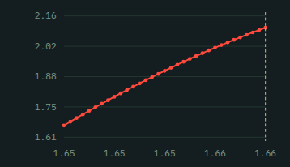

# UA-2 retained-history storage and exact metadata sharing

Updated 2026-11-02. **Long-history saving has a confirmed format/size problem.**
The full 5,281-state browser trajectory has been measured one segment at a time.
A new UI cache reuses exactly equal checkpoint metadata across continuations,
without changing physical fields, standalone checkpoints or ordinary JSON.
This reduces duplicate objects in retained histories; it does not solve the
ordinary-JSON archive limits.

| Complete retained-history measurement | Result |
|---|---:|
| Unique physical snapshots | 5,281 |
| Snapshot array alone, minified ordinary JSON | **4,221,782,122 bytes** |
| Project file limit | 67,108,864 bytes (64 MiB) |
| First snapshot count exceeding that limit | **84** |
| JSON values in the snapshot array | 66,379,113 |
| First count exceeding the 2,000,000-value guard | **160 snapshots** |
| Repeated restart-context / accepted-input JSON | 3,325,407,457 bytes |
| Distinct exact blocks for those two fields | 102; 32,165,160 bytes |

The snapshot-only counts are lower bounds for a full solution/project. They
follow the actual continuation rule: preceding snapshots retain their original
restart context, and repeated boundary snapshots are omitted. All 330 retained
segments are checked against their receipt hashes, all joins match, and every
time matches the audited 5,281-point grid. The whole trajectory is never loaded
into the sizing process. The largest measured segment takes 1.26 seconds;
process peak RSS is about 417 MiB, including transient decoding buffers.

The metadata figures are serialized-value sizes, **not a measurement of JS
heap savings**. The old worker already shares metadata within each response.
Ordinary JSON expands these references again. Even storing the two counted
metadata fields only once per distinct value leaves roughly 0.93 GB before
reference/index overhead and other root fields. A larger single JSON limit is
not an adequate long-history storage design.

The UI now shares exact metadata when receiving a cold time result, continuing
an existing history, or restoring an archived result. It also shares equal
`setup` objects between the context and accepted-method inputs. The cache is
bounded to 4,194,304 serialized-key characters; older entries can be evicted
without removing anything from a retained state. Per-response encoding caches
are released rather than retaining a large string for every source object.

Matching uses complete JSON-compatible values and key order, with signed zero
kept distinct. It uses no tolerance, numeric rounding, time-based reconstruction
or hash-only equality. Changed inputs and historical method fields remain
separate. Unsupported opaque values are left untouched. Computed metadata is
read-only, as with the existing worker sharing; exported standalone checkpoints
still own independent copies of all branches.

**All 330 segments serialize identically before/after sharing**, covering
5,610 records including the 329 repeated join states, or 5,281 unique states.
Every original input remains unchanged. Both endpoint checkpoints from each
segment also compare exactly: **660/660**. Consecutive root contexts reuse the
same object on **323/329** joins; the other contexts retain their differences.
All **24 focused tests** pass, covering archive checksums, legacy data, signed
zero, changed forcing, internal method states, cache eviction and independent
checkpoint copies. No scientific pass count or numerical tolerance changes.

The actual development app separately replays two complete browser segments
through the real continuation handler. It retains **33 snapshots**, reuses the
root context, selects the final physical state correctly and exports every
snapshot and inherited result field unchanged (30,156,209 pretty-printed bytes).
Desktop and 390 px mobile checks pass with no horizontal overflow or JavaScript
page errors. The geometry uses the app's software renderer.

That UI check uses a test-only worker adapter: small serial CPython jobs answer
model-inspection/distribution requests, and the recorded browser output answers
one continuation request. The request must match the ASW source, checkpoint
time and source-airflow numerical settings. No integration is rerun. A Vite-only
hook supplies the first retained segment; these hooks are absent from production.
This checks the UI consumer/continuation path, not current WASM startup. The
previous full-period built-worker scientific comparison remains separate.
The final replay finishes in 52.9 seconds.

Four earlier UI attempts remain recorded: two reached their wall caps and two
failed the equation-selection readiness guard. The harness now waits for the
same draft/inspection readiness required by the app and has a 180-second total
budget, with each inspection still capped at 30 seconds. No failed attempt is
counted as a pass. The short-segment time-axis rounding issue observed in the
previous UI report remains unchanged.

**Still required:** a versioned, chunked retained-history store and portable
archive, with bounded-memory loading, checksums, saving and export; integration
with plots, selection, playback, branching/restart and project undo; then actual
full-history browser memory and persistence tests. Preserve every physical and
method field, including internal BDF/Radau predecessors and distinct same-time
states. The existing 64 MiB and structural-size guards remain in place. Neither
UA family nor the full project is complete; native ASWING provenance remains
unresolved.

Evidence: [machine summary](isae-ua2-history-storage-20261102.json),
[sizing](../../artifacts/isae/ua2-history-storage-20261102/sizing.json),
[full exact-sharing audit](../../artifacts/isae/ua2-history-storage-20261102/sharing.json),
[app replay](../../artifacts/isae/ua2-history-storage-20261102/app-continuation.json),
[focused tests](../../artifacts/isae/ua2-history-storage-20261102/focused-tests-execution.json),
[metadata implementation](../../web/time-history-metadata.js),
[sizing script](../../scripts/measure-isae-ua2-history-storage.mjs),
[exact verifier](../../scripts/verify-isae-ua2-history-metadata.mjs), and
[UI replay harness](../../scripts/test-isae-ua2-history-sharing.mjs).
