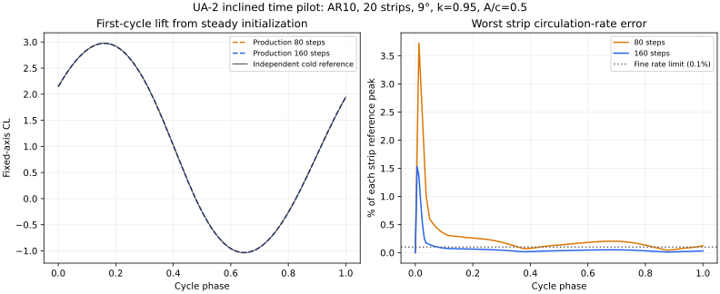

# UA-2: nonzero-incidence reference and production checks

Follow-up: the [controlled startup comparison](isae-ua2-incidence-nested-20261101.md) passes this physical case. This page retains its original grid results.

Updated 2026-11-01. **64/64 instantaneous-state checks pass**, spanning
20/40 strips, 5°/9°, k=0.475/0.95 and peak-to-peak A/c=0.5. Eight phases per
case are checked in both body and wind coordinates (128 production evaluations).
**0/1 first-cycle refinement checks pass** for the 20-strip, 9°, k=0.95 pilot. These are independently
implemented equation checks, not recovered native ASWING trajectories.

| Strips | Mean incidence | k | Maximum reference-method difference, fraction | Maximum vector-force coefficient error | Maximum residual error |
|---:|---:|---:|---:|---:|---:|
| 20 | 5° | 0.475 | 7.111e-10 | 3.331e-16 | 4.956e-14 |
| 20 | 5° | 0.95 | 1.658e-09 | 1.554e-15 | 6.479e-14 |
| 20 | 9° | 0.475 | 1.312e-09 | 4.441e-16 | 6.298e-14 |
| 20 | 9° | 0.95 | 9.579e-10 | 8.882e-16 | 7.732e-14 |
| 40 | 5° | 0.475 | 9.450e-09 | 4.441e-16 | 9.007e-14 |
| 40 | 5° | 0.95 | 9.896e-09 | 1.332e-15 | 1.153e-13 |
| 40 | 9° | 0.475 | 1.387e-09 | 1.110e-15 | 1.143e-13 |
| 40 | 9° | 0.95 | 6.476e-11 | 8.882e-16 | 1.388e-13 |

The [inclined-wing derivation](isae-inclined-wing-heave-reference.md) retains
finite-span bound-induced velocity, moving control-point direction, the
circulation-rate force and apparent-mass projection onto fixed lift axes.
The closed span integrals are independently derived from the horseshoes.
The nonzero steady circulation follows a direct finite-grid tangency solve.
Seven focused tests cover the zero-incidence limit, infinite-span section
limit, steady solutions, analytic Jacobian, coordinate rotation, off-solution
loads and the reference integrator's startup.

Each reference uses separate DOP853 and Radau cold and periodic integrations.
Their largest accepted difference is
**9.896e-09** of the relevant
peak, below the unchanged 1e-8 gate. Each strip's own peak is used for local
circulation and rate. The largest periodic closure fraction is
4.255e-13. The largest body/wind coordinate
discrepancy is 1.110e-15.

Instantaneous checks supply the independent circulation and rate to production
to isolate spatial residuals and loads. They do not themselves establish a
production time history or native solver parity. The following separate pilot
does evolve production circulation from production's own steady initial state.

## Production time-refinement pilot

| Nominal steps/cycle | Lift error | Worst strip circulation error | Worst strip rate error | First-step relative rate error |
|---:|---:|---:|---:|---:|
| 80 | 0.22262% | 0.47146% | 3.72439% | 14.759% |
| 160 | 0.05408% | 0.16818% | 1.52879% | 10.562% |

All 242 snapshots are audited, including startup, using the full forcing table
from the first step and preserving both BDF predecessors across 15 serial
16-step segments. Every segment converges without rejected steps. Failed time gates: circulation, circulation_rate, refinement.
Lift and each strip's circulation are normalized by their peak departure from
pre-motion steady values; rate uses each strip's peak. Fine errors must be
below 0.1%, fine/coarse ratios below 0.35, and nonlinear residuals below 1e-10.
The SA 3% tolerance is not used. Ratios for lift/circulation/rate are
0.2429, 0.3567, 0.4105.

The fine maximum residual is 9.947e-11;
initial circulation differs from the independent finite-grid steady solution
by at most 2.442e-14.
Maximum heave velocity error is 0.0025120 m/s;
maximum position error is 0.11337%
of heave amplitude. Motion and first-step relative-rate errors remain visible
diagnostics, without separate gates in this pilot. Solver time is
2.59–8.92 seconds per
segment (65.42 seconds total).

## Retained reference failures and scope

The first reference attempt let DOP853 choose an entire forcing period as its
first trial from equilibrium; the internal trial overflowed. The reference
now bounds trial steps while retaining adaptive error control. A subsequent
reporting-only list/array error is also retained. At 40 strips, 9°, k=0.475,
the original integration tolerances left a tip-rate method difference of
2.316e-8, above the 1e-8 limit. Tighter tolerances (1e-13 relative, 1e-15
absolute) resolve it. Both 40-strip 9° references use that tighter integration.
The original files, failed outcomes and frozen code are preserved; none of
these changes alter production equations or acceptance limits.

All 136 production Python files remain unchanged. Jobs run serially, use one
BLAS thread and have a 45-second cap. The previous 16/16 zero-incidence
first-cycle and 2/2 periodic checks remain intact. The 222 native UA-2 slots
remain blocked by unresolved archived-run provenance. This new first-cycle
pilot does not establish production periodic response at nonzero incidence,
time accuracy on the 40-strip mesh, stall, compressibility or browser/WASM
behavior. Broader conditions and the full project goal remain unfinished.

Evidence: [machine summary](isae-ua2-incidence-20261101.json),
[reference and load checks](../../artifacts/isae/ua2-incidence-20261101-r2),
[tighter references and selected-case provenance](../../artifacts/isae/ua2-incidence-20261101-r3),
[complete production histories and audit](../../artifacts/isae/ua2-incidence-time-20261101),
and [time audit implementation](../../scripts/audit-isae-ua2-incidence-time.py).
