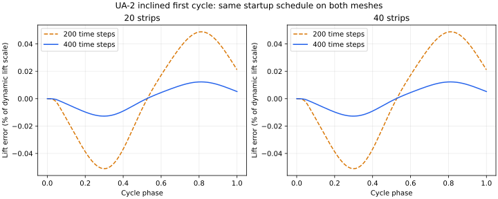

# UA-2: inclined time refinement at 40 strips

Updated 2026-11-01. **2/2 inclined time checks and
1/1 inclined mesh checks pass.** These cover one physical
condition on two meshes: AR10, 9° incidence, k=0.95, peak-to-peak A/c=0.5,
Mach zero and stall disabled. The 20-strip result is retained from the
[previous comparison](isae-ua2-incidence-nested-20261101.md).
All declared gates pass.

| Strips | Accepted time steps | Lift error | Worst strip circulation error | Worst strip rate error |
|---|---:|---:|---:|---:|
| 20 | 200 | 0.05113% | 0.09382% | 0.06433% |
| 20 | 400 | 0.01275% | 0.02341% | 0.01608% |
| 40 | 200 | 0.05112% | 0.09387% | 0.06433% |
| 40 | 400 | 0.01275% | 0.02343% | 0.01608% |

Errors use peak departures from the initial steady state for lift and each
strip's circulation, and each strip's peak for circulation rate. Production
starts from its own steady solution. The complete forcing table is present
before startup; checkpoint joins preserve the accepted state and BDF predecessor.
Both meshes use the same 200-step startup grid and its 400-step bisection.
No reference state is supplied to the production time march.

At 40 strips, the fine/coarse error ratios are
0.24936, 0.24959, 0.24995 for lift, circulation and rate.
The unchanged gates are 0.1% for each fine waveform and 0.35 for its refinement
ratio. First-step rate error is 0.12948%
(limit 1%); maximum velocity error is
0.01561% of peak heave velocity,
and position error is 0.04288% of
heave amplitude (limits 0.1% each). Maximum normalized nonlinear residual is
9.974e-11
(limit 1e-10). Every segment converges with zero rejected steps.

The maximum integrated lift change from 20 to 40 strips is
**0.04252%**, against a predeclared 0.1% limit.
The independently integrated equations give
0.04252%.
Both use the 40-strip dynamic lift scale at identical fine-grid times;
no strip interpolation is involved. Two meshes establish this measured
change, rather than a continuum error bound.

All 602 new raw snapshots and exact checkpoint joins are audited. The 38 jobs
run serially with one BLAS thread and a 45-second cap each. Solver time is
1.57–14.66 seconds per segment,
213.53 seconds total. The independent DOP853 and
Radau references agree within 6.797e-11 of the
relevant peak. All 136 production Python files and application defaults remain
unchanged. The earlier failed startup grids remain recorded in the linked report.

This verifies the [published inclined finite-wing equations](isae-inclined-wing-heave-reference.md).
It does not add native ASWING passes: all 222 UA-2 native comparison slots remain
blocked by archived-run provenance. Inclined production periodic response,
broader conditions, automatic time-step accuracy, stall and browser/WASM checks
remain unfinished. Neither UA family nor the full project is complete.

Evidence: [machine summary](isae-ua2-incidence-n40-20261101.json),
[raw data and receipts](../../artifacts/isae/ua2-incidence-n40-20261101),
[run setup](../../scripts/isae_ua2_incidence_n40.py), and
[all-snapshot audit](../../scripts/audit-isae-ua2-incidence-n40.py).
