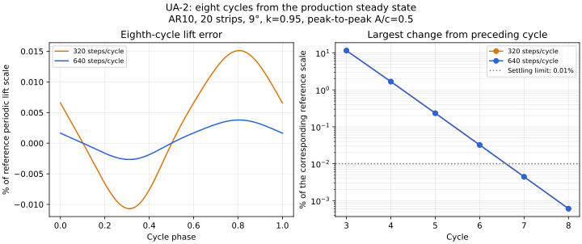

# UA-2: inclined periodic response

Updated 2026-11-01. **1/1 inclined periodic checks pass** at 20 strips,
9° incidence, k=0.95 and peak-to-peak A/c=0.5 on the reconstructed rigid AR10
wing. Mach is zero and stall is disabled. All declared gates pass.
This is a comparison with independently integrated published equations.
The 222 native ASWING comparisons remain blocked by archived-run provenance.

| Nominal steps/cycle | Periodic lift error | Worst strip circulation error | Worst strip rate error | Maximum position error, % heave amplitude |
|---|---:|---:|---:|---:|
| 320 | 0.01511% | 0.03365% | 0.01387% | 0.13847% |
| 640 | 0.00379% | 0.00845% | 0.00348% | 0.03491% |

Every production trajectory starts from its own steady equilibrium, with the
complete eight-cycle acceleration table present before startup. No periodic
reference state is supplied to production. The variable-step BDF2 equations
are the documented unsteady-theory Eqs. 123–128. The initial step is first order.
Checkpoint joins preserve the full accepted state and its BDF predecessor.
The coarse and fine grids have 2,640 and 5,280 accepted steps; every coarse
interval, including startup, is bisected to form the fine grid. Later cycles
share uniformly spaced phase samples.

The saved independent motion-only calculation predicted 0.1385% position error
at 320 nominal steps/cycle over eight cycles. This exceeds the existing 0.1%
fine-result limit, so the declared production comparison uses 320/640 grids.
The 320-step result is retained as the coarse result; no acceptance limit or
physical equation was changed. Event-window filtering now retains a terminal knot within rounding distance of the requested endpoint.

The fine fundamental amplitude error is
-0.001820%, phase error
0.001403°, and mean-lift error
0.000716% of the periodic dynamic lift scale.
The largest seventh-to-eighth-cycle change is
0.000605%.
Fine/coarse periodic lift/circulation/rate error ratios are
0.25058, 0.25101, 0.25074.
All cold-start samples are also checked: fine lift/circulation/rate errors
are 0.00331%, 0.00585%, 0.00402%.
First-step rate error is 0.01493%,
and maximum velocity error is 0.00391%
of peak heave velocity.

The gates retain the earlier inclined periodic limits: 0.1% for each cold and
periodic lift/circulation/rate waveform, 0.35 for fine/coarse error ratios,
0.1% fundamental amplitude error, 0.1° phase error, 0.1% dynamic-scale mean
error, 0.01% cycle change and 1e-10 normalized nonlinear residual. The inclined
startup motion gates also apply: first-step rate error below 1% of that sample,
velocity and position errors below 0.1% of their motion amplitudes. Every strip
uses its own reference scale. Periodic lift and circulation scales are peak
departures from their periodic means; cold scales use the pre-motion steady state.

Independent DOP853 and Radau cold and periodic references agree within
1.931e-11 of the relevant peak.
Each method uses its own previously verified periodic boundary for its reference
integration; both freshly computed periodic closures are below 1e-10.
Reference tolerances are 1e-13 relative and 1e-15 absolute. The independent
[inclined finite-wing derivation](isae-inclined-wing-heave-reference.md) is unchanged.

All **7,922 unique production snapshots** are audited.
All 107 completed serial segments converge with no rejected steps. Each runs
with one BLAS thread and a 45-second cap. Solver time is
2.88–20.41 seconds per segment,
1442.24 seconds total.
The fresh run's segment 42 hit its 45-second cap after reporting 102 accepted
steps. That incomplete attempt is retained and contributes no samples or pass
count. Recovery resumes the last complete checkpoint in 32-step jobs on the
same physical grid, retaining the full forcing and BDF predecessor. The raw
audit verifies every additional checkpoint join. Its numerical metrics and
acceptance limits are unchanged.
The only production change since the original attempt is the endpoint event-filter fix in forcing.py; the other 135 production files, physical equations, application defaults and accuracy limits are unchanged. The original fine-grid failure and its direct replay remain recorded in the [checkpoint repair](isae-ua2-time-endpoint-fix-20261101.md).

The [20/40-strip first-cycle comparison](isae-ua2-incidence-n40-20261101.md) remains
passing. The [40-strip periodic follow-up](isae-ua2-incidence-periodic-n40-20261101.md) now also passes all 18 applicable accuracy and mesh gates, with a periodic lift mesh change of 0.0495% below the 0.1% limit. These two meshes cover one condition. Broader conditions, full periodic browser/WASM verification, app time-accuracy behavior and native ASWING provenance remain unfinished. Neither UA family nor
the full project is complete.

The [checkpoint browser replay](isae-ua2-time-endpoint-wasm-20261101.md)
passes under Node WASM and in the built browser worker. Desktop/mobile startup
also passes, and the app and both download archives contain all 136 current
production modules. That one-step replay verifies the repair in the packaged
runtime; it does not establish full periodic browser accuracy.

Evidence: [machine summary](isae-ua2-incidence-periodic-20261101.json),
[references, raw histories and receipts](../../artifacts/isae/ua2-incidence-periodic-20261101-r1),
[setup](../../scripts/isae_ua2_incidence_periodic.py), and
[full raw-history audit](../../scripts/audit-isae-ua2-incidence-periodic-chunks.py), and
[serial audit runner](../../scripts/run-isae-ua2-incidence-periodic-audits.py).
