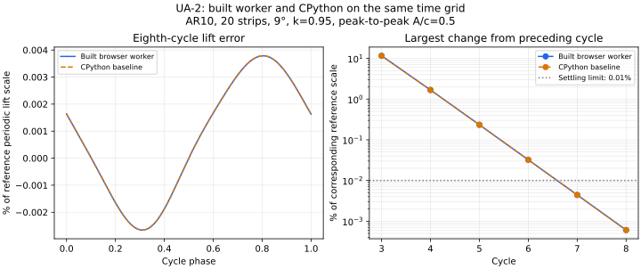

# UA-2: built-browser inclined periodic comparison

Updated 2026-11-01. **1/1 full-period built-worker checks pass.**
17/17 declared gates pass.
All gates pass.
This covers the actual built app worker through eight cycles on a reconstructed
rigid AR10 wing: 20 strips, 9° incidence, k=0.95, peak-to-peak A/c=0.5,
Mach zero and disabled stall. Native ASWING provenance remains unresolved;
the 222 native comparison slots remain blocked.

| Quantity | Full cold-history error | Eighth-cycle periodic error |
|---|---:|---:|
| Lift | 0.003305% | 0.003787% |
| Worst strip circulation | 0.005846% | 0.008446% |
| Worst strip circulation rate | 0.004018% | 0.003477% |

The maximum scaled difference from the completed CPython trajectory is
**5.162e-09**, below 2e-8. Compared fields are
fixed-axis lift, all force coefficients, per-strip circulation/rate and projected
heave velocity/position/acceleration. Each difference is normalized by
`max(1, abs(CPython value))`. The comparison uses identical times, without interpolation.

Production starts from its own browser-computed steady equilibrium with the
complete forcing table present. No reference or CPython state seeds production.
All **5,280 physical steps** and **5,281 unique snapshots** are retained.
The 330 serial 16-step requests preserve their full accepted state and BDF
history across every continuation join. At the final forcing cutoff, the
accepted BDF2 record retains both prior states while the history for a future
continuation is cleared. A passing startup pilot precedes the full runner; a new browser
invocation resumes the saved browser checkpoint. The worker persists between
requests within each invocation. Each worker request has a 45-second cap.
All numerical requests converge with no rejected steps. The original producer
exits 1 after its final solve because it incorrectly requires continuation
history at the forcing cutoff. Its 329 successful request receipts and the
[failed final receipt](../../artifacts/isae/ua2-incidence-periodic-browser-20261101/production/part329/receipt.json)
remain intact. A separate assessment verifies the retained final output without
recomputing any trajectory. It requires the exact terminal cutoff, the left-side
endpoint, cleared continuation history, and both prior states and coefficients
of the accepted BDF2 step. The Python baseline has the same cutoff behavior.
The original assertion is corrected only in this assessment and audit; all
physical accuracy gates are unchanged. Forty-two bounded raw-audit
batches verify every reported quantity, saved checkpoint and join before
the combined accuracy calculation.

The [10 focused checkpoint-verifier tests](../../artifacts/isae/ua2-incidence-periodic-browser-20261101/cutoff-validator-tests-execution.json) pass, including variable steps and rejection of invalid terminal or interior history. An earlier [combined regression command](../../artifacts/isae/ua2-incidence-periodic-browser-20261101/cutoff-combined-tests-execution.json) reached its 45-second cap and is not counted as a pass. The first offline assessment also [failed a bookkeeping check](../../artifacts/isae/ua2-incidence-periodic-browser-20261101/cutoff-assessment-attempt01-execution.json) by requiring a step order on its initial zero-step checkpoint; the corrected assessment applies the original producer's rule to newly integrated steps. These attempts remain recorded.

The first physical step is BDF1, followed by documented variable-step BDF2.
The grid has 640 nominal steps/cycle and refined startup, exactly matching the
[CPython study](isae-ua2-incidence-periodic-20261101.md). This verifies the browser
runtime on that grid; it makes no new temporal-order or spatial-refinement claim.
The [40-strip CPython spatial study](isae-ua2-incidence-periodic-n40-20261101.md)
provides the separate mesh comparison.

Periodic fundamental lift amplitude error is
-0.001820%, phase error
0.001403°, and mean-lift error
0.000716% of the periodic dynamic scale.
The largest seventh-to-eighth-cycle change is
0.000605%.
First-step rate error is 0.014932% of that
sample's continuous reference rate. Maximum velocity and position errors are
0.003907% of peak heave velocity and
0.034911% of heave amplitude.
The largest normalized nonlinear residual is 9.995e-11.

Sixteen applicable physical accuracy gates are unchanged from the CPython
study: 0.1% for each cold/periodic lift, circulation and rate waveform;
0.1% for amplitude, dynamic-scale mean and motion; 0.1° phase; 0.01% cycle
change; 1% first-step rate; and 1e-10 nonlinear residual. The seventeenth gate
checks CPython agreement. Cold scales use departures from initial steady;
periodic lift/circulation scales use departures from their periodic means.
Every strip has its own scale. Rate scales use peak absolute rates. The
previously verified DOP853/Radau references and their limits are unchanged.

All 136 loaded solver modules match the pinned source. The actual runtime is
Pyodide 314.0.7, Python 3.14.2,
NumPy 2.4.6 and SciPy 1.18.0.
The same source/runtime fingerprint is retained across all requests.
Recorded worker time is 6.43–35.45 seconds per
request, 3466.83 seconds summed over the 329 requests
with recorded worker timings. The final request has no saved worker timing
because the original assertion preceded that report write; its retained wall
time includes output processing. There are
2 runner invocations. Each invocation's first request includes
runtime initialization; every request includes checkpoint restoration and
result transport. These are bounded-validation timings, not an uninterrupted
solve benchmark. No production code, physical equation, default or acceptance
limit changed during this browser study.

6 successful process-tree memory samples, taken after
55–321 requests, measured **0.95–1.36 GiB** of proportional
resident memory (PSS) for Chromium and the test driver together. PSS allocates
shared pages proportionally across processes. These intermittent observations
are not a measured peak, a memory-leak test or a full-history UI measurement.
The [raw memory observations](../../artifacts/isae/ua2-incidence-periodic-browser-20261101/memory-observations.jsonl)
retain unsuccessful sampling attempts separately; missing measurements are
excluded from the range.

The sample after 321 requests also measured
0.27 GiB of proportional swapped pages.
The resident-memory figures above exclude swapped pages.

The worker uses the app's lossless compact transport. The validation harness
saves one segment at a time to bound resident history. It therefore does
**not** establish that the full trajectory can be retained, plotted and
manipulated in the UI on a phone. Full-history UI memory/rendering, broader
conditions, arbitrary-model time-step accuracy and native ASWING provenance
remain unfinished. Neither UA family nor the full project is complete.

Evidence: [machine summary](isae-ua2-incidence-periodic-browser-20261101.json),
[raw audit](../../artifacts/isae/ua2-incidence-periodic-browser-20261101/assessment/audit.json),
[cutoff assessment](../../artifacts/isae/ua2-incidence-periodic-browser-20261101/assessment/assessment.json),
[original producer exit](../../artifacts/isae/ua2-incidence-periodic-browser-20261101/production-execution.json),
[frozen plan](../../artifacts/isae/ua2-incidence-periodic-browser-20261101/plan.json),
[pilot verification](../../artifacts/isae/ua2-incidence-periodic-browser-20261101/pilot-verification.json),
[built-worker runner](../../scripts/run-isae-ua2-periodic-browser.mjs),
[auditor](../../scripts/audit-isae-ua2-periodic-browser-cutoff.py), and
[serial audit supervisor](../../scripts/run-isae-ua2-periodic-browser-cutoff-audits.py).
