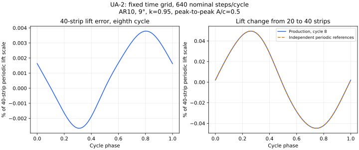

# UA-2: inclined periodic spatial refinement to 40 strips

Updated 2026-11-01. **1/1 new inclined periodic cases
and 1/1 periodic mesh checks pass.**
18/18 predeclared gates pass.
All gates pass.
The reconstructed rigid AR10 wing uses 9° incidence, k=0.95, peak-to-peak
A/c=0.5, Mach zero and disabled stall. This compares independently integrated
published equations; the 222 native ASWING slots remain blocked by archived-run
provenance.

| Quantity | Full cold-history error | Eighth-cycle periodic error |
|---|---:|---:|
| Lift | 0.003305% | 0.003787% |
| Worst strip circulation | 0.005850% | 0.008447% |
| Worst strip circulation rate | 0.004019% | 0.003477% |

| Mesh comparison | Production lift change, 20 to 40 strips | Independent reference change |
|---|---:|---:|
| Full cold history | 0.043245% | 0.043246% |
| Eighth cycle / periodic reference | 0.049512% | 0.049514% |

Errors use the 40-strip reference scales: departures from the initial steady
state for the cold history, and from the periodic mean for periodic lift and
circulation. Each strip has its own scale. Rate scales are their respective
peak absolute rates. Both mesh gates retain the existing 0.1% limit.
Only integrated fixed-axis lift is compared between meshes; strip states are
not interpolated.

The time grid is exactly the fine grid from the
[20-strip study](isae-ua2-incidence-periodic-20261101.md): 640 nominal steps/cycle
with refined startup, 5,280 physical steps over eight cycles. Production starts
from its own steady equilibrium with the complete forcing table present.
All 330 serial jobs preserve the accepted state and BDF predecessor; every
checkpoint join and all 5,281 unique snapshots are audited in 42 bounded batches.
The first physical step is first order, followed by variable-step BDF2.
This is a spatial refinement at fixed temporal resolution. It makes no new
40-strip temporal-order claim. Time-refinement evidence remains in the preceding
20-strip periodic and [40-strip first-cycle](isae-ua2-incidence-n40-20261101.md) studies.

The fundamental lift amplitude error is
-0.001822%, phase error
0.001402°, and mean-lift error
0.000716% of the periodic dynamic scale.
The largest seventh-to-eighth-cycle change is
0.000601%.
First-step rate error is 0.058547% of that
sample's reference rate. Maximum velocity and position errors are
0.003907% of peak velocity and
0.034911% of heave amplitude.
The largest normalized nonlinear residual is 9.992e-11.

The 16 applicable single-grid gates are unchanged: 0.1% for cold and periodic
lift/circulation/rate waveforms, amplitude, dynamic-scale mean lift and motion;
0.1° phase; 0.01% cycle change; 1% first-step rate; and 1e-10 normalized residual.
The two additional mesh gates use 0.1%. No failed check is removed or retuned.

Independent DOP853 and Radau integrations agree within
1.654e-10 of the relevant peak, below
the unchanged 1e-8 agreement limit. Both use relative/absolute tolerances
1e-13/1e-15. Their exact samples are used without time interpolation.
The [inclined-wing derivation](isae-inclined-wing-heave-reference.md) is unchanged.

All completed production jobs converge without rejected steps. Each uses one
BLAS thread and a 45-second cap. Recorded solver time is
2.51–9.73 seconds per
16-step segment, 1420.61 seconds summed across jobs.
These timings include repeated setup; they are not an uninterrupted-run benchmark.
No production code, equation, application default or acceptance limit changed
in this spatial study. The earlier endpoint repair remains in place.

Broader frequency/incidence/amplitude coverage, full periodic browser validation,
arbitrary-model time-step accuracy and native ASWING provenance remain unfinished.
The existing [built-browser checkpoint replay](isae-ua2-time-endpoint-wasm-20261101.md)
covers one continuation step. Neither UA family nor the full project is complete.

Evidence: [machine summary](isae-ua2-incidence-periodic-n40-20261101.json),
[raw audit](../../artifacts/isae/ua2-incidence-periodic-n40-20261101/audit.json),
[predeclared plan](../../artifacts/isae/ua2-incidence-periodic-n40-20261101/production-plan.json),
[reference verification](../../artifacts/isae/ua2-incidence-periodic-n40-20261101/reference-verified.json),
[serial runner](../../scripts/run-isae-ua2-periodic-n40.py), and
[auditor](../../scripts/audit-isae-ua2-periodic-n40.py).
