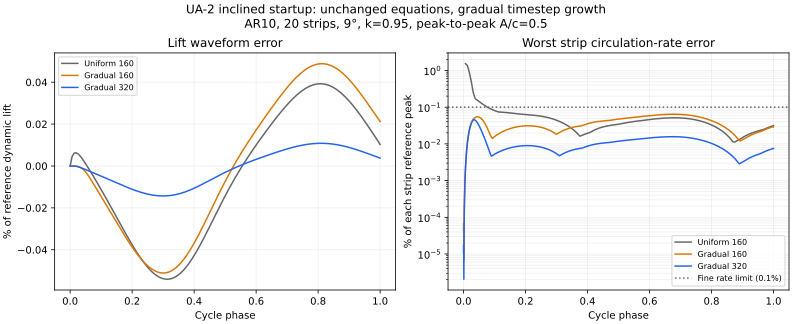

# UA-2: resolving inclined-wing startup time error

Follow-up: the [controlled startup comparison](isae-ua2-incidence-nested-20261101.md) passes this physical case. This page retains its original grid results.

Updated 2026-11-01. **0/1 inclined first-cycle checks pass** for the 20-strip AR10 wing at 9°,
k=0.95 and peak-to-peak A/c=0.5. Failed gates: refinement. The
[original uniform-grid pilot](isae-ua2-incidence-20261101.md) remains saved,
including its failed circulation/rate limits. This follow-up uses the same
production equations and existing variable-step BDF implementation, with
a prescribed gradual startup grid already used in the zero-incidence UA-2 tests.

| Time grid | Lift error | Worst strip circulation error | Worst strip rate error | First-step relative rate error | Max position error, % heave amplitude |
|---|---:|---:|---:|---:|---:|---:|
| Uniform 160 | 0.05408% | 0.16818% | 1.52879% | 10.5624% | 0.11337% |
| Gradual 160 | 0.05113% | 0.09382% | 0.06433% | 0.0657% | 0.17192% |
| Gradual 320 | 0.01431% | 0.02551% | 0.04557% | 0.0329% | 0.04713% |

The first step is nominal dt/256. Subsequent increments grow by at most 1.125
until reaching the nominal dt. The 160/320 nominal grids have 200/360 accepted
steps, respectively. The complete forcing table is present before the first
step. Every checkpoint preserves the accepted state and BDF predecessor;
only the initial step is first order. No analytic circulation or periodic
initial state is supplied to production.

All **562 unique snapshots** and all 36 serial segments are audited. Each
segment has at most 16 steps. Every solve converges without rejected steps.
The first-cycle check counts one physical case; it does not add a second
case for replacing the failed uniform-grid calculation.

The original waveform gates remain: fine lift and each strip's circulation
and rate error below 0.1%, with fine/coarse ratios below 0.35 and normalized
nonlinear residuals below 1e-10. Lift/circulation are normalized by their
departures from pre-motion steady values; rate uses each strip's own peak.
Additional gates were declared before these runs: first-step rate error below
1% of that sample's reference, maximum velocity error below 0.1% of peak
heave velocity, and maximum position error below 0.1% of heave amplitude.
No tolerance was relaxed.

The fine/coarse lift/circulation/rate ratios are
0.2800, 0.2719, 0.7085. Fine velocity error is
0.0006754 m/s, or
0.01422% of peak velocity.
Maximum residual is 9.797e-11.
The initial circulation matches the independent steady finite-wing solution
within 2.420e-14.

The independent [inclined finite-wing equations](isae-inclined-wing-heave-reference.md)
are integrated by DOP853 and Radau at every requested time. Their largest
difference is 2.056e-11 of the relevant
peak, below the unchanged 1e-8 reference gate. Tight reference tolerances are
1e-13 relative and 1e-15 absolute. At the fine first step, the two reference
rates agree within 7.919e-08% of that sample's
own local rate. Production uses its own nonlinear solves.

Solver time is 1.41–12.90
seconds per segment, totaling 154.75 seconds.
All jobs are serial, single-threaded and capped at 45 seconds each.
All 136 production Python files and application defaults remain unchanged.
This result demonstrates the effect of resolving startup in this verification
case; arbitrary-model automatic step selection is still unfinished.

The accompanying 64/64 inclined instantaneous checks and eight independent
reference pairs remain passing. Earlier zero-incidence UA-2 results are
unchanged. Production periodic response at nonzero incidence, 40-strip time
refinement, broader amplitudes/frequencies, stall and browser/WASM verification
remain incomplete. The 222 native UA-2 comparisons remain blocked by unresolved
archived-run provenance. Neither this family nor the full project goal is complete.

Evidence: [machine summary](isae-ua2-incidence-startup-20261101.json),
[full grids, reference, raw histories and receipts](../../artifacts/isae/ua2-incidence-startup-20261101),
[startup-grid setup](../../scripts/isae_ua2_incidence_startup.py), and
[all-snapshot audit](../../scripts/audit-isae-ua2-incidence-startup.py).
