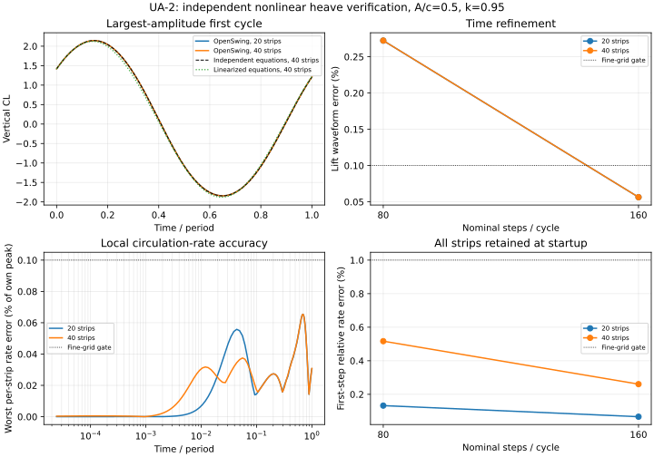

# UA-2: independent nonlinear finite-amplitude verification

Updated 2026-11-01. **Two time-refinement checks and one mesh-stability check
pass** for the largest published amplitude, A/c=0.5, at k=0.95. Four complete
first-cycle trajectories cover 20/40 strips and 80/160 nominal steps per cycle.
All **644 unique snapshots** are audited against an independently implemented
straight-wing equation reference. Native UA-2 ASWING agreement remains unverified.

| Strips | Coarse lift error | Fine lift error | Fine circulation error | Fine rate waveform error, per-strip peak | Fine first-step relative rate error |
|---:|---:|---:|---:|---:|---:|
| 20 | 0.27231% | 0.05639% | 0.09067% | 0.06541% | 0.06641% |
| 40 | 0.27234% | 0.05640% | 0.09067% | 0.06542% | 0.26059% |

Lift and circulation waveform errors are maximum absolute errors divided by
their respective reference peaks. Rate error is normalized separately by each
strip's own reference peak, then maximized across all strips and times. The
first-step column instead uses each strip's reference rate at that accepted
instant. Every strip and time sample is retained.

The predeclared gates require fine lift and per-strip rate waveform errors
below 0.1%, first-step relative rate error below 1%, and lift-error reduction
below 0.35 when halving the maximum timestep. The observed reduction is
0.2071 on both meshes. Coarse-grid errors remain visible and exceed the
fine-grid accuracy requirement. Doubling the strip count changes the fine
lift waveform by **0.04570%**, below the separately declared 0.2% mesh gate.
The independent reference predicts a nearly identical **0.04572%** mesh change.
This is a two-grid stability check, not proof of the spatial continuum limit.

Unlike the earlier small-signal study, the new reference does not obtain its
spatial matrices from production residuals. The
[documented derivation](isae-straight-wing-heave-reference.md) integrates each
finite bound vortex and both semi-infinite trailing legs independently, then
uses Drela's circulation-lag and instantaneous load equations. Two constant
scalar spanwise influence matrices suffice for this straight geometry; their
physical directions rotate with the incident wind. The lag and rate-lift terms
retain the circulation-dependent speed at the bound vortex. This is neither
a frozen-wind calculation nor a constant small-signal approximation.

Eight targeted tests pass. They compare the closed integrals with direct
Biot–Savart quadrature, independently generated node/sample coordinates with
production geometry, and nonlinear residuals and loads at finite positive and
negative heave velocities. Off-solution circulation rates also check the
residual sign and tangency-squared force. The small-signal limit agrees with
the previous production matrices. A mesh-refinement check covers the continuous
elliptical-downwash limit without applying any correction to the discrete model.

The independent reference is integrated with both DOP853 and Radau at
rtol=1e-11 and atol=1e-13. Maximum inter-method differences are **1.36e-12 of
peak lift**, **6.53e-11 of each strip's peak circulation**, and **8.62e-10 of each strip's
peak rate**. Both meshes satisfy the declared 1e-8 agreement gate. The nonlinear
lift waveform differs from its linearized approximation by **4.51% of peak**,
well above the measured production timestep error. That difference is retained
as finite-amplitude behavior, not fitted away or treated as native-output error.

Settings retain the reconstructed full AR10 rigid wing, unit chord, V=10,
zero mean incidence, Mach zero, gravity zero and stall disabled. A is peak-to-peak
displacement. Both time grids begin at `dt_max/256` and grow by at most 1.125.
Nominal 80/160 grids contain 120/200 accepted steps after startup refinement.
This explicitly selected schedule follows the documented variable-step BDF
coefficients and leaves app defaults unchanged.

Each of the 22 serial jobs advances at most 32 steps. Checkpoints retain the
full original forcing and BDF predecessor. Forces, circulation and circulation
rate have zero observed jumps at all joins; no additional cold starts are
introduced. All jobs finish in **1.94–21.79 seconds**, with no rejected steps,
timeouts or retries. Total solver time is 226.48 seconds. Maximum normalized
residual is 9.943e-11, below the unchanged 1e-10 tolerance. All 136 production
files remain unchanged.

Two development test expectations were corrected and retained in the
[development record](../../artifacts/isae/ua2-nonlinear-20261101/development-findings.json).
The first imposed an arbitrary lower bound larger than the actual induced-speed
change. The second incorrectly required a finite sampled elliptical distribution
to equal its continuous downwash limit exactly. The final test checks mesh
convergence. Neither correction changed a production equation, numerical gate
or the independent vortex integrals.

Evidence: [machine summary](isae-ua2-nonlinear-20261101.json),
[full trajectories, execution receipts, both ODE references and frozen sources](../../artifacts/isae/ua2-nonlinear-20261101),
[segment driver](../../scripts/verify-isae-ua2-nonlinear-segment.py),
[serial runner](../../scripts/run-isae-ua2-nonlinear.py), and
[complete-trajectory auditor](../../scripts/audit-isae-ua2-nonlinear.py).

Other finite amplitudes/frequencies, nonzero mean incidence and periodic 3D
response remain unfinished. The independent implementation checks this specific
discretization of Drela's documented approximation; it does not supply missing
native model/driver provenance or validate arbitrary geometry. All 222 native
UA-2 comparison slots remain blocked. Browser/WASM verification and the full
project goal remain unfinished.
