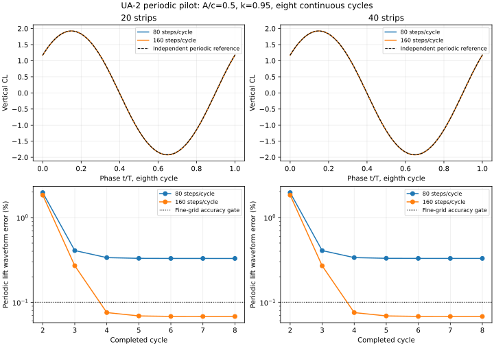

# UA-2: nonlinear periodic-response pilot

Updated 2026-11-01. **2/2 periodic-response checks and 1/1 mesh check pass**
for A/c=0.5, k=0.95, on the reconstructed rigid rectangular AR10 wing. Four
continuous cold-start trajectories run for eight cycles on 20/40 strips at
nominal 80/160 steps per cycle. **All 4,004 unique snapshots are audited.**
This extends the [first-cycle grid](isae-ua2-amplitude-grid-20261101.md).
Native ASWING parity and complete UA-2 validation remain unfinished.

| Strips | Coarse / fine lift waveform error | Fine local rate error | Amplitude error | Phase error | Mean error, % peak | Last-cycle change |
|---:|---:|---:|---:|---:|---:|---:|
| 20 | 0.32925% / 0.06799% | 0.05916% | -0.02792% | +0.02348° | +0.014487% | 0.000067% |
| 40 | 0.32922% / 0.06799% | 0.05916% | -0.02794% | +0.02348° | +0.014481% | 0.000066% |

Lift waveform errors are maximum absolute differences divided by the periodic
reference peak. Local circulation-rate errors use each strip's own reference
peak. Amplitude and phase describe the fundamental harmonic; mean error is
normalized by peak lift because the reference mean is zero. Every cycle includes
both endpoints. Doubling the strip count changes the final fine-grid waveform
by **0.04672%**, below the 0.2% mesh gate. This checks stability over two
meshes; the spatial continuum limit remains unverified.

| Strips | Reference fundamental CL amplitude | Reference phase | Third / first harmonic amplitude |
|---:|---:|---:|---:|
| 20 | 1.94342373 | 306.413453° | 1.04194% |
| 40 | 1.94416182 | 306.398685° | 1.04256% |

The phase convention is `Re(H exp(i omega t))`, with displacement
`z=(A/2) cos(omega t)` and phase wrapped to 0–360°. The reference retains the
finite-amplitude higher harmonics; the mean and second harmonic are zero to
the independent integration accuracy.
Fine third-harmonic amplitude errors are -0.24460% to -0.24435%,
and phase errors are +0.00777° to +0.00777°.
These supplementary diagnostics add no pass count; the declared acceptance
gates below cover the fundamental and complete waveforms.
Fine periodic circulation errors are 0.14773–0.14774% of the
reference circulation peak, with fine/coarse ratios 0.1986–0.1986.
These circulation errors are larger than the lift/rate errors and are retained
as a separate diagnostic; the predeclared pass gates do not impose a 0.1%
circulation-value limit. The machine summary also retains full-history
circulation errors and prescribed-motion velocity/position errors.
Maximum prescribed-motion velocity error is 0.002957, or
0.0622% of peak heave velocity. Maximum position error is
0.001365 chords, or 0.5462% of heave displacement amplitude.
These are measured against the ideal prescribed motion throughout all eight
cycles and remain explicit diagnostics; passing lift/rate checks does not
establish the same relative accuracy for every state variable.

The unchanged numerical gates require fine periodic lift and per-strip rate
errors below 0.1%, amplitude error below 0.1%, phase error below 0.1°, mean error
below 0.1% of peak, and final cycle-to-cycle change below 0.01% of peak. Fine/coarse
error ratios must be below 0.35. Full-history lift/rate errors and first-step
local-rate accuracy are checked separately against the cold reference. Coarse
results that exceed the fine-grid accuracy gates remain visible. These gates
do not inherit the provisional SA 3% tolerance.

The [independent straight-wing equations](isae-straight-wing-heave-reference.md)
retain bound-vortex speed, wind-aligned horseshoes, nonlinear circulation lag,
circulation-rate lift and apparent mass. A periodic boundary is obtained by
converging the nonlinear one-period map until relative circulation change is
below 1e-11. DOP853 and Radau each independently integrate the complete cold
history and converge this boundary. Their largest difference is 1.62e-09
of the relevant reference peak, below the unchanged 1e-8 agreement gate.
The periodic reference verifies closure, half-cycle lift antisymmetry and zero
mean. A 5,120-interval quadrature measures its harmonics; no fitted span factors
are used. The production runs start with zero circulation and receive no periodic
initial state or subsequent state correction.

Startup uses a geometric ramp whose total duration is exactly eight nominal
timesteps. Its first step is no larger than dt/256, growth is at most 1.125,
and it joins the uniform cycle lattice smoothly. This avoids the abrupt step
increase that would follow appending cycles to the earlier first-cycle grid's
short closing interval. Each trajectory has 40 extra startup steps, giving
680/1,320 accepted steps for nominal 80/160 resolution over eight cycles.
The complete forcing table is present from the first job. Checkpoints preserve
the original table and BDF predecessor. All snapshots, including startup, are
checked against the cold solution; phase-aligned periodic diagnostics use
cycles 2–8. There are no force, circulation or rate jumps at checkpoint joins.

Six focused tests pass: smooth grid alignment, the linear complex-matrix limit,
finite-amplitude two-method agreement and half-cycle symmetry, rejection of an
incomplete reference cycle, and complete cold-start forcing. Production files,
solver tolerances and app defaults are unchanged. Solver time for the
169 accepted serial segments is 1.60–22.11 seconds each,
totaling 1265.97 seconds. Their complete worker wall times, including
imports and artifact handling, are 6.41–39.65 seconds,
totaling 2681.02 seconds. Each numerical job is capped at 45 seconds
and uses one BLAS thread.

The original first fine 40-strip segment reached the 45-second cap after its
last progress record reported 22 accepted steps at 33.04 seconds. Its terminal
exit code was 124, and process inspection confirmed it had stopped. That
incomplete attempt remains preserved and is excluded from accepted histories.
The same cold trajectory was restarted with 16-step segments, preserving its
time grid, forcing, equations and tolerances. The other three trajectories
reuse all 86 original segments with their raw hashes unchanged. The recovery
adds 83 successful segments. It changes only process boundaries and preserves
the BDF predecessor; it introduces no restart within an accepted trajectory.

The saved-only full 40-strip audit also reached its 45-second cap, without
producing an audit output. Its terminal receipt is retained. Separate coarse
and fine grid audits then cover the same complete histories, and a checked
combination applies the original refinement gates. No production solve is
repeated for this audit split. The auditor retains only measured fields in
memory between segment reads; every original sampled time is still checked,
and all full raw artifacts remain unchanged.

Evidence: [machine summary](isae-ua2-periodic-20261101.json),
[plans, full trajectories, reference solutions, audits and frozen sources](../../artifacts/isae/ua2-periodic-20261101),
[periodic reference](../../scripts/isae_ua_wing_periodic.py), and
[independent history audit](../../scripts/audit-isae-ua2-periodic-compact.py).

Remaining work includes other periodic amplitudes/frequencies, nonzero mean
incidence, and native setup provenance. The current specialization has Mach
zero, no stall, no structural deformation and no bodies or propulsion. All
222 native UA-2 slots remain blocked. Browser/WASM verification, broader model
coverage and the full project goal remain unfinished.
