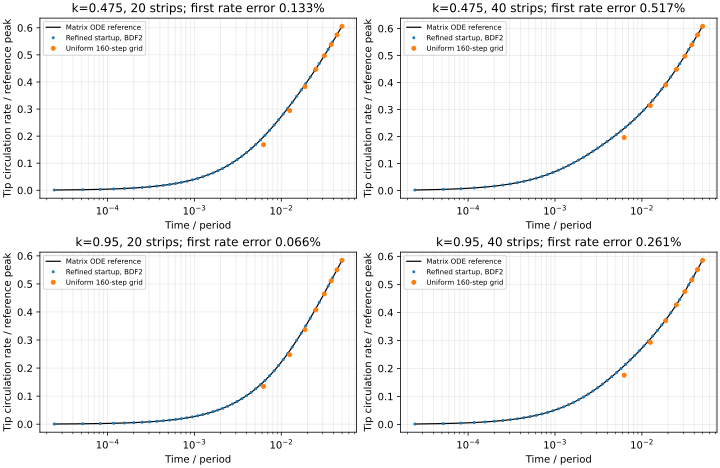

# UA-2: resolving local startup rates with temporal refinement

Updated 2026-11-01. **Four local startup-accuracy checks pass**, covering both
20/40-strip meshes and k=0.475/0.95. An independent ODE integration audits all
804 unique snapshots. The earlier large first-step errors are controlled by
refining the time grid, with no change to the production equations or solver
tolerance. This remains a reconstructed, small-amplitude integration check;
native UA-2 ASWING provenance and complete unsteady validation are unfinished.

| k | Strips | Uniform-grid first-step rate error | Refined first-step rate error | Refined maximum rate waveform error, per-strip peak | Refined lift waveform error |
|---:|---:|---:|---:|---:|---:|
| 0.475 | 20 | 14.673% | 0.133% | 0.0505% | 0.0691% |
| 0.475 | 40 | 14.724% | 0.517% | 0.0503% | 0.0691% |
| 0.950 | 20 | 10.639% | 0.066% | 0.0635% | 0.0502% |
| 0.950 | 40 | 16.064% | 0.261% | 0.0566% | 0.0502% |

First-step error is relative to each strip's reference rate at its first
accepted time; the table gives the maximum across strips. The uniform and
refined first steps occur at different times. Rate waveform error is the
maximum absolute error at any saved time, normalized by the reference peak
of that same strip over the complete cycle, then maximized across strips.
The corresponding uniform-grid rate waveform errors were 2.899%, 3.389%,
1.606% and 3.365%. No near-tip samples are removed or normalized by the much
larger midspan peak.

The declared gates require first-step relative rate error below **1%**, every
strip's peak-normalized rate waveform error below **0.1%**, and total-lift
waveform error below **0.1%**. All four cases pass without relaxing these gates.

The [unsteady description](../../.reference/asw_uns_theory.txt), §12.1,
Eqs. 123–125, explicitly gives variable-step backward differences. Production
already implements these coefficients. The diagnostic starts at `dt_max/256`
and grows step lengths by at most 1.125 until reaching the original
`dt_max=T/160`. It uses 200 steps per cycle. Smooth forcing-table knots impose
the time grid; the cosine acceleration is exact at every accepted knot.
The equations, initial conditions and maximum timestep are unchanged.
This schedule is a chosen accuracy refinement, not a claimed native ASWING
default or a new automatic step controller.

To keep numerical jobs short, each trajectory is split after step 32 and
continued through the existing checkpoint API. The entire original forcing
table and BDF predecessor are retained. All post-checkpoint steps remain BDF2;
there is no added cold start or forcing cutoff. Forces, circulation and
circulation rate have **zero observed jump** at the four joins. The eight
numerical segments take **20.13–26.10 seconds each**, with no rejected steps
and maximum normalized residual **9.45e-11**, below the unchanged 1e-10
tolerance. Work remains serial, with one BLAS thread and a 45-second process cap.

The comparison uses the full coupled 3D K/M matrices from the
[earlier UA-2 study](isae-ua2-time-20261101.md), integrated independently with
DOP853 over the complete cycle. It shares production spatial physics and
therefore verifies temporal accuracy, not independent 3D aerodynamic truth
or native ASWING output. Settings remain AR10, unit chord, V=10, zero mean
incidence, A/c=0.001, Mach zero and stall disabled.

The retained trials explain why both initial step and subsequent growth matter.
Reducing only the first step by 32 while allowing growth 1.5 leaves 3.68%
first-step rate error and 0.349% per-strip waveform error. At subdivision 256
and growth 1.2, the 40-strip case passes, but the 20-strip case still has
0.120% waveform error. Tightening growth to 1.125 resolves all four cases.
These are temporal refinements; no aerodynamic correction factors are fitted.

The work also corrected a validation-output bottleneck. One completed solve
reached the process cap while the old JSON writer was saving its large
checkpointed trajectory; the incomplete gzip is retained. The new writer
encodes one snapshot at a time with the C JSON encoder and publishes the final
filename only after the gzip closes. An interrupted write keeps a `.partial`
suffix. A complete 168-snapshot history was re-encoded in **1.41 seconds**,
with every field verified by a semantic SHA-256 comparison. Segment persistence
takes 0.16–1.47 seconds. This improves validation artifact writing; it is not
a browser-performance measurement. The interrupted case was repeated only
after this lossless writer correction.

An initial resume request was rejected before time marching because it
redundantly supplied a condition already owned by its checkpoint. The corrected
driver uses that checkpoint condition. Both the failed request and its original
producer driver are retained; all production and model hashes stay unchanged.

Sixteen targeted tests pass. They cover variable-step polynomial consistency,
the forcing table across a checkpoint boundary, local-rate normalization,
lossless checkpoint serialization, incomplete-file handling, and the earlier
matrix-reference checks. All 136 production files retain their previous hashes.

Evidence: [machine summary](isae-ua2-startup-20261101.json),
[all trials, segmented trajectories and source snapshots](../../artifacts/isae/ua2-startup-20261101),
[segment driver](../../scripts/verify-isae-ua-startup-segment.py),
[independent auditor](../../scripts/summarize-isae-ua-startup.py),
[startup grid and metrics](../../scripts/isae_ua_startup.py),
[bounded trajectory writer](../../scripts/isae_ua_artifacts.py),
and [permanent tests](../../tests/test_isae_ua_startup.py).

The uniform-grid baseline and app defaults remain unchanged. The refined grid
demonstrates how to resolve the sampled startup transient; it does not establish
an automatic error-control policy for arbitrary models. The later
[nonlinear study](isae-ua2-nonlinear-20261101.md) independently derives the spatial
equations and passes two time-refinement and one mesh check at A/c=.5, k=.95.
Other finite amplitudes, periodic response, broader frequencies/incidences and
trustworthy native UA-2 comparisons remain unfinished. Browser/WASM verification and a
bundle refresh are still pending. The full project goal remains active.
