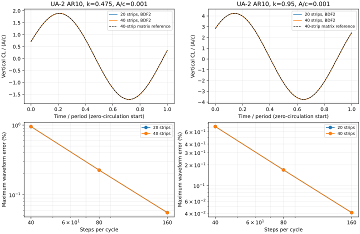

# UA-2: coupled 3D prescribed-heave time verification

Updated 2026-11-01. **Four lift timestep-refinement checks and two mesh-stability
checks pass.** Twelve production time runs complete, with all 1,132 snapshots
audited against a separate integration of the coupled 3D matrices. This verifies
time integration for a reconstructed AR10 wing. It does not establish native
ASWING agreement or complete UA-2 validation; all 222 native comparison slots
remain blocked by the [source-provenance issue](isae-ua-harmonics-20261101.md).

The later [startup-resolution study](isae-ua2-startup-20261101.md) passes four
additional local-rate checks with explicit variable-step refinement. It retains
the uniform-grid baseline below and does not change app defaults.

| Reduced frequency k | Strips | Error, 40 steps/cycle | Error, 80 steps/cycle | Error, 160 steps/cycle | Result |
|---:|---:|---:|---:|---:|---|
| 0.475 | 20 | 0.95240% | 0.22608% | 0.05557% | Pass |
| 0.475 | 40 | 0.95234% | 0.22606% | 0.05557% | Pass |
| 0.950 | 20 | 0.71357% | 0.16916% | 0.04101% | Pass |
| 0.950 | 40 | 0.71368% | 0.16919% | 0.04102% | Pass |

Errors are maximum absolute vertical-CL differences over the first cycle,
normalized by the maximum absolute reference CL. The declared gates require
each timestep-halving error ratio below 0.35 and the finest error below 0.1%.
Observed ratios are 0.237–0.246, consistent with second-order convergence.
These thresholds do not inherit the provisional SA 3% policy.

Doubling the spanwise mesh changes the fine-time-grid lift waveform by
**0.04945% at k=0.475** and **0.04471% at k=0.95**. Both satisfy the separately
declared 0.2% mesh-stability gate. Exact-matrix histories have nearly identical
mesh changes. This is stability across two meshes, not proof of the spatial
continuum limit.

The reference centrally differentiates the production aerodynamic residual
and vertical force to form the full coupled system

`K Γ + M Γ̇ + rv w + ra z̈ = 0`,

`CL = fg Γ + fd Γ̇ + fv w + fa z̈`.

The spatial matrices include spanwise induced-velocity coupling, the documented
circulation lag, circulation-rate force and apparent mass. They are assembled
once per mesh. Matrix-exponential propagation of an augmented circulation,
sine and cosine state provides the startup reference. A separate DOP853 ODE
integration audits every saved time; the largest CL disagreement between these
two reference integrations is **6.43e-15**. The reference shares production
spatial physics and therefore cannot independently validate those spatial
equations or substitute for native ASWING output.

The production runs use the existing JSON time action, source moving-airflow
operator and Euler/BDF2 temporal policy. Settings are a rigid unit-chord wing,
full AR10, V=10, zero mean incidence, Mach zero, stall disabled and peak-to-peak
`A/c=0.001`. Motion starts at `z=A/2`, with zero circulation and vertical
velocity. Exact cosine accelerations are supplied at the requested BDF knots;
the solver integrates the motion. Forces use the fixed plunge direction and
freestream dynamic pressure. The original paper's semi-AR5 supports this
[AR10 reconstruction](isae-ua-primary-sources-20261101.json); the native deck,
root-wall treatment and modified motion driver remain unavailable.

The local fields are less resolved at startup than integrated lift:

| k | Strips | Finest circulation error, % of waveform peak | Finest circulation-rate error, % of waveform peak | Rate error relative to the affected local value |
|---:|---:|---:|---:|---:|
| 0.475 | 20 | 0.09875% | 0.47146% | 14.67% |
| 0.475 | 40 | 0.09872% | 0.41728% | 11.50% |
| 0.950 | 20 | 0.07803% | 0.34296% | 10.64% |
| 0.950 | 40 | 0.07802% | 0.35901% | 16.06% |

Every maximum rate error occurs at the first Euler startup step, near a tip,
at 1/160 of a cycle on the finest grid. These errors decrease with timestep
refinement, but are not covered by the passing integrated-lift gate. The JSON
retains the affected strip, time, predicted value and reference value. The later
[startup-resolution study](isae-ua2-startup-20261101.md) resolves these sampled
local-rate errors by refining the time grid; no local samples are discarded.
That study also reports the maximum first-step relative error across all strips,
which can occur at a different strip from the maximum absolute error tabulated here.

The earlier V30 harmonic results and new V10 matrices use the same dimensional
finite-difference step, hence different nondimensional perturbations. An initial
audit's absolute 1e-8 equality threshold was exceeded by the 40-strip result
(difference 1.087e-8). A separate three-step derivative study finds the expected
quartering of truncation error and bounds both meshes' differences. Estimated
relative response uncertainty is 3.33e-10 and 3.14e-9. The original time-run
matrices are retained; no solver tolerance or time-refinement gate changes.

Ten targeted tests pass, including reference-versus-ODE integration, documented
lag and force identities, frame/nodal harmonic equivalence, derivative-step
convergence and rejection of mismatched references. The first force-identity
test used an excessively strict bound on a finite difference; the final test
explicitly verifies its second-order convergence and zero-step limit.

All twelve time runs finish in **7.89–19.95 seconds**, with zero rejected steps,
two Jacobian builds each, and maximum accepted residual **8.09e-11**, below
the unchanged 1e-10 tolerance. Work is serial, with one BLAS thread and a
45-second cap per numerical process. All 136 production files are unchanged.
No 0.85/0.90 plot correction enters production. Browser/WASM execution and a
bundle refresh are not included.

Evidence: [machine summary](isae-ua2-time-20261101.json),
[all trajectories, matrices and frozen sources](../../artifacts/isae/ua2-time-20261101),
[matrix-reference implementation](../../scripts/isae_ua_wing_reference.py),
[trajectory auditor](../../scripts/summarize-isae-ua2-time.py),
[derivative study](../../scripts/verify-isae-ua-wing-derivatives.py),
and [permanent tests](../../tests/test_isae_ua_wing_reference.py).

The later [nonlinear study](isae-ua2-nonlinear-20261101.md) independently derives
the straight-wing spatial equations and passes two time-refinement and one mesh
check at A/c=.5, k=.95. Remaining work: extend to other
published finite amplitudes and frequencies/incidences, and compare
periodic amplitude, phase and mean lift after startup. Native 3D parity still
requires trustworthy native reference provenance. The full project remains
active and incomplete.
