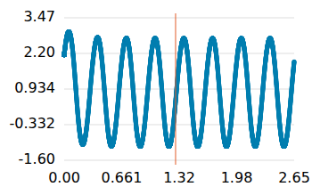

# UA-2 time-history plot performance

Updated 2026-11-01. **The time plot now retains its curve while scrubbing or
playing and updates only the selection cursor.** Changes to the trajectory,
quantity, node/sensor or plot width still rebuild the curve. No solver equation,
accepted sample, export value or physical tolerance changed.

| Measurement | Before | After |
|---|---:|---:|
| Median scrub, all 5,281 audited lift samples | 58.5 ms | 1.4 ms |
| Largest of 12 measured scrubs | 99.2 ms | 10.4 ms |
| Full curve replacements in those 12 scrubs | 12 | 0 |
| First plot construction, one observation | 81.7 ms | 119.8 ms |

The measured median reduction is **41.8× for the plot component**. The benchmark
uses every audited time and fixed-axis lift value, without interpolation or
thinning. It calls the production `createTimeResults` component with a minimal
selection callback, so this ratio does not include full-app geometry or report
updates. First construction still draws all points; no startup speedup is
claimed. These timings are single-run observations on this host, not a guarantee
for a phone or a stable performance threshold.

Thirteen browser assertions pass: the curve remains unchanged on selection,
all samples are present, the cursor selects the correct state, CSV is complete,
playback reaches the endpoint, width/quantity/node/sensor changes redraw,
missing values and input jumps remain separate, coincident states retain their
phase, clearing/replacement works, and the input trajectory is unchanged.
Before/after CSV SHA-256 is identical. The two existing timeline regression
tests also pass.

The **actual development app** separately replays the complete retained browser
segment `part209` (17 physical snapshots, all fields retained). With the app's
software geometry renderer, loading/parsing takes 502.4 ms, initial presentation
25.0 ms, and five scrub observations 3.9–5.5 ms. Earth-frame geometry and node
quantity selection work. JSON export contains exactly the original retained
values (12,568,450 pretty-printed bytes). Desktop and 390 px mobile views pass,
with no horizontal overflow or JavaScript page errors. Worker interception
permits only model inspection/distribution requests, preventing any new solve.
A test-only Vite hook injects the retained result into the actual time renderer;
it is absent from the production application. This checks rendering integration,
not solution-archive import or the full worker result pipeline.

The first app attempt reached its 45-second cap during startup and WebGL
initialization; it is not a pass. The second completed the desktop and export
assertions but waited for a hidden plot after mobile correctly preserved focus
on Output. The corrected harness selects the Plots tab; its completed run exits
0 in 30.6 seconds. Both earlier attempts remain recorded. Screenshots were
inspected: the whole-history curve and cursor are legible; the short physical
segment exposes an existing time-axis rounding issue where several ticks read
1.65. That label issue is not corrected by this performance change.

**Full physical-history UI loading, memory, archive saving and export remain
unfinished.** The 5,281-sample component fixture contains scalar plot fields;
the full-app check contains 17 complete physical snapshots. Neither alone proves
that a phone can retain and manipulate all 5,281 physical states. No new native
ASWING or scientific pass is added. UA-1, UA-2 and the full project remain open.

Evidence: [machine report](isae-ua2-time-ui-20261101.json),
[component benchmark](../../scripts/benchmark-isae-ua2-time-plot.mjs),
[app replay](../../scripts/replay-isae-ua2-ui.mjs),
[fixture provenance](../../artifacts/isae/ua2-time-ui-20261101/fixture-manifest.json),
[executions](../../artifacts/isae/ua2-time-ui-20261101/executions.json),
[first app timeout](../../artifacts/isae/ua2-time-ui-20261101/app-attempt01-execution.json),
[second app attempt](../../artifacts/isae/ua2-time-ui-20261101/app-attempt02-execution.json).
