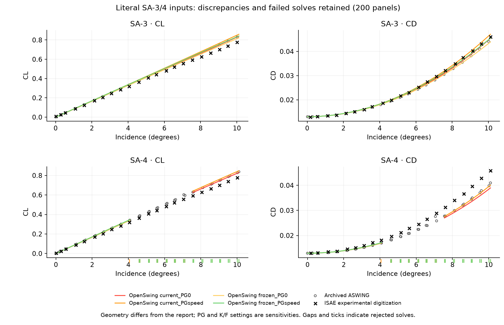
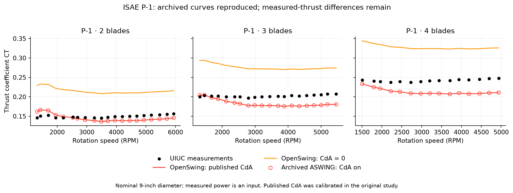

# ISAE ASWING validation

## Current acceptance target: tested ASWING results

Completion requires reproducing tested ASWING cases using the same models
and operating settings. Experimental agreement is not required.
**P-1 reproduces all six stored CT curves (110 values).** The corrected-arc SA-3
comparison covers all 22 archived rows and seven outputs on three meshes.
All 66 solves converge; every 200-to-400 interval mesh check passes, but
reference differences remain. Fine-mesh CL / CD / CDi RMSE is
0.000344 / 0.000349 / 0.000000392. Pitching moment fails the coarser mesh check.

Frozen-influence Pazy curves remain close in selected outputs. AE-2's selected
displacement differs by 0.435% and sensor beta by −0.138°. An independent
field calculation rules out moving the receiver alone as a correction.
See the [reference status](isae-aswing-reference-status.md),
[SA-3 comparison](isae-sa3-accurate-arc.md) and
[AE-2 sensor diagnostic](isae-ae2-sensor-reference.md).

The historical 18 partial / 23 pending / 0 fully validated family tally below
is a study inventory, not the completion count for this revised target.
Experimental discrepancies and specimen-property corrections do not block
an otherwise established ASWING match. The new arc correction changes numerical
mesh construction, while model properties and solver tolerances remain unchanged.
The full project remains incomplete.

The [SA-3 velocity diagnosis](isae-sa3-velocity.md) verifies the sampled
kernels and rules out the tested curvature analogue as the main drag explanation.
The [full ST-3 static-output comparison](isae-st3-reference.md) now covers all
45 archived rows with the original signed weights. After accounting for printed
coordinate rounding, interpolated native output matches 269/270 structural
entries on all three meshes; the remaining tip moment is a 5.59×10⁻⁹ N·m
archived residual versus effectively zero. Another 90 conditional zero entries
are accounted for separately. The browser solve takes 3.68 s and agrees with
native output. This single static snapshot is close; the wider ST-3 family
and exact historical discretization remain incomplete.

The [accurate-arc correction](isae-sa3-accurate-arc.md) removes a confirmed
9.91% local interval-length error near the curved SA-3 tip. All 66 new native
states converge, but the archived drag gap remains. Old saved v0/v1 meshes keep
their original equations. The selected browser solve takes 8.72 s after 27.73 s
startup and agrees with native output; its project restores without solving.
Earlier P-1, ST-3, AE-1 and AE-2 numerical results retain their recorded source
versions; they are not newly rerun studies for the corrected arc kernel.

## Historical comparison record

The [AE-2 low-aspect-ratio wing pilot](isae-ae2-pilot.md) now completes
six cold cases on three meshes with the unchanged literal model. All four
1% displacement mesh checks pass, with a maximum change of 0.0221%.
The finest result differs from the selected raw experimental displacement by
+166.2%; a separate archived ASWING control differs by +1.17%. Native solves
take 1.00–2.73 s; a selected browser solve takes 4.13 s after 29.32 s startup
and its saved project reopens without solving. Literal/report stiffness and historical setup differences
remain unresolved. This pilot is supplemental; AE-2's broader comparison
stays pending and coverage remains **18 partial / 23 pending / 0 fully validated**.

The [Pazy observable review](isae-ae1-observables.md) reconstructs 392 saved
mappings and preserves 184 unique measured scalars. Its 20,714-check arithmetic
audit passes. Chord-angle and sensor-elevation definitions do not explain the
twist mismatch; displacement projections change agreement modestly but do not
identify the exported Test 2 axis, baseline or filtering procedure. No model,
production default, fitted correction or family classification changes follow.

The [full frozen-influence Pazy comparison](isae-ae1-literal-frozen-curves.md) completes
196 airflow states at all 98 archived speed coordinates on two meshes, using
188 new cold solves and eight exact prior states plus two gravity baselines.
All 196 mesh checks pass. Fine-mesh displacement RMSE against archived ASWING
falls from 6.203/1.028 mm to **0.240/0.120 mm** at 5°/7°.
Experimental displacement agreement worsens; historical K/F remains unknown.
Independent saved-data audits pass 44,293 checks. One selected offline browser
solve takes 7.24 s after 25.29 s startup and agrees with native output; its
importable project restores without solving again. Production defaults stay
unchanged, and coverage remains **18 partial / 23 pending / 0 fully validated**.

The [conditional literal Pazy curves](isae-ae1-literal-curves.md)
complete 198/198 fresh cold states at 98 positive-speed coordinates on two meshes,
including independent gravity baselines. The predeclared 0.1% mesh-change gate
passes 196/196 checks. Fine-mesh differences from archived ASWING have
displacement RMSE 6.203/1.028 mm and sensor-elevation RMSE
0.04219/0.00822° at 5°/7°. These conditional comparisons retain the
historical setup uncertainties and experimental disagreements. The
[circulation correction](isae-circulation-finish.md) resolves a finishing-iteration
stall without changing the full-equation tolerance; the current browser case
takes 7.97 s, separately from 14.95 s startup. Original failures are retained.
Coverage remains **18 partial / 23 pending / 0 fully validated**.

ISAE is the current priority, 2026-10-25. The [corrected SA-6 comparison](isae-sa6-single-aileron.md)
completes 966 states using the primary reports' separate single-aileron procedure.
Earlier calculations used simultaneous opposite controls. Correcting that
observable reduces pooled roll RMSE by 2.73% but increases yaw RMSE by 5.33%;
large-deflection discrepancies remain. Three yaw transcription errors are
explicitly corrected and one primary-table inconsistency is retained.
Separate up/down measurements now guide the physical investigation. ISAE
remains the user's priority; Daedalus reference matching is deferred.

The [SA-6 local-field diagnosis](isae-sa6-local.md) now separates circulatory,
constant-profile and stall-drag contributions at 21 representative conditions.
An independent reconstruction passes all retained strip loads. Large downward
aileron yaw is dominated by the documented stall term; upward errors also
involve circulation. No supported production correction follows. Primary Clark-Y
experiments have been reviewed for applicability. The Pazy comparison below
uses known incidence/speed data to extend the work to coupled deformation.

The [full AE-1 sweep](isae-ae1-sweep.md) now completes all 186 states at 92
supplied speed coordinates on two meshes, with eight exact pilot states reused.
All 92 displacement mesh checks pass (0.612–0.681% changes); 829,488 independent
saved-data checks and three actual browser cases agree. Full-sweep fine-mesh
displacement RMSE is 1.057/0.868 percentage points of nominal semispan at 5°/7°,
and twist RMSE is 0.261°/0.326°. Experimental disagreement, axis/setup ambiguity,
section-data assumptions, high-speed dynamics and the literal attachment error
remain unresolved. Scoped steady wall-root support is now implemented below. AE-1 moves to partial
numerical comparison. The current ledger is **18 partial / 23 pending / 0 fully
validated**; no new application release is claimed.

The [isolated AE-1 lift-slope study](isae-ae1-section.md) now adds six coupled
states and 238,889 independent saved-data checks. Increasing the slope from
6.1185/rad to 2π/rad changes displacement and twist by about 2%, too little to
explain the selected experimental twist deficits. Displacement agreement is
mixed, so the baseline coefficients are retained. All three displacement mesh
checks pass. The [saved-load reconstruction](isae-ae1-loads.md) passes 71,043
checks and finds no supported load-transfer or twist-output defect. These are
diagnostic results, with no experimental pass, stability result or coverage promotion.

The [steady wall-root implementation](isae-ae1-wall-root.md) adds production
support for exact fully clamped lifting endpoints on an ideal solid image plane.
Eleven new regression cases pass; the derived native Pazy half-wing at 5°/30 m/s
has a fresh residual of 1.22e-14. The offline browser passes 693/693 checks
with a 7.83-second cold solve, separately from runtime startup. Strict physical crossing and unsteady-rate
rejection remain. The literal attachment error, setup/section assumptions and
experimental discrepancies remain open. Kernel count changes from 110 to 111;
historical studies keep their original source pins. Coverage is unchanged.

The [conditional literal Pazy comparison](isae-ae1-literal-pilot.md)
now compares two independent cold states using the ISAE model with only two
proven load-null, out-of-range Weight rows removed. At 5°/30 m/s, baseline-subtracted
tip displacement is 0.777% above the archived ASWING output and sensor-3 elevation
is 0.680% above it. The no-flow sag differs by 51 nanometres, near the archive's printed resolution.
The native case runs take 0.82/1.62 seconds; all 272 case/provenance checks pass (26 numerical gates and 246 pin checks). These are
conditional source-output comparisons with declared transverse gravity, not new
experimental acceptance. The historical mesh and complete operating state remain
unidentified; the subsequent full-curve and mesh studies are reported above. The primary-property
zero-gravity experimental studies keep their separate setup and results.

**OpenSwing does not yet pass this suite.** The full repository has been audited
for available cases and literal model compatibility. Quantitative comparisons
cover SA-1 through SA-8, SA-10 through SA-12, SA-14, the isolated static propeller case P-1, and
ST-2 reconstructed Pazy static/mode comparisons, ST-3 structural modes/static loads, conditional primary ST-4 modes, literal/reconstructed ST-5 rigid-joint static loads, and the reconstructed AE-1 steady Pazy sweep. The
[41-family coverage ledger](isae-coverage.md) identifies every remaining case;
it distinguishes import failures, missing models and physical comparisons that
have not been run. No untested family is counted as validated.

The [final equilibrium rank check](final-equilibrium-rank.md) now uses a guarded sparse certificate for eligible saved-state corrections, with full SVD fallback. A 4,172-unknown same-state comparison has identical sparse/dense matrices and measured 6.87 seconds for the certificate versus 37.32 seconds for SVD; assembly remains about 23 seconds. Native, WebAssembly and offline browser checks pass, including actual progress labels. These are phase timings, not a browser benchmark. All five mesh failures remain; coverage at that stage stayed **17 partial / 24 pending / 0 fully validated**. Source and local kernel are updated; hosted/download releases are unchanged.

The earlier [saved-equilibrium study](seeded-corrector.md) introduced complete sparse Newton correction. Its 4,172-unknown replay matched all 49,176 saved numeric values with about 30% fewer residual evaluations (4,498 versus 6,423), while retaining the dense final rank check. That historical run took 102.7 seconds, including 56.6 seconds for the dense check; the original evidence is preserved.

The [AE-3 finest-mesh finite-control study](isae-ae3-320-finite-control.md) records 4/4 completed independent nonlinear cases and 2 passing, 0 failing and 0 unavailable derivative-consistency comparisons. All five earlier mesh failures and experimental validation gaps remain. Production source, runtime bundles, hosted release and coverage classifications are unchanged.

The [AE-3 regional mesh study](isae-ae3-two-axis-mesh.md) adds 194- and 320-interval responses by splitting the 34 intervals shared by the earlier meshes. Its three unchanged 1% comparisons yield 0 passes and 3 failures. Both new cases pass equation checks; all original mesh failures remain. New-finest-grid finite-control consistency and experimental agreement remain open. No production code, runtime or coverage status changed.

The [AE-3 saved circulation diagnosis](isae-ae3-circulation-defect.md) reconstructs the fixed-geometry aerodynamic mesh change using fine-equation defects and one transpose solve. It retains output-functional and solver-residual terms, and records every receiver contribution. The 34 unchanged intervals remain a convergence blind spot; two additional grids have been prepared to test them separately. Both original coupled mesh failures and all experimental gaps remain. No production code or runtime changed.

The [AE-3 saved-output integration check](isae-ae3-output-integration.md) analytically integrates each mesh’s saved interval-constant circulation under both output formulas. The descriptive mesh difference changes from 7.14354% to 7.13741%; this is an output-functional sensitivity, not a self-consistent alternative solve or a Drela correction. Both original mesh failures remain. The two integrations and independent audit pass, with no new aerodynamic evaluation or linear solve. AE-3 and experimental validation remain pending.

The [AE-3 component checks](isae-ae3-component-checks.md) pass independent
selected-row vortex integration and common-load structural consistency checks.
Under identical loading, the existing meshes differ by 0.01355% in sampled
displacement norm and 0.01221% in rotation norm. These findings narrow the
numerical investigation; both original mesh failures and all experimental
gaps remain. No family status, tolerance or hosted release changed.

The [AE-3 saved-operator diagnostic](isae-ae3-clamped-circulation.md) finds
material mesh changes in both the fixed-geometry aerodynamic response and the
elastic coupling difference. At 20O-05 their signed shares are 41.91% and 58.09%;
strong cancellation magnifies the final response. Four block solves and the
independent saved-output audit pass. The original two mesh failures remain,
and the difference cannot be interpreted as structural error alone.

The [corrected-method global mesh comparison](isae-ae3-analytic-global-mesh.md)
still fails both 1% criteria, with changes of 2.0773% and 7.1435%. Three derivative
calls reuse saved equilibria; all equation checks pass. The separate
[packaged browser check](analytic-gamma-browser.md) passes current/frozen cases,
native comparisons and exports. Mesh convergence and experimental matching
remain open; no family status, tolerance or hosted release changed.

The [AE-3 analytic-circulation correction](isae-ae3-analytic-gamma.md) passes both
saved nonlinear consistency checks at the original default step. The exact
tested source is integrated; the matched original-method failures remain.
All earlier mesh failures and experimental gaps remain open. Runtime bundles
and the hosted release are unchanged.

The [AE-3 finest-mesh derivative-step study](isae-ae3-fine-derivative-step.md)
passes 4/4 comparisons against saved nonlinear control pairs at smaller full
API steps. It preserves the original step failures and all global mesh verdicts.
No experimental acceptance or production-default change follows.

The [AE-3 global comparison with fixed control-boundary cells](isae-ae3-global-patch.md)
passes 0/2 mesh checks and 0/2 finite-control checks at the original tolerances.
It tests a new mesh family and retains the earlier failed comparisons. All seven
new physical cases pass equation checks. This does not establish a continuum
error bound or experimental acceptance; AE-3 remains pending.

The [AE-3 both-sided refinement](isae-ae3-break-refinement.md) measures the
control response after successive subdivisions of the four cells beside the
aileron boundaries. All three cases pass equation checks. This local sequence
leaves the remaining mesh unchanged and does not replace the failed global
comparisons or advance AE-3 to experimental acceptance.

The [AE-3 local mesh diagnostic](isae-ae3-mesh-sensitivity.md) confirms sensitivity
to the cells beside the aileron boundaries. Two controlled refinements pass
equation checks, but introduce no new convergence or experimental acceptance.
Saved-matrix and source reviews narrow the numerical investigation; the original
global mesh failures and all family classifications remain unchanged.

The [AE-3 128-to-256 mesh refinement](isae-ae3-mesh-refinement.md) retains
both high-pressure mesh failures: 1.3579% and 4.5885% against the original 1%
limit, using the same smaller derivative step on both meshes. All seven native
cases pass equation checks, and both new finite-control comparisons pass.
Numerical mesh convergence and experimental matching remain unresolved; no
family status or acceptance threshold changed.

The [AE-3 derivative-step diagnostic](isae-ae3-derivative-step.md) now passes
both retained nonlinear control comparisons at two smaller API steps, using
the same saved 128-panel equilibrium. The original default-step failures remain
recorded. This resolves selected numerical consistency; it leaves the two mesh
failures and experimental matching gaps open. Coverage at that stage remained 17 partial,
24 pending and zero fully validated families.

The [AE-3 locked-wing comparison](isae-ae3-locked-control.md) adds conditional
predictions at all 18 primary pressure readings, using 70 native states and
four selected WebAssembly replays. All native equation checks pass, but two
refined mesh checks and two original centered-control derivative checks failed.
The separate step diagnostic above passes the latter comparisons at finer steps.
The saved WebAssembly physical comparisons pass; the original harness key-type
failures are preserved. The primary finite control ratio is not yet matched
to the zero-control derivative because amplitude, incidence and sign remain
unresolved. Section-coefficient provenance, mechanical fixture discrepancies,
driven-roll and reversal work also remain open. AE-3 stays pending.

The [AE-3 mechanical follow-up](isae-ae3-mechanics.md) compares all ten primary
unit-load measurements with refined native results and an independent continuous
beam. Numerical agreement is established for the declared fixture, including
two actual WebAssembly replays, while experimental discrepancies remain: the
computed bending near the applied load is 13.17% below the primary value.
All 18 locked-wing pressure coordinates have also been re-read from the primary
plot, with explicit digitization bounds and the old CSV preserved. Finite control
amplitudes, incidence and sign convention remain unresolved; the full aerodynamic
and driven-roll comparisons are unfinished. AE-3 remains pending.

The earlier [AE-3 source audit and numerical pilot](isae-ae3-progress.json) retain
all five source CSVs and their classifications, six literal models and six
labelled historical coefficient reports. Seven native states check the signed
locked-wing response at an explicitly declared archive pressure. The final
32-to-64 requested mesh change is 0.02209%; separately resolved positive
and negative controls reproduce the implicit derivative within 3.45e-8 relative.
The original coarse-mesh gate failure is retained. This is numerical evidence
only: primary pressure-axis discrepancies, specimen stiffness, control sign and
incidence remain unresolved. Two near-zero helix samples are extrapolations,
and the primary roll condition was simulated using driven zero-average-moment
rotation. No original ASWING executable is available. AE-3 remains pending;
the [complete pilot evidence](isae-ae3-20261016-evidence.zip) preserves the inputs,
frozen kernel, full outputs, scripts and independent saved-output review.

The source ledger now records **18 partial families and 23 pending**, with no
family fully validated. The [SA-14 consolidation](isae-sa14-comparison.md)
accounts for all 116 digitized points, 180 archived polar rows and 426 original
load-export rows. It distinguishes 3,056 study requests from 3,035 unique
conditions, including 48 rejected states. The earlier SA-12 application
contained 13 partial families and 28 pending; the endpoint-repair release contained 15/26, and the pre-primary-ST-4 release contained 16/25. These are historical counts; new distributions include this ledger.

The [FFWT-1 nominal comparison](isae-ffwt1-nominal-07.md) records
original-mesh 10°, 20° and 30° folding-wing equilibria on one source snapshot,
fresh-network residual and hinge-observable checks, and a portable report
replay. A [relative-coordinate precision repair](relative-pg.md) enables the
new 30° cold solve without relaxing acceptance. The 10° state is replayed and
the 20° state receives a separately recorded public warm correction.
Conditional port-fold differences from the nominal-protocol measurements are
+3.1232°, +4.1204° and +1.5597°. Exact experimental setup, branch correspondence
and mesh-refined curves remain unfinished, so FFWT-1 and the overall coverage
counts are unchanged. Earlier attempts remain in the preserved
[previous comparison](isae-ffwt1-nominal.md).

The subsequent [independent folded reference](isae-ffwt1-folded-reference.md)
reproduces circulation, loads and hinge balances at three supplied poses,
including actual WASM replay. The [fixture-attitude comparison](isae-ffwt1-fixture-attitude.md)
adds four paired equilibria with the gravity direction required by an inclined
rig in horizontal flow. It reduces the high-incidence lift deficit to 3.33%,
while increasing discrepancies in sensor bank, local incidence and root moment.
The archived producing setup and physical fixture remain unresolved;
neither study establishes experimental validation or changes coverage.

The subsequent [Fourier circulation diagnostic](isae-ffwt1-circulation-modes.md)
finds severe local flow defects and load sensitivity in twelve fixed-pose
mode-count probes: eight projected-residual passes and four local Mach
rejections. Independent replay confirms the eight returned fields, but no
new hinge equilibrium or physical validation is claimed. Original Fourier
coordinate grouping and converged local-flow/load behavior remain unresolved;
source, defaults and coverage are unchanged.

The [circulation refinement study](isae-ffwt1-circulation-refinement.md)
adds fifteen fixed-pose attempts and demonstrates worsening local velocities
when the small Fourier space is held fixed under panel refinement. Exact
saved-field decomposition identifies the adjacent tip as the dominant source.
Full-basis comparisons closely reproduce pointwise loads, while native and
independent strict residual failures remain explicit. This narrows the
representation issue without establishing original ASWING coordinate grouping,
new hinge equilibria or experimental validation. A selected-panel 80-digit
audit explains two borderline replay failures as evaluation arithmetic;
it does not replace the recorded full-vector outcomes.

The [connected circulation reference](isae-ffwt1-connected-circulation.md)
adds fifteen solves with a single material coordinate and matched sample
geometry. All twelve connected-series states pass independent projected
checks, with bounded total velocities across the three tested meshes and
smaller total-force component differences as modes increase. Local defects at the hinges and
two strict independent pointwise-control failures remain. This is a scoped
representation study; original ASWING grouping, production integration and
physical validation are not established. Coverage remains unchanged.

The [influence accuracy follow-up](isae-ffwt1-influence-accuracy.md) attributes
the two pointwise replay failures primarily to rounded-geometry differences.
Two new independently solved states pass their own equations and selected
high-precision checks, with all sixteen field/load comparisons passing.
The earlier prescribed-state failures remain unchanged. An unintegrated
shared-wake factorization improves sampled evaluation accuracy; no physical
validation or production release is claimed.

The subsequent [source integration](isae-ffwt1-influence-integration.md)
applies that factorization to cached fields and their derivatives. Final-source
native checks pass (138 cache/time/frequency and 68 affected geometry cases),
as do 42 coefficient and three independent physical-field WASM cases. The
candidate remains unreleased because native rigid runtime increases by factors
of 1.67 for Daedalus and 1.24 for the flexible-wing example, with approximately
twice the vector-operator storage in the FFWT benchmark. Performance work and
coupled/browser verification remain open; coverage and physical-validation
status are unchanged.

The [performance follow-up](isae-ffwt1-influence-performance.md) connects
mounted corrections to complete geometry derivatives and fixes a physical
stencil's projection order. Final-source verification passes 269 native tests
and 51 coefficient plus three physical-field WASM cases. The default Daedalus
mounted solve returns in 179.233 seconds with a full residual of 8.51e-14, but
ten recovered shell-stress fields miss the unchanged fixture-comparison
bounds. State/load arrays pass; tiny moment differences amplified by the
shell area explain the failed derived fields. The source remains unreleased,
mounted browser verification remains pending, and no physical coverage is
promoted.

The later [sparse wake optimization](isae-ffwt1-sparse-wake-performance.md)
returns the same cold Daedalus outputs, captured arrays and iteration history
exactly in 41.450 seconds. It removes exactly zero derivative contractions
after compensated source grouping; the complete tangent also compares exactly.
All 169 affected integrated-source checks pass. An actual offline browser solve
returned in 100.189 seconds; all 49,485 numeric output comparisons pass. Two raw
exact-identity checks fail on explicit zero mode settings and tiny coordinate
roundoff, with the prior ten fixture-field failures also preserved. This is a
performance and numerical-consistency result, not new experimental validation.
The 105-module local release also passes a public saved-result import on
desktop and mobile, Fit/WebGL checks and exact export roundtrips, without a
second browser solve. Source/offline packages contain the tested modules and
validation summaries; optional raw archive ZIPs remain separate. No original
ASWING executable is available. The two exact-comparison failures and ten
historical fixture-field failures remain recorded.

The later [finite-chord force diagnostic](swept-lifting-line-limit.md#finite-chord-force-accounting-follow-up)
passes 16 independent linear cases and 1,090 saved-array audit checks. It rules
out a direct chordwise-force correction to lift in the planar control, while
retaining growing swept force-point velocity and continuing yaw-moment changes
under refinement. This narrows the unresolved physics; it changes no production
equations or validation coverage. Its summary is included in the subsequent
name-compatibility build; optional raw experiment archives remain separate.

The [AE-2 source preparation](isae-ae2-preparation.json) maps the composite-wing
models, archived operating scripts and raw measurement columns to the pinned
primary thesis. Video observations and strain-derived estimates remain
separate, with their original speeds and nonzero deflections preserved. Literal
model/table correspondence and the producing setup remain unresolved. The
[conditional AE-2 attempt and ground checks](ground-backtracking.json) record
an initial geometry rejection before any full equilibrium residual: the assumed
zero Earth position puts the wing root on the image plane. The archived script
does not specify that numerical position, and the experimental pedestal and
finite cover disk do not establish an infinite wall. No AE-2 physical result or
coverage promotion follows. Independent mirrored-wing field controls pass for
the factored operator; a separate dense near-seam diagnostic failure is retained.
The [inventory](isae-ae2-inventory.json) and
[49-file source record](isae-ae2-source-pins.json) retain the exact inputs.

The [Pazy ST-2 comparison](isae-st2-comparison.md) adds all 77 supplied static
measurement rows over three meshes and two explicit load reconstructions: 246
distinct solved states. Sixteen air-free modal states, independent rod/beam
checks, 12 WASM solutions and 10 offline browser solutions complete this
comparison increment. All six original files still reject their out-of-range
attachments. Experimental errors and primary material/load reconstruction
remain unfinished; matching the native and browser results is not a physical
validation pass.

The [corrected primary Pazy study](pazy-loaded-comparison.md) adds 225 static
states, 26 modal states and 28 independent nonlinear references. It compares
all 77 measured static rows and replays ten conditions in both WASM and the
offline browser. The original Nastran mass matrices prove a product-sign error
in my earlier spreadsheet conversion; four corrected `pazy-primary-conm2-*`
inputs replace that conversion. The [earlier study](pazy-primary-comparison.md)
is explicitly superseded, with its original archive preserved unchanged.
All 97 solver modules remain unchanged. The explicit extension–torsion
projection, literal attachment failures, experimental discrepancies, fixture
geometry and uncertainty remain unresolved. Numerical checks do not establish
a physical-validation pass and did not increase the historical 16-partial/25-pending count.

The subsequent [sparse modal adjoint audit](modal-adjoint.md) checks faster
left-vector recovery on all 26 saved corrected Pazy matrices and three fresh
offline browser cases. It preserves physical equations and finite-root
classification. Earlier studies retain their original source pins; this
numerical optimization adds no fully validated family.

The [zero-reference/ST-4 audit](zero-reference.md) adds 64 unchanged structural imports, 81 vacuum modal states, independent energy and continuous beam references, and three WASM/browser checks. All 486 modal frequency errors decrease under refinement, but mesh error and experimental inertia/table/setup conflicts remain. This historical supplemental evidence left the 16-partial/25-pending count unchanged.

The [primary ST-4 comparison](st4-primary-study.md) now covers 252 vacuum and
252 still-air states across 42 configurations, two section-inertia endpoints
and three meshes, with 672 independent references. All 78 printed before/after
observations, original labels and six incomplete triplets are retained. The
72 complete triplets are compared as sorted spectra under an explicit
lowest-three-mode assumption, without frequency fitting or physical mode pairing.
At 32 intervals the first three air frequencies agree with the continuous
model within 0.4712% (minimum kinetic modal assurance 0.999913), but mean absolute
experimental discrepancy remains 9.264–9.296%, reaching 54.867% for one value.
The sixth/seventh modes mix in the tip-loaded 7f case. Zero-speed density is
unreported; 1.225 kg/m³ is an assumption distinct from the flutter test medium.
Pylon/fixture properties, in-plane stiffness and omitted fluid physics remain
uncertain. The 176 selected native checks, one JavaScript check, three WASM
replays and three fresh offline browser checks pass. This completes a conditional
comparison, moves ST-4 to partial coverage, and establishes no full physical pass.
The fixed-frame exact-zero-speed still-air modal path does not support broader
nonlinear zero-flow analysis, ROM, stability, frequency response or time launch.

The completed [SA-11 comparison](isae-sa11-comparison.md) retains all 5,304
requests: 1,227 computed and 4,077 rejected. All 83 measured drag points were
requested at two meshes, yielding 38 observed matching-lift roots and 128
missing roots. Its source audit identifies three literal input failures and an
[archived normalization conflict](isae-sa11-archive.md).
The [40-state WebAssembly replay](isae-sa11-wasm.json) and
[14-state offline browser check](isae-sa11-browser.json) pass, while experimental
agreement and local-flow growth remain unresolved. This evidence is included
in the newer source/raw downloads; it is not a validation pass.

The [SA-13 airship diagnostics](isae-sa13.md) likewise do not increase released
coverage. Four figures without original inputs support explicitly conditional
outline reconstructions: 38 native and WebAssembly calculations, measured-data
overlays, and independent source-field integration. Source conflicts and
experimental discrepancies remain. The endpoint display defect is now repaired
in source after full regression accounting; the [source transition](endpoint-source-transition.json)
preserves the historical numerical results and their original solver hashes.

The [SA-14 pilot](isae-sa14-pilot.md) adds 50 native/WebAssembly states and
15 offline browser solves. It distinguishes primary pressure stations from
drawn curve endpoints and uses primary total/exposed-wing force definitions.
The [extended lift comparison](isae-sa14-polars.md) evaluates all 180 archived
polar rows and all 44 exact experimental lift angles: 2,952 native requests,
78 WebAssembly checks and 12 offline browser cases. Archive convergence flags
and 48 OpenSwing validity rejections remain explicit. Original iw=4° provenance,
uncertainties and tip-local flow convergence remain unfinished;
released family counts are unchanged.
The subsequent [load-export audit](isae-sa14-load-exports.md) recovers all
426 original rows and compares 18 existing native profiles using the documented
midpoint locations. It identifies shifted plotting coordinates and a wing-only
moment-reference conflict. Exact archive discretization and physical agreement
remain unresolved.

The [4° incidence study](isae-sa14-incidence.md) now compares all 24 source
points using explicit wing-frame and body-frame reconstructions. The primary
report resolves the wing/body angle convention and identifies the η=0.15 points
as upper-surface measurements with interpolated lower loading. All 54 native
states, 18 WebAssembly replays and eight offline browser states compute; the
18 equivalent-frame checks pass. Higher-angle experimental discrepancies remain.
These reconstructions do not recover the original missing iw=4° input. The
subsequent consolidated audit moves SA-14 to partial comparison complete while
retaining that source limitation and all experimental discrepancies.

The [swept force-velocity diagnosis](swept-lifting-line-limit.md) now reproduces
the growth with prescribed elliptic circulation and independent integration.
The same-line swept kernel has a singular refined limit even with one smooth
circulation mode. This remains a model issue requiring a justified resolution;
it does not turn the affected comparisons into validated results.

The source is Romain P. Jan's
[ISAE ASWING Experimental Validation repository](https://github.com/rom1isae/ISAE_Aswing_Experimental_Validation/tree/f62943df20e9e4d7d9f50e070477b22426b5f865),
revision `f62943df20e9e4d7d9f50e070477b22426b5f865`. All 2,539 files are checked
against their Git blob hashes and sizes, with SHA-256 recorded locally. The
279 `.asw` files include convergence studies outside the 41 case folders.
SA-9 is missing upstream. The four accompanying reports are the primary setup
descriptions: Jan, *Experimental validation of ASWING*, Parts I–IV.

## Findings

| Study | Result | Limitation |
|---|---|---|
| Literal parser compatibility | 177 / 279 models parse unchanged; 102 are rejected | Parsing does not establish mesh construction or validate physical predictions |
| SA-1, straight wing | 171 source-pinned records; fixed-zero-PG CL RMSE 0.03985 and CD RMSE 0.02095 against the experimental digitization | Near-stall drag is substantially underpredicted; deep-stall branch selection remains unresolved |
| SA-2, swept wing | 104 computed and 10 rejected records; current-flow, zero-PG CL RMSE 0.00196 against archived ASWING | The literal geometry differs from the primary experiment; pressure-only drag and finer-mesh failures remain concerns |
| SA-3, elliptical wing | 433 computed / 3 rejected; current-flow, zero-PG CL RMSE 0.000508 against ASWING | Experimental/archived geometry conflict; failed branches remain |
| SA-4, crescent wing | 463 computed / 213 rejected over three meshes and four PG/K/F choices | 133 continuation failures and 80 local section-normal Mach-limit rejections; no validation pass |
| SA-5, dihedral wing | 132 computed cases; current-flow, zero-PG CL RMSE 0.00792 against archived ASWING | The other reference is CFD, not experiment; its geometry and force-axis reduction need reconciliation |
| SA-6, aileron moments | All seven literal models plus one explicit control-span reconstruction; three angles, three meshes and two influence settings | Primary/source transcription conflicts, mislabeled control span, remaining moment errors and setup/uncertainty limits; see [study](isae-sa6.md) |
| SA-10, winglets/tip sails | 2,238 computed / 438 rejected states; six variants including one explicit joint reconstruction; 160 matched-lift requests | Geometry/setup conflicts, missing roots, post-stall differences and junction-velocity growth remain; see [study](isae-sa10.md) |
| SA-11, transonic winglets | 1,227 computed / 4,077 rejected states; all 88 measured lift points requested on three meshes; 38 roots from 166 matched-lift drag requests | No computed experimental points for the two reconstructed winglet configurations; swept/junction flow, source normalization and transonic limitations remain; see [study](isae-sa11-comparison.md) |
| SA-12, ground effect | All 2,866 states computed; 75 lift and 71 drag measurements at exact angles, three meshes; 33 WASM and 17 offline browser cases pass | Experimental discrepancies remain after mesh refinement; archived pitch, angle datum and equivalent-flap section properties limit physical validation; see [study](isae-sa12.md) |
| SA-7/8, tandem wings | 900 computed runs across four models, two meshes and four PG/K/F choices | Literal model/setup differences remain; per-surface and drag-at-fixed-lift comparisons are pending |
| P-1, static propellers | All 55 archived samples reproduced with viscous power both on and off, within 2e-12 in CT | Measured-thrust errors remain; measured power and previously calibrated drag area are inputs |
| ST-2, Pazy structure | 77 static measured rows, 246 computed conditions, 16 air-free modal states; independent rod/beam and offline runtime checks | Six literal attachment failures; explicit load reconstructions retain simplified properties. In-plane frequency is about 128 Hz versus measured 60.7 Hz; see [comparison](isae-st2-comparison.md) |
| ST-3, composite-wing modes | Original study: 41 computed / 7 rejected records; finest air-free modes agree with an independent beam within 0.11%. Dense repair: 21 operating points / 42 complete spectra pass | Primary/ISAE mode-label and property conflicts; the finer 64-panel uncoupled model needs a tighter rank setting; first torsion of the uncoupled wing remains about 21% high in the small-speed comparison |
| ST-3, static force/couple loads | 395 native solves compare 160 signed measurements; independent nonlinear rod differences below 0.014 mm / 0.00049 degrees; archived ASWING differences below 0.452 mm / 0.050 degrees. A further 398 direct signed-load replays and desktop/mobile browser checks pass | Upstream torque is 1.3734 times its plot label; corrected nominal loads still disagree with experiment |
| ST-4, concentrated-weight wing | 252 vacuum and 252 still-air states, 672 independent references, 78 printed observations with 72 complete triplets; first three air frequencies within 0.4712% of continuous references at 32 intervals | Conditional primary reconstruction; assumed density, incomplete inertia/fixture details and sixth/seventh-mode mixing remain. Air mean absolute experimental discrepancy 9.264–9.296%, maximum 54.867%; see [study](st4-primary-study.md) |
| ST-5, joined-wing structures | Three literal rigid-joint load cases solve across five meshes and pass desktop/mobile checks; earlier reconstructed comparisons retained. Twenty of 38 files now construct static networks | Sixteen attachment and two syntax failures; custom link joint, reference scaling and experimental differences remain |

The aerodynamic studies retain failed solves and missing reference rows.
SA-4 error statistics are computed only over the surviving samples, with their
counts recorded. A lower error over a smaller surviving subset is not evidence
that its PG/K/F setting is better.
Residual checks, mesh refinement and native/WebAssembly agreement are numerical
verification; none establishes experimental agreement by itself. PG Mach and
frozen/current influence choices are reported as separate sensitivities where
the archived startup state is unknown. No aerodynamic parameters were fitted.

Detailed source-pinned data:
[SA-1](isae-sa1-current.json), [SA-2](isae-sa2-current.json),
[SA-3/4](isae-sa34.json), [SA-5](isae-sa5.json), [SA-6](isae-sa6.md), [SA-7/8](isae-tandem.json), [SA-10](isae-sa10.md), [SA-11](isae-sa11-comparison.md), [SA-12](isae-sa12.md), [P-1](isae-p1.json).
The [ST-5 structural study](isae-st5.md) separates reconstructed load comparisons
from the 38 unsuccessful literal network setups at its original revision.
The later [distributed static study](distributed-static.md) supports the three
rigid-joint files directly, while retaining the attachment and custom-joint
limitations. The [ST-3 modal study](isae-st3.md) adds literal-file comparisons against the primary
Dunn thesis and preserves the secondary-source label conflicts. With the later SA-14, ST-2 and primary ST-4 comparisons, seventeen families now
have completed quantitative studies of at least part of their scope; 24 await completed studies.
The historical SA-12, endpoint-repair and pre-primary-ST-4 releases contained 13, 15 and 16 partial families, respectively.
The subsequent [dense modal repair](dense-staircase.md) resolves the checked
8/16/32-panel failures without changing physical inputs or A/M assembly. Its
fresh runs are separate from the original study and its retained failures.
The [static study](isae-st3-static.md) retains the unmodified signed measurements,
quantifies the upstream torque conversion, and distinguishes exact static load
reconstruction from the literal signed-weight solves unsupported at that
study’s revision. The later [direct static workflow](structural-static-workflow.md)
adds 398 current-source replays and passing offline desktop/mobile checks
for the three unmodified static inputs. This is additional numerical and
workflow verification, not new evidence of experimental agreement.
The historical [SA-1](sa1.md) and [SA-2](sa2.md) source audits explain their
setup conflicts and experimental force conventions.



For SA-3/4, the literal span is 2.0554 m and reference aspect ratio is about 7;
the report describes a 1.22 m span and aspect ratio 6. Using those models
unchanged measures a discrepancy; it does not reproduce the stated experiment.
The SA-4 archived tables also have different incidence samples and a missing
row. They are compared separately without inventing data or shifting the curves.

For SA-7/8, each archived `.asw` and polar is paired by its original filename.
SA-7's fore-only geometry/section parameters differ from its tandem-model
canard: its span is 9.144 m versus 1.29 m, and chord is 0.3048 m versus
0.22 m. The reference area remains 0.55815 m². This literal fore-only model
has CL RMSE 4.684 against its archived polar in the current-flow, zero-PG run;
that large discrepancy is retained. The tandem model's corresponding CL RMSE
is 0.01756 against ASWING and 0.17822 against the experimental total-lift
digitization. SA-8 total-lift RMSE is 0.00977 against ASWING and 0.07907
against CFD under that same mode. The independent SA-7 comparison uses only the CSV pair labeled
experimental total lift; SA-8 uses the pair labeled CFD total with airframe.
The other fore/hind, LLT and airframe variants are not substituted. Two meshes
measure sensitivity; they do not establish a converged continuum result.

## Static propeller result

The P-1 model uses the production `engine_load`/`actuator_disk` implementation
at zero axial speed. It is an isolated component test, not an aircraft hover
solve. The primary inputs are the
[UIUC Volume 2 propeller tables](https://m-selig.ae.illinois.edu/props/volume-2/propDB-volume-2.html).
All 55 experimental RPM/CT pairs stored in the ISAE MATLAB figures match those
tables exactly. Measured CP supplies input power; the original study's published
drag areas are 1.6, 2.4 and 3.2 × 10⁻⁴ m².

| Blades | Samples | Mean absolute CT error vs measurements, published CdA |
|---|---:|---:|
| 2 | 20 | 6.367% |
| 3 | 20 | 9.470% |
| 4 | 15 | 11.994% |



Nominal 9-inch diameter reproduces the archived curves to floating-point
precision. UIUC's two-blade geometry plot specifies a true diameter of 9.1 inches;
that alternative is recorded as a separate sensitivity. It is not fitted to
the measurements. The original study calibrated CdA using measured data, so
these errors are not independent validation of that calibration. The four-blade
FIG legend says 11%, while the report says 12%; the computed value is 11.994%.

The component checks cover 220 production evaluations, two densities, independent
hover momentum/power equations, force direction and torque balance. All 220
comparisons also pass in actual WebAssembly.

## Compatibility and browser checks

One confirmed input issue was fixed: valid Fortran implicit exponents such as
`6.2832+00` are now accepted. Direct compiled Fortran reads independently confirm
that interpretation. Invalid and nonfinite numbers still fail with a source-line
error. The initial numeric-syntax checks passed 79 native tests and 12 WebAssembly cases.

The full 279-input audit has identical native and WebAssembly outcomes, including
all 102 current rejections. [Zero-origin legacy Reference compatibility](reference-compatibility.md)
adds 30 unchanged imports and passes 97 native tests, 306 native/WASM model
comparisons and 18 new WASM checks. Nonzero legacy reference coordinates remain
unverified. Other remaining failures include zero reference area, one-station
property tables, missing block terminators,
distribution/header inconsistencies and invalid sensor/joint data. The benchmark
files were not edited and parser safeguards were not bypassed.

Earlier numerical reports retain their original source pins. The parser transition
verifies identical complete parsed states for their exact inputs and byte-identical
physics modules; these reports are not presented as fresh native reruns.

Both SA-3 and SA-4 also solve and export offline through the browser workbench,
with 100 panels at five degrees incidence. Exported coefficients agree with
native results within 2e-7, and exports identify all 97 kernel modules. A newly accepted ST-3 model
also imports, saves unchanged, solves and exports offline. These
successful operating points do not override the failed points in the sweeps.
The [SA-3/4 WebAssembly replay](isae-wasm-sa34.json) also checks eight successful
200-panel states across all PG/K/F choices and preserves two native rejection
outcomes. All 16 selected [tandem replays](isae-wasm-tandem.json) agree within
2e-7 with native coefficients.

All 43 MATLAB figures have numeric-series extraction records, including missing
values and original labels. Those labels alone are not accepted as proof that a
series is experimental data. See the [figure inventory](isae-figure-inventory.json),
[input inventory](isae-suite-inventory.json), and
[current WebAssembly import/propeller results](isae-wasm-reference-imports-p1.json).

## Reproduce

To rebuild and audit the completed SA-11 tables from the pinned native and drag
caches already recorded in this workspace:

```sh
OPENBLAS_NUM_THREADS=1 OMP_NUM_THREADS=1 .venv/bin/python scripts/summarize-isae-sa11.py
OPENBLAS_NUM_THREADS=1 OMP_NUM_THREADS=1 .venv/bin/python scripts/check-isae-sa11-drag.py
OPENBLAS_NUM_THREADS=1 OMP_NUM_THREADS=1 .venv/bin/python scripts/check-isae-sa11.py
.venv/bin/python scripts/summarize-isae-validation.py
```

The SA-11 native runner is `scripts/verify-isae-sa11.py --workers 2`; after it
finishes, `scripts/verify-isae-sa11-drag.py` computes the matched-lift requests.
Both preserve source/module identities and resume their caches. The checks also
require the recorded source audit and WebAssembly/browser evidence; they do not
treat report generation as a fresh runtime replay.

```sh
.venv/bin/python scripts/fetch-isae-validation.py
.venv/bin/python scripts/inventory-isae-validation.py
.venv/bin/python scripts/extract-isae-figures.py
.venv/bin/python scripts/fetch-sa1.py
.venv/bin/python scripts/fetch-sa2.py
.venv/bin/python scripts/fetch-isae-p1.py
OPENBLAS_NUM_THREADS=1 OMP_NUM_THREADS=1 .venv/bin/python scripts/verify-sa1.py --output docs/validation/isae-sa1-current.json
OPENBLAS_NUM_THREADS=1 OMP_NUM_THREADS=1 .venv/bin/python scripts/verify-sa2.py --output docs/validation/isae-sa2-current.json
OPENBLAS_NUM_THREADS=1 OMP_NUM_THREADS=1 .venv/bin/python scripts/verify-isae-sa34.py
OPENBLAS_NUM_THREADS=1 OMP_NUM_THREADS=1 .venv/bin/python scripts/verify-isae-sa5.py
OPENBLAS_NUM_THREADS=1 OMP_NUM_THREADS=1 .venv/bin/python scripts/verify-isae-tandem.py
OPENBLAS_NUM_THREADS=1 OMP_NUM_THREADS=1 .venv/bin/python scripts/verify-isae-p1.py
.venv/bin/python scripts/inventory-isae-validation.py
.venv/bin/python scripts/summarize-isae-validation.py
.venv/bin/python scripts/plot-isae-validation.py
OPENBLAS_NUM_THREADS=1 OMP_NUM_THREADS=1 .venv/bin/python scripts/verify-isae-st5.py
.venv/bin/python scripts/summarize-isae-st5.py
OPENBLAS_NUM_THREADS=1 OMP_NUM_THREADS=1 .venv/bin/python scripts/check-isae-st5.py
.venv/bin/python scripts/plot-isae-st5.py
.venv/bin/python scripts/summarize-isae-validation.py
.venv/bin/python scripts/fetch-isae-st3.py
OPENBLAS_NUM_THREADS=1 OMP_NUM_THREADS=1 .venv/bin/python scripts/verify-isae-st3.py
.venv/bin/python scripts/summarize-isae-st3.py
.venv/bin/python scripts/plot-isae-st3.py
.venv/bin/python scripts/summarize-isae-validation.py
node scripts/test-isae-st3-wasm.mjs
node scripts/test-isae-validation-wasm.mjs imports p1 sa34 tandem st5
node scripts/test-reference-compatibility-wasm.mjs
npm run build
npm run test:browser -- tests/browser/isae-sa34.spec.js
```

The native SA-3/4 and SA-5 runners cache each completed solve under an identity
that includes every kernel module and the study script. Failure records are
cached too. Re-running resumes the identical study; changing code/settings
creates a separate cache. External inputs stay in `.reference`, and no upstream
shell or MATLAB scripts are executed. Source and local-app downloads include
the study scripts and result summaries.
