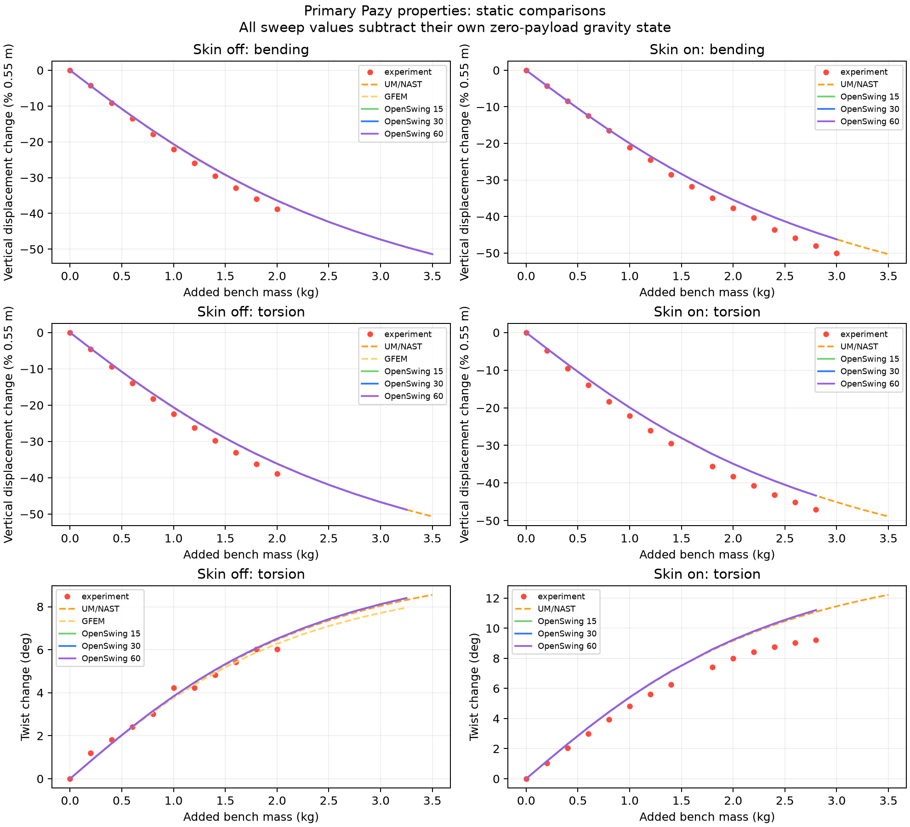

# Pazy primary-model correction and loaded comparisons

**Numerical comparisons completed; experimental validation remains incomplete.** This study supersedes the previous primary-model inertia conversion. All 97 production solver modules are unchanged.

## Corrected input convention

The primary spreadsheet off-diagonals are signed CONM2 products, requiring their negatives in the physical inertia tensor. My earlier derived inputs interpreted them as tensor entries. The corrected reconstruction reproduces every entry of both original Nastran 6×6 rigid-body mass matrices to printed precision; the old interpretation differs by over 7,000 rounding units. Mass, CG and positive-definite tensors are checked independently of modal frequency agreement. [Source audit](pazy-loaded-source-audit.json).

Use the four `pazy-primary-conm2-*.asw` inputs below. The old `pazy-primary-skin*.asw` models and their archived study are retained as superseded evidence. Original source point masses already include their CONM2 calibration masses; no duplicate calibration mass was added.

The source is [Riso and Cesnik’s pinned primary data](https://github.com/UM-A2SRL/AePW3-LDWG/tree/396710a19a80004c65c767e9955fe60d59565c39/00_Models/01_Pazy_Technion/02_Models_Beam). The small intrinsic extension–torsion K12 term remains explicitly projected because documented ASWING section fields cannot represent it. Full and projected independent beam references quantify this limitation. [Model and test definitions](https://doi.org/10.2514/1.C036869).

## Modal results

| Skin | Mode | UM zero gravity, 15 intervals (Hz) | OpenSwing zero gravity, 15 (Hz) | UM with gravity, 15 (Hz) | OpenSwing with gravity, 15 (Hz) | OpenSwing with gravity, 120 (Hz) |
|---|---|---:|---:|---:|---:|---:|
| off | OOP1 | 4.222246 | 4.222246 | 4.222431 | 4.225450 | 4.222203 |
| off | OOP2 | 28.389015 | 28.389015 | 28.381447 | 28.383956 | 28.224047 |
| off | T1 | 41.465523 | 41.465523 | 41.199360 | 41.205920 | 41.204137 |
| off | OOP3 | 82.521586 | 82.521586 | 82.492001 | 82.494579 | 81.367559 |
| off | IP1 | 108.650807 | 108.650809 | 102.431084 | 102.471793 | 102.339081 |
| on | OOP1 | 4.190634 | 4.190634 | 4.190824 | 4.193892 | 4.190684 |
| on | OOP2 | 28.493241 | 28.493241 | 28.485023 | 28.487603 | 28.327324 |
| on | T1 | 41.878928 | 41.878927 | 41.581283 | 41.588337 | 41.586277 |
| on | OOP3 | 83.064586 | 83.064586 | 83.032739 | 83.035458 | 81.903862 |
| on | IP1 | 105.891904 | 105.891906 | 100.067143 | 100.103504 | 99.978295 |

The largest first-five-mode difference from published coarse UM/NAST is 0.0000017% without gravity and 0.07321% with gravity. Every checked zero-gravity branch converges monotonically over 15/30/60/120 intervals toward the independent exact projected beam; the maximum 120-interval error is 0.02154%.

The skin-on upright in-plane mode remains 105.811 Hz versus measured 60.7 Hz (74.3% high). Other measured modal comparisons, all 40 archived main-component profile correlations, eight-mode frame covariance, full A/M matrices and eigenpair errors are retained in the JSON. These comparisons do not establish an experimental pass. [Primary GVT tables 3–5](https://doi.org/10.2514/1.J060621).

## Static measurements and independent nonlinear reference

All 77 measured static rows are compared at 15/30/60 intervals, together with exact matching samples of the primary nonlinear UM/NAST and GFEM curves. The 225 native conditions cover 75 unique skin/load/mass combinations. Linear GFEM curves are retained separately as controls. Gravity is 9.807 m/s², from the primary GRAV input. Every displacement component and twist subtracts its own zero-payload gravity baseline.

| Skin | Load | Observable | Measured rows | N60 RMSE | N60 maximum absolute error | Unit |
|---|---|---|---:|---:|---:|---|
| off | bending | z | 11 | 1.5442 | 2.4114 | percent nominal semispan |
| on | bending | z | 16 | 2.1673 | 3.8168 | percent nominal semispan |
| off | torsion | z | 11 | 1.8632 | 2.7896 | percent nominal semispan |
| off | torsion | twist | 11 | 0.2549 | 0.4796 | degree |
| on | torsion | z | 14 | 2.6857 | 3.6468 | percent nominal semispan |
| on | torsion | twist | 14 | 1.0825 | 1.9831 | degree |

The independent reference shoots a geometrically nonlinear massless rod with the complete source 4×4 constitutive matrix, nodal gravity forces, CG moment jumps and bench load. It imports no OpenSwing solver code. Full and projected references cover 28 conditions, including unloaded gravity, 2 kg and maximum tested loads, plus upright gravity. Native positions and rotations are compared along the whole beam, not just at the tip.

All horizontal position errors decrease by more than a factor of 3 for each mesh doubling. At 60 intervals the largest profile-position error against the projected reference is 0.012172 mm. The largest full-versus-projected reference position change is 0.000024 mm. All 225 static states have numerically identical positions and rotation matrices before and after the inertia-sign correction.

The raw native run index mislabels the two UM/NAST files ending `_rot.txt` as displacement. This comparison identifies their mass/twist columns directly from the published filenames and verifies the complete file contents. The correction is recorded in `dataset_metadata_corrections`; it affects only reference reporting. UM/NAST curves do not select native load cases, and the quantity labels do not enter the equations.

## Runtime checks and inputs

Ten actual WebAssembly and ten offline served-browser cases pass: four maximum-load 60-interval statics, two 15-interval zero-gravity modal cases, and four 60-interval gravity-loaded modal cases. Checks cover full static fields, reactions, modal A/M matrices in WASM, frequencies, complex mode shapes, input equality and all 97 module hashes. Desktop/mobile screenshots and per-case elapsed times are retained. [WASM](pazy-loaded-wasm.json), [browser](pazy-loaded-browser.json).

- [pazy-primary-conm2-skin0-horizontal.asw](../../examples/pazy-primary-conm2-skin0-horizontal.asw)
- [pazy-primary-conm2-skin0-upright.asw](../../examples/pazy-primary-conm2-skin0-upright.asw)
- [pazy-primary-conm2-skin1-horizontal.asw](../../examples/pazy-primary-conm2-skin1-horizontal.asw)
- [pazy-primary-conm2-skin1-upright.asw](../../examples/pazy-primary-conm2-skin1-upright.asw)

Import the matching `pazy-primary-mesh-15/30/60/120.json` through the mesh-file control. For modal runs, select vacuum modes, fixed frame and custom gravity magnitude 0 or 9.807 as specified in each report. For static runs, select structural analysis and its separate custom gravity vector `[0, 0, -9.807]`. Static payload inputs are preserved exactly in each native cache and browser export.

## Remaining limitations

- K12 intrinsic extension-torsion is still explicitly projected; this audit does not remove that constitutive limitation.
- Static load and observation geometry use the nominal0.1m chord and paper reference-axis fraction. Original UM/NAST load-input coordinates are not provided in this dataset.
- Reference-axis nodes are shifted from the GFEM origin. Structural mesh edges and the nominal aerodynamic outline need not coincide; exact experimental fixture geometry remains unresolved.
- The six original ISAE out-of-domain attachments are not repaired or validated by these generated inputs.
- No added10g/5g calibration mass is appended: primary inertia totals already include the original GFEM concentrated masses. Only requested bench payload is added.
- Gravity 9.807 m/s² is explicit in the published GFEM input. The archived UM/NAST output does not provide its gravity setting; numerical differences are not interpreted as a matched-setting accuracy tolerance.
- Zero-gravity exact references verify the beam discretization. Gravity-loaded modal frequencies are compared with published numerical/experimental values; there is no independent full loaded-modal reference.
- Published UM/NAST static curves use a denser load grid. Comparisons use exact matched loads from the native sweep; unmatched reference samples are plotted but not presented as native solves.
- Nominal 0.1 m chord, paper axis fraction 0.441 and tip load offsets are explicit. Exact experimental fixture coordinates and original UM/NAST static input are not published here.
- The nominal x-z chord-projection twist and gravity-baseline convention are explicit. Experimental uncertainty and model calibration dependence remain unresolved.
- The published model development used static/GVT measurements. These comparisons are not an independent calibration holdout; no additional material or frequency fit was made in this study.
- Skin-on upright in-plane frequency remains far above measured 60.7 Hz. The primary paper suggests clamp compliance; this is an unverified explanation, not a fitted correction.
- Ten runtime cases sample 4 static and 6 modal conditions; they do not replay all 251 native states or the 120-interval states.
- All 6 literal ISAE Pazy inputs retain unresolved out-of-domain attachments. Corrected generated inputs do not constitute literal-file compatibility.
- No flutter, unsteady aerodynamics, time-response or full ASWING parity claim. Family coverage remains 16 partial / 25 pending; all 40 broad requirements remain Partial.

[Machine-readable comparison](pazy-loaded-comparison.json), [coverage ledger](isae-coverage.md), [historical primary study](pazy-primary-comparison.md).
