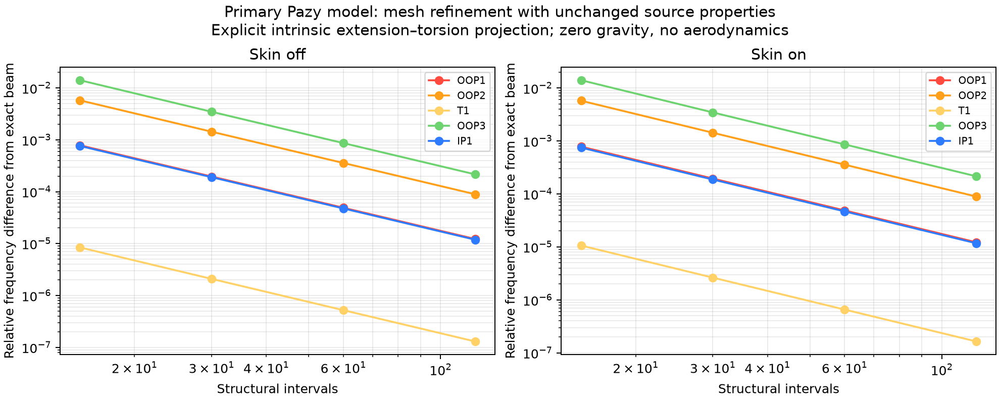

# Historical primary Pazy beam reconstruction

**SUPERSEDED INPUT CONVENTION.** The earlier derived models below contain an incorrect interpretation of spreadsheet inertia off-diagonals. Their numerical results remain reproducible historical evidence, but they must not be used as validation of the corrected primary model. Use the [corrected inputs and loaded study](pazy-loaded-comparison.md); the [original Nastran mass-matrix audit](pazy-loaded-source-audit.json) proves the correction. The original evidence ZIP is unchanged.

**Numerical comparison complete; experimental validation remains incomplete.** Four importable `.asw` models retain the primary skin-specific stiffness distributions, 16 point masses, centroid offsets and full inertia tensors. All 97 production modules remain unchanged. Ten native modal states, six actual WebAssembly replays and six offline browser states pass.

The source is [Riso and Cesnik’s primary data](https://github.com/UM-A2SRL/AePW3-LDWG/tree/396710a19a80004c65c767e9955fe60d59565c39/00_Models/01_Pazy_Technion/02_Models_Beam), pinned at revision `396710a19a80004c65c767e9955fe60d59565c39`. The paper defines local axes along the span, toward the leading edge, and upward. Therefore the out-of-plane curvature changes sign when mapped to ASWING’s aft-pointing chord axis. Point inertia matrix off-diagonals are converted to ASWING’s negative-product convention. [Model definitions, §III and Appendix A](https://doi.org/10.2514/1.C036869).

## Explicit constitutive limitation

The primary 4×4 matrix includes intrinsic extension–torsion stiffness K12. The documented `.asw` fields cannot express that term: their axial coupling comes from offsets in the section plane. It is explicitly set to zero; the other nine independent entries are preserved by an exact energy-equivalent mapping. No frequency or material parameter is fitted. The complete original matrices and all mapped fields remain in [the mapping report](pazy-primary-mapping.json).

For every possible section strain vector, the relative strain-energy perturbation is bounded by 0.06140% without skin and 0.04910% with skin. This bound is obtained from the extreme generalized eigenvalues of the matrix difference relative to the full positive-definite source matrix. It is not an experimental tolerance. Full and projected matrices are both evaluated by the independent reference.

## Independent reference and mesh refinement

The reference integrates the exact end flexibility of each massless material interval and assembles the original nodal spatial inertias. Its unit-load work integrand is quadratic, so two-point Gauss integration is exact. Both direct and reciprocal generalized eigenproblems check numerical sensitivity. This reference imports no OpenSwing solver code.

| Skin | Mode | Published UM/NAST (Hz) | OpenSwing 15 intervals (Hz) | OpenSwing 120 intervals (Hz) | Exact projected beam (Hz) |
|---|---|---:|---:|---:|---:|
| off | OOP1 | 4.222246 | 4.222247 | 4.218992 | 4.218940 |
| off | OOP2 | 28.389015 | 28.388905 | 28.228949 | 28.226431 |
| off | T1 | 41.465523 | 41.466937 | 41.466593 | 41.466587 |
| off | OOP3 | 82.521586 | 82.521196 | 81.394269 | 81.376738 |
| off | IP1 | 108.650807 | 108.650807 | 108.569491 | 108.568202 |
| on | OOP1 | 4.190634 | 4.190634 | 4.187417 | 4.187366 |
| on | OOP2 | 28.493241 | 28.493155 | 28.332827 | 28.330302 |
| on | T1 | 41.878928 | 41.880427 | 41.879989 | 41.879982 |
| on | OOP3 | 83.064586 | 83.063812 | 81.932330 | 81.914730 |
| on | IP1 | 105.891904 | 105.891904 | 105.813924 | 105.812687 |

At the original 15-interval discretization, the largest first-five-mode difference from the archived UM/NAST frequencies is 0.00358%. At 120 intervals, the largest difference from the independent projected beam is 0.02154%.

Every first-five-mode frequency approaches the exact reference monotonically over 15/30/60/120 intervals. The archived finite-element result is not treated as the refined limit. This distinction matters especially for third bending.

At 15 intervals the zero-shear midpoint constraints reduce 90 massive coordinates to 60 independent coordinates, giving 120 finite first-order states. With subdivision, massless internal nodes allow all 90 massive coordinates, giving 180 states. An independent constrained strain-energy model reproduces all eight coarse-mesh frequencies within 3×10⁻⁹ Hz; the difference in state count is explained by the discretization. [Discrete reference audit](pazy-primary-discrete.json).

All five published skin-off main-component mode profiles are compared with both UM/NAST and GFEM exports at every mesh. Those one-component correlations are separate from the six-component kinetic-energy correlations against the independent reference. Horizontal/upright zero-gravity frames agree across eight modes for both skin conditions.

## Importable models and runtime evidence

| Model | Input file |
|---|---|
| skin0 horizontal | [pazy-primary-skin0-horizontal.asw](../../examples/pazy-primary-skin0-horizontal.asw) |
| skin0 upright | [pazy-primary-skin0-upright.asw](../../examples/pazy-primary-skin0-upright.asw) |
| skin1 horizontal | [pazy-primary-skin1-horizontal.asw](../../examples/pazy-primary-skin1-horizontal.asw) |
| skin1 upright | [pazy-primary-skin1-upright.asw](../../examples/pazy-primary-skin1-upright.asw) |

Import a matching mesh through the Settings mesh-file control: [15 intervals](../../examples/pazy-primary-mesh-15.json), [30 intervals](../../examples/pazy-primary-mesh-30.json), [60 intervals](../../examples/pazy-primary-mesh-60.json), [120 intervals](../../examples/pazy-primary-mesh-120.json). These material-station meshes work with all four models.

Use vacuum modes, fixed frame and **gravity magnitude zero** to reproduce this study. The JSON native cache records the explicit mesh for each run. Arbitrary positive t labels avoid implicit mirroring; no attachment lies outside its beam. The beam spans 0.549843728 m, directly from the supplied coordinates. The reference chord fraction is 0.441 from the paper; its README rounds this to 0.44.

The [WASM report](pazy-primary-wasm.json) checks complete A/M matrices, frequencies and complex shapes. The [browser report](pazy-primary-browser.json) checks the actual unchanged application offline after boot, original input equality, explicit mesh import, module provenance, frequencies/shapes and the mobile Plots layout. The runtime sample covers 15 and 60 intervals, including both orientations; it does not replay the 120-interval states.

## What this resolves and what remains

The primary properties explain a substantial part of the simplified model’s in-plane frequency difference: the primary zero-gravity model predicts about 106–109 Hz, while the previous simplified model predicted about 128 Hz. The measured upright skin-on value remains 60.7 Hz. The new gravity-free comparison is not a matched loaded experimental test, and does not establish physical validation.

The literal ISAE attachment issue also remains. The public user guide, extended manual, theory and version notes do not state how to handle an anchor beyond a beam endpoint. No inferred clamping/extrapolation rule was added. These primary-data models are separately generated inputs, not repaired originals. [Drela’s Weight definition](https://web.mit.edu/drela/Public/web/aswing/aswing_doc.txt).

- Check self-weight equilibrium, gravity-loaded modes and complete static measured curves with these primary properties.
- Resolve original .asw attachment semantics using authoritative documentation or controlled ASWING observations.
- Reconcile precise test loads, reference-axis/chord geometry, calibration dependence and measurement uncertainty before any physical-validation pass.
- Complete remaining aerodynamic/aeroelastic and other family comparisons; this study does not validate flutter or time response.

Full evidence: [comparison JSON](pazy-primary-comparison.json), [mapping and native runs](pazy-primary-mapping.json), [SVG figure](pazy-primary-refinement.svg). The original [ST-2 simplified-model study](isae-st2-comparison.md) remains unchanged. Family coverage stays at 16 partial/25 pending, with no fully validated family.
