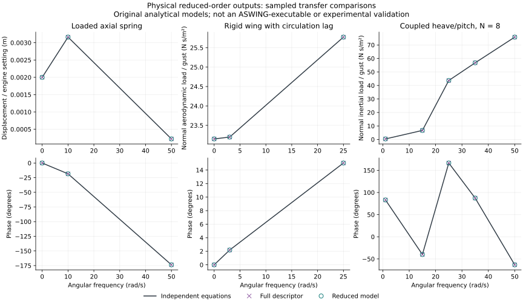

# Physical reduced-order output selection

Reduced-order models accept explicit node, structural-section, aerodynamic-strip
and global outputs alongside the existing named global/Sensor measurements.
The browser selector uses the solved modal base to offer available quantities,
beams and samples. Each sampled selection retains its array index, logical beam
and material coordinate; a stale selection is rejected rather than transferred
silently to a different station. Missing shell dimensions and undefined local
incidence remain unavailable.

Node displacement is relative to jig geometry, while its tangent describes
motion about the loaded base. Rotation is a spatial increment about that base,
with zero base value. Node velocity and rotation rate describe local elastic
motion in body axes. Section vectors use local c/s/n axes at constitutive
material midpoints. Aerodynamic vectors use body axes; densities retain their
current-length normalization. Explicit rotations and elastic incidence use
radians. Legacy named measurements retain their existing units, including
degrees for angles. Base values are stored separately from perturbation matrices.

## Equations and export

ASWING's unsteady formulation, §13.3.4, equations 182–189, includes both state
and state-rate dependence in a linear output:

`dy = C dx + Q dxdot + D du`.

With the selected real modal basis V and algebraic input lift R,
`dx = V z + R du`, the exported equations are

`zdot = Ar z + Br du`,

`dy = Cr z + Dr du + D_rate dudot`,

where `Cr = C V + Q V Ar`, `Dr = C R + Q V Br + D`, and
`D_rate = Q R`. Output recovery differentiates the complete instantaneous
physical quantity, retaining direct control/gust terms and rate-dependent
loads. Initial-state spectra retain the `s X - x0` boundary term.

The algebraic lift satisfies `M R = 0` and the full finite-range consistency
equation. An exact singleton row of M proves the corresponding coordinate of R
is zero. Repeated elimination preserves these zeros, and exact zero columns
use canonical null vectors. The remaining coupled nullspace uses the original
rank threshold. Its dimension must match the full mass-matrix rank, and the
original consistency and mass-residual checks still apply. No small coefficient
is zeroed by magnitude. Unresolved weak inertia and inputs requiring state
derivatives remain errors.

This matters when an output is identically unresponsive to an input: ordinary
full SVD roundoff had introduced circulation-rate coefficients near 1e-18 into
such a channel. The strict `.rom` export check correctly rejected them relative
to that channel's almost-zero transfer. Preserving the exact mass constraints
fixes this at the input-lift construction, without relaxing the export check.

JSON and matrix text retain selectors, units, state maps and `D_rate`. Annotated
`.rom` exports convert physical values and time to SI and label these additional
channels `OpenSwing ...`. They are explicit output-label extensions, not a claim
of original-executable label compatibility. Genuine derivative-input feedthrough
cannot be represented in the observed legacy layout and remains an explicit
export rejection. Saved computed solutions retain physical output selections;
loading them does not recompute the matrices.

For API clients, a modal result includes `rom_output_catalog`, containing field
units/components, valid station identities and available quantities. Pass
selected entries as objects in the ROM `outputs` array, alongside any named
measurements. For example, the loaded spring fixture uses:

```json
[
  {"group":"nodes","key":"displacement","component":1,"index":4,"beam":1,"t":2},
  {"group":"global","key":"support_force","component":1},
  "RY[2]"
]
```

Vector components are zero-based x/y/z or c/s/n according to the field;
scalar outputs omit `component`. Distributed indices are zero-based positions
in the corresponding report array, not logical beam/node numbers. Always obtain
index/beam/t from the current catalog; do not copy this fixture's station into
a different mesh. The output metadata echoes the canonical selector and sampling
definition.

## Independent physical references

`scripts/verify-rom-outputs.py` checks three original systems, comparing both
the full descriptor response and selected-mode response with separate equations.

- A rigid straight wing uses closed finite-horseshoe integrals at its control
  points. For one-metre chord and speed U, the circulation equation is
  `(s 2/(pi U) I - W) Gamma = gust`. Normal load density is
  `rho (U+s) Gamma`. A flap with pitching-moment derivative but zero lift
  derivative checks direct moment feedthrough and exactly zero flap-induced
  circulation. The prescribed initial circulation profile checks
  `(s 2/(pi U) I - W) Gamma = 2/(pi U) Gamma0` and the load spectrum
  `rho [(U+s) Gamma - Gamma0]`. Four/eight intervals, alternate consistent
  L/T/F units, K/F and a changed difference step are included.
- A loaded axial spring has the independent SI law
  `H(s) = engine_gain / (m s² + c s + k)`. Tip displacement and velocity,
  axial strain, internal force, engine force and support force are compared.
  A second mesh with changed declared units represents a different physical
  oscillator and is checked against its own dimensional coefficients.
- A rigid wing on an axial spring and sprung pitch hinge has independent
  heave/pitch balance coupled to the same finite-horseshoe circulation matrix.
  The reference includes eccentric real mass, flat-plate apparent mass and
  rotational inertia, circulation-rate lift and pitch-rate terms. Every strip's
  normal aerodynamic/inertial densities and incidence, plus wing displacement
  and rotation, are compared for engine and gust inputs. Four/eight intervals
  and a changed tangent step are included. This finite-wing reference does not
  substitute the infinite-span typical-section approximation.

The focused native tests also check distributed inertial density excludes a
separate point mass, mixed legacy/physical outputs, stale/invalid selectors,
missing shell dimensions and locally stagnant flow. Separate descriptor tests
retain a null combination of two nonzero mass columns, exact rate zeros and the
weak-inertia rejection.

The packaged-WASM replay recomputes selected cases and compares physical
responses, initial spectra and base outputs. It compares observable responses
rather than coordinate-dependent modal matrices. Offline browser workflows
exercise quantity/beam/sample selection, direct and rate terms, initial spectra,
export units, archive restoration, invalidation and mobile layout.

Reproduction commands:

```sh
OPENBLAS_NUM_THREADS=1 OMP_NUM_THREADS=1 .venv/bin/python scripts/verify-rom-outputs.py
npm run build
node scripts/test-rom-outputs-wasm.mjs
npm run test:browser -- tests/browser/rom-outputs.spec.js tests/browser/rom.spec.js
.venv/bin/python scripts/plot-rom-outputs.py
```

All nine native cases pass. The maximum scaled errors against the independent
references are 1.7997e-09 for the 1,872 complex forced values and
5.6684e-11 for the 360 complex initial-spectrum values, counting both full
and reduced responses. All nine .rom exports reparse and replay; maximum scaled
error is 4.7614e-12. Five packaged-WASM cases compare 2,606 real
components/base values with maximum scaled native difference 1.0763e-11.
All 86 distinct targeted native checks, 27 JavaScript checks and five offline
browser workflows have passing evidence. The checks record retains the initial
syntax/export failures, a reference-harness list/array error and a misplaced
new test assertion; those attempts are not relabeled as successful runs.



The final bundles are compared with tested source and browser assets. This is targeted component verification. Original ASWING
sampling/label parity, generalized or defective ROM bases, convected-gust
constant matrices, aircraft/experimental validation and the full requirements
ledger remain open.
