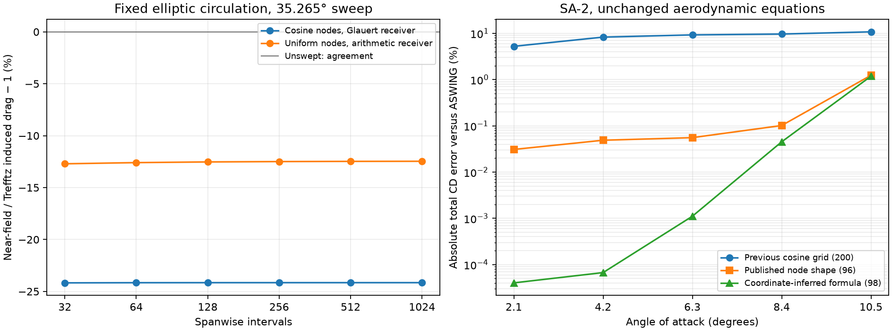

# Archived SA-2 swept-wing comparison and source audit

**2026-10-29 acceptance update:** the user authorized a provisional 3% reference
error allowance. Fresh default-mesh solves pass **50/70 checks** (still 0/70 at
printed precision); the remaining failures are total drag. The separately
[rerun coordinate-inferred mesh diagnostic](../../artifacts/isae/sa2-inferred-native-three-percent-20261029/acceptance-report.json)
passes **35/35 at 3%**, with 75/75 numerical checks and a maximum output error
of 1.281%. Its original strict score remains 9/35. Production mesh defaults and
aerodynamic equations are unchanged. References to unchanged tolerances below
describe the earlier investigations; [ISAE_STATUS.md](ISAE_STATUS.md)
records the current acceptance policy and full SA rerun.

**Spacing-only follow-up:** keeping the baseline interval counts at 100 and 200,
the coordinate-inferred modified cosine distribution passes **70/70 checks at
3%**, versus **50/70** with plain cosine spacing. All ten fresh cold solves are
numerically valid. Total-CD errors fall from approximately 5–11% to at most
1.179%; the five fine-mesh errors are +0.0400%, +0.0602%, +0.0624%, +0.0165%
and −1.1304%. This isolates spacing from the earlier diagnostic's use of 98
intervals. The paired evidence is in the
[SA-1–SA-5 spacing investigation](isae-sa1-sa5-spacing-20261029.md).
The sections below retain earlier investigation results; their strict pass
counts and descriptions of unresolved drag precede these acceptance and mesh
comparisons.

This study compares the unchanged public SA-2 input with its archived ASWING
polar, audits the experimental source, and records mesh, K/F and PG sensitivity.
It does **not** establish a validated 45-degree swept-wing solution. The archived
geometry differs from the experiment, drag differs from the archived ASWING
results, and the finest mesh rejects part of the incidence range.

The current priority is agreement with the archived ASWING case, not the
experiment's different geometry. On 2026-10-28, a fresh registered comparison
completed all ten 100/200-interval solves with **0/70 printed-output matches**.
At 6.3 degrees and 200 intervals, drag is 21.602152 N versus 23.7999 N archived
(9.2343% low). An [independent force decomposition](../../artifacts/isae/sa2-force-decomposition-20261028/summary.json)
reproduces the bound/wake velocities and load arithmetic in all 31 checks;
separation drag is negligible at that point. This excludes a stall-tuning
explanation there, but does not identify the native force contribution that
differs or prove full aerodynamic equivalence.

A separate [fixed 40-mode diagnostic](../../artifacts/isae/sa2-fourier-diagnostic-20261028/summary.json)
retains all five incidences on 100/200/400 intervals: 13 cases compute and two
400-interval cases reject for local Mach reaching unity. Across ten paired
current-kernel comparisons, maximum changes from pointwise circulation are
6.81e-6 in CL and 1.86e-6 in CD. Tip growth and reference differences persist.
Historical circulation K is unknown; these diagnostic checks do not replace
the registered denominator or establish pointwise convergence of a truncated
Fourier solution. No production equation or parameter changed in these studies.

The [force-sampling source audit](../../artifacts/isae/sa2-force-sampling-audit-20261028/summary.json)
finds no uniquely specified aerodynamic endpoint-load recovery in the inspected
papers. The structural endpoint-average rule and aerodynamic Glauert-midpoint
rule do not, by themselves, define that transfer. An independent saved-circulation
check passes all 24 checks and confirms a pole in the velocity and force density
at interior nodes with nonzero trailing-vortex strength. Directly substituting
endpoint forces into a trapezoid would therefore require an additional finite
reconstruction rule. This excludes that naive substitution as a justified fix;
it does not explain the archived drag difference or exclude a separately defined
ASWING load-recovery algorithm. No equilibrium was recomputed for this audit.

The original files are pinned in `sa2-sources.json`, fetched into excluded
`.reference/isae-sa2`, and omitted from the source and offline-app distributions.
No downloaded command script is executed. Numerical parameters are not fitted.

## Drag investigation, 2026-10-29

The active priority is the SA-2 drag discrepancy. It remains unresolved, with
the registered result unchanged at **0/70**. At 6.3 degrees and 200 intervals,
the previously retained pointwise solution gives:

| Quantity | OpenSwing | Archived ASWING | Relative difference |
|---|---:|---:|---:|
| Total drag (N) | 21.6021523 | 23.7999 | −9.2343% |
| CL | 0.356404350 | 0.356264 | +0.03939% |
| CDi, Trefftz plane | 0.0105601396 | 0.0105583 | +0.01742% |
| Cm | −0.350926014 | −0.350927 | 0.000281% in magnitude |

All seven archived quantities remain outside their original printed-precision
tolerances, including the close CL, CDi and Cm values. These pointwise numbers
are retained results, not newly rerun current-build outputs.

A [saved-data analysis](../../artifacts/isae/sa2-drag-evidence-20261029/report.json)
reconstructs forces, moments, Trefftz coefficients and normalization in all
15 arithmetic checks. Across the older saved 200-interval polar, the missing
total CD divided by archived CDi is 8.84%, 8.83%, 8.81% and 8.81% at
2.1, 4.2, 6.3 and 8.4 degrees; it rises to 9.64% at 10.5 degrees. Profile CD
is nearly constant, approximately 0.000964–0.000967. This trend rules out a
missing constant profile-drag offset as the full explanation and directs
attention to induced-force recovery. It does not identify a correction.
All five native force/coefficient pairs agree with the input dynamic pressure
and reference area within their combined printed rounding bounds.

Close CDi alone does not establish identical circulation. Using the documented
span-efficiency relation, symmetry and the original rounding intervals gives
native CLi about 0.35747155 at 6.3 degrees, versus 0.35775628 in the retained
solution. Both circulation and its conversion to near-field loads therefore
remain relevant.

One algebraic diagnostic replaces only the opposite-half bound/wake velocity
in the lift-force expression with half the infinite-wake velocity, holding
circulation and profile forces fixed. This almost closes drag (23.77595 N),
but increases the CL error from 0.00014035 to 0.00182969 and the absolute Cm
error from 0.000000986 to 0.00084270. It fails all seven original targets.
This is a counterfactual calculation, not an equilibrium or a proposed force
law; it demonstrates why the scalar drag coincidence is insufficient.

Two new [20-mode cold solves](../../artifacts/isae/sa2-fourier20-20261029/report.json)
test the lower end of the report's general 20–40-variable recommendation.
The historical SA-2 mode count is still unknown. Physical inputs, interpolation,
and archived tolerances are unchanged:

| Intervals | Drag (N) | Difference from archived drag | Maximum projected residual | Maximum local residual |
|---:|---:|---:|---:|---:|
| 100 | 21.5892026 | −9.2887% | 8.66e-17 | 0.00508 |
| 200 | 21.5962224 | −9.2592% | 3.99e-17 | 0.00702 |

Both solves finish: **26/26 numerical checks pass; 0/14 reference checks pass**.
The finite Fourier projection converges, while the reported local residuals
remain nonzero. This is not evidence of pointwise convergence. The earlier
200-interval 40-mode drag was 21.59980 N and the pointwise drag was 21.60215 N;
those comparisons retain their recorded producer versions. None of these mode
choices accounts for the roughly 2.20 N deficit. No default or force equation
has been changed on this evidence.

A subsequent [pairwise force identity](../../artifacts/isae/sa2-drag-pair-identity-20261029/report.json)
isolates a specific sampling contribution in the retained 200-interval field.
The bound segments meet exactly, and their vectors equal the physical strip
vectors within 3.14e-16 m. Near-field induced drag is 5.64050 N below Trefftz
drag: 3.46670 N comes entirely from the diagonal, own-interval trailing-wake
terms, and 2.17380 N from interactions between opposite halves. Same-half
off-diagonal terms cancel in the integrated quadratic force. All 28 independent
identity checks pass without a new field evaluation or equilibrium solve.

For a straight interval, the diagonal difference has the closed form
`rho * (wind·span) * ds / (4*pi) * (1/dL - 1/dR)`, multiplied by circulation
squared; `dL` and `dR` are distances from the Glauert force receiver to its
bound endpoints. On the cosine grid its sum generally approaches a finite,
nonzero limit for smooth, tip-vanishing circulation. Ordinary refinement need
not remove this term. This identifies a concrete force-sampling effect to
compare with ASWING's integration, not the cause of the archived discrepancy:
the 3.46670 N term is different from the 2.19775 N missing archived drag.
The published receiver is the Glauert point. Deleting its self-wake term or
moving that receiver would require further justification and would also affect
other forces. Neither change has been made.

The [full self-wake force and moment check](../../artifacts/isae/sa2-self-force-vector-20261029/report.json)
now rules out deleting that isolated term as an explanation at the retained
circulation. Native-minus-current body force requires approximately
`[+2.220863, 0, -0.088559] N` and pitching moment `-0.001183 Nm`.
Subtracting the self-wake term instead adds `[+3.425143, 0, +0.567224] N`
and changes pitching moment by `-0.414868 Nm`. The vertical-force directions
remain opposite throughout the propagated native rounding intervals. All nine
vector/identity checks pass; none of the CL, CD or Cm comparisons is recovered.

A [complete arithmetic-receiver diagnostic](../../artifacts/isae/sa2-force-receiver-20261029/report.json)
also fails to explain the discrepancy. It reassembles every bound and trailing
influence at the arithmetic midpoint of each bound segment, recomputes all
profile forces, and integrates the corresponding physical section moment.
It retains the original circulation, vortex endpoints and control-point fields;
this is a fixed-circulation diagnostic, not another solved equilibrium or a
documented ASWING convention. The Glauert replay and alternate calculation pass
all 13 arithmetic checks. Moving the complete receiver lowers drag to
**21.431661 N (9.9506% low)**, versus the original 21.602152 N. CL becomes
0.356404529 and Cm becomes -0.350903400; all seven archived comparisons fail.
The section residual with the changed bound velocity is 2.64e-11 and maximum
local normal Mach is 0.8193, both explicitly retained. This excludes the simple
arithmetic-midpoint substitution at these fixed fields. It does not exclude
every possible historical load-recovery algorithm or prove matching circulation.

The [original MATLAB figure audit](../../artifacts/isae/sa2-figure-source-20261029/report.json)
independently verifies that both curves labelled **ASWING 5.96** contain exactly
the same five CL/CD values as `SA_2_CL.txt`. The separate **ASWING-ISAE** curves
belong to the report's modified-model/viscous-loop comparison and provide no
replacement native target. All eight retained case files match the repository
manifest. The version-note chord-unsweep options change plotting only; they
do not authorize changing the aerodynamic chord geometry. No additional
historical node, mode, K/F or PG settings were recovered.

Further [saved-field separation-drag accounting](../../artifacts/isae/sa2-fourier-separation-20261029/report.json)
shows that finite Fourier residuals do not provide the missing drag directly.
At 6.3 degrees and 200 intervals, the Eq.70 separation contribution is
0.0132548 N for 20 modes and 0.00201062 N for 40 modes: only 0.601% and
0.0914% of their respective drag deficits. The pointwise contribution is
1.39e-8 N. These positive contributions already add drag. Reconstructing the
term from the saved section residuals agrees with independent strip-force
subtraction within 7.86e-15 N across all 16 computed retained states; two
Mach-rejected states remain invalid. This bounds the direct separation term,
not every possible circulation effect of an unknown historical mode count.

The original `% A D` sequence was also checked against the official and ISAE
manuals. It enters keyboard constraint selection, selects Anchored defaults,
then exits with DONE. It does not set a different rigidity or stall model.
The complete historical numeric preset is not printed in those manuals.
The implemented direct apparent-force term is normal to this planar wing;
at fixed circulation it has zero body-axis axial force. Supplying the missing
2.19775 N drag through that term would add 19.90695 N lift, whereas the native
table requires lift to decrease by 0.33205 N. This is not an explanation of the
selective drag deficit. The broader effects of unspecified historical rates
are not claimed to have been recovered.

### Mesh reconstruction: the principal drag discrepancy

Investigation resumed at the user's request. A coordinate-inferred native mesh
now nearly eliminates the large total-drag discrepancy **without changing the
aerodynamic equations**. The prospective five-angle diagnostic passes **9/35**
original printed-precision comparisons and **75/75** numerical checks. These
are separate diagnostic results; the registered two-mesh baseline remains
**0/70**. [Frozen protocol and results](../../artifacts/isae/sa2-inferred-native-mesh-20261029/report.json)

| Alpha | Inferred-mesh CD | Archived CD | CD error |
|---:|---:|---:|---:|
| 2.1° | 0.0019632092 | 0.00196321 | −0.000040% |
| 4.2° | 0.0049809767 | 0.00498098 | −0.000067% |
| 6.3° | 0.0100692883 | 0.0100694 | −0.001109% |
| 8.4° | 0.0173023008 | 0.0173101 | −0.045056% |
| 10.5° | 0.0260663562 | 0.0263778 | −1.180704% |

At 6.3°, the previous pure-cosine grid underpredicted total drag by 9.23%.
The new comparison differs by approximately 0.0011%. The median absolute CD
error across all five diagnostic angles is 0.001109%; the largest remaining
error is at 10.5°. No coefficients, force corrections or acceptance tolerances
were fitted to obtain these results.

The investigation separated node spacing from panel-count refinement:

- [Prescribed elliptic-circulation controls](../../artifacts/isae/sa2-prescribed-circulation-20261029/report.json)
  reproduce a 24.16% near/Trefftz gap on a swept cosine grid, while the unswept
  control agrees within 1e-14. Reversing sweep reverses the gap. Uniform nodes
  approach a different gap, about 12.5%, for the same analytic circulation.
  A separate [true-Glauert-receiver control](../../artifacts/isae/sa2-prescribed-uniform-glauert-20261029/report.json)
  confirms that the uniform/cosine distinction persists with the documented
  receiver construction. All 72 synthetic cases are finite; no equilibrium
  solve, stall law or fitted circulation enters these controls.
- [Four cold SA-2 solves](../../artifacts/isae/sa2-mesh-density-20261029/verification.json)
  confirm the sensitivity: at 200 intervals, pure cosine gives 21.6022 N and
  uniform spacing gives 24.9101 N, versus 23.7999 N archived. Uniform spacing
  worsens lift/moment agreement and is not a correction. The original wrapper
  had a list/`abs` error after writing each successful solve; independent
  verification recovered all four saved outputs without solver retries.
- Public native convergence-study node listings differ materially from pure
  cosine. Transferring their normalized, rounded N96 station shape to SA-2
  reduces the 6.3° drag error to 0.0555%. The same fixed shape improves every
  incidence, with [1/35 original comparisons passing](../../artifacts/isae/sa2-public-node-polar-20261029/report.json).
  Those coordinates belong to another run: its display increment is unrecorded
  and the retained rectangular producer model does not match its header.

The next reconstruction used **coordinates only**, before any aerodynamic
evaluation. It matches all **191/191** distinct printed stations across five
native rectangular meshes, N=6,12,24,48,96, within their rounding intervals:

```text
q = nextafter(float32(1), float32(0))
a = asin(q)
u_j = sin((2*j/N - 1)*a)
eta_j = 0.7*u_j + 0.3*u_j^3
```

The ISAE aerodynamics report describes ASWING's mesh as cosine-clustered
(pp. 21 and 32), without specifying the exact generator or its default
parameters. The ASWING theory's Glauert-angle coordinate and midpoint sampling
also do not require equally spaced Glauert-angle structural nodes. Thus the
documented family is cosine clustering; an exact native default remains
unconfirmed.

Ignoring the small floating-point angle cutoff, the candidate is a symmetric
cubic redistribution of `u = -cos(pi*j/N)`. It keeps tip clustering while moving
interior nodes toward the center. For the actual N98 candidate, center intervals
are about 0.70 times the plain-cosine interval width and tip intervals about
1.63 times. It is different from the standard linear combinations of uniform,
cosine and one-ended sine spacing documented in the
[AVL primer](https://web.mit.edu/drela/Public/web/avl/avl_doc.txt) and implemented
in JVL's `SSPACER`. There is no identified ASWING menu option that authenticates
this cubic formula as a universal default.

Declared endpoints and the symmetric root are enforced exactly. Two independent
WingLoop tail listings corroborate this candidate to normalized differences of
1.51e-7 and 2.54e-7, compatible with float32 arithmetic, but not every decimal
rounding interval. The SCN scripts explicitly pair node request `I` with
`N=I-2` nonzero intervals; applying that interpretation to SA-2's `I100` yields
98 intervals. For this straight swept beam, material arc is proportional to
its parameter, so the candidate stations are `t=1.2446*eta`.
[Coordinate evidence and qualifications](../../artifacts/isae/sa2-node-source-20261029/coordinate-candidate.json)

This is a coordinate-inferred reconstruction, not recovered ASWING meshing
source. Its apparent success does not authenticate every native allocation,
constraint, default or circulation-mode choice. No production mesh default has
been changed. The earlier assertion that further useful progress required a
native SA-2 executable was too restrictive: cross-case coordinate evidence
has supplied a substantial discriminator.



### Why near and Trefftz drag can remain different here

The new mesh reproduces native total drag closely, but does not impose equality
between near and far induced drag. The bound-line wake field is singular;
the synthetic controls show that different node-density families can approach
different integrated near-field values even with prescribed smooth circulation.
Converged control-point equations alone therefore do not establish a unique,
mesh-independent bound-line force integral.

An independent [whole-segment integration study](../../artifacts/isae/sa2-continuous-force-20261029/DERIVATION.md)
holds the previous n200 circulation fixed. Excluding a common physical distance
from each endpoint gives a limiting near-minus-far difference of −2.1728805 N;
excluding a common fraction of each interval gives −5.6365065 N. The shift is
predicted analytically from endpoint singularities to within 7.7e-10 N. Each
individual integral diverges logarithmically at fixed piecewise-constant
circulation. Increasing quadrature accuracy consequently cannot supply a
unique correction. These exclusions are mathematical diagnostics, not proposed
vortex cores or changes to Drela's wake.

This interpretation is consistent with published warnings about swept
bound-line velocity in [Hunsaker 2011](https://digitalcommons.usu.edu/mae_facpub/99/)
and convergence problems in [Goates/Hunsaker 2021](https://digitalcommons.usu.edu/mae_stures/26/).
Their modified wake method is not adopted as an ASWING correction.

### Remaining moment and high-incidence differences

A [saved-load moment audit](../../artifacts/isae/sa2-lift-moment-centroid-20261029/report.json)
finds that the conservative structural equations 55–56 recover the distributed
force moment at the physical arithmetic centroid, although aerodynamic
quantities can still be sampled at Glauert stations. Applying this distinction
to circulation force adds two low-incidence Cm matches: **11/35** in that
counterfactual, versus 9/35 with the current moment recovery. All 55 identity
checks pass, with no force, circulation or velocity changes. Equation 155's
force-location wording and the distinction between sampling and conservative
integration are recorded explicitly. No production moment equation is changed.

The remaining high-incidence discrepancy is strongly sensitive to the smooth
stall law. A [three-angle term-omission diagnostic](../../artifacts/isae/sa2-stall-tail-counterfactual-20261029/report.json)
retains the inferred mesh and every physical input, but sets the existing
`stall=False` diagnostic option:

| Alpha | CD error, documented smooth stall enabled | CD error, stall term omitted |
|---:|---:|---:|
| 6.3° | −0.001109% | +0.000908% |
| 8.4° | −0.045056% | +0.045932% |
| 10.5° | −1.180704% | +1.803625% |

All 45 numerical checks pass, but **0/21** reference checks pass. Native drag
lies between the enabled and omitted calculations; omission is not a fix.
At 10.5°, maximum section cl is about 1.006, below the input limit 1.2, yet
the smooth pre-stall tail changes circulation materially. The theory recommends
approximately `Ks=40`, `Delta_cl=.05`; the exact v5.96 compiled values remain
unknown, and no version-note change or authenticated settings mapping supplies
alternative values. [Source audit](../../artifacts/isae/sa2-node-source-20261029/stall-source-audit.json)

### Reference blocker

The earlier broad reference blocker is superseded by the mesh-reconstruction
findings above. The precise native meshing implementation, force-recovery
details and stall constants remain unverified. Native SA-2 node/local-field
output would still help, but its absence does not prevent the independent
mathematical and cross-case checks that produced this progress. The full case
is not validated. Registered baseline counts and tolerances remain unchanged;
new diagnostic results are reported separately rather than replacing them.

## Source and setup findings

The archived input, script and results come from the
[ISAE validation repository](https://github.com/rom1isae/ISAE_Aswing_Experimental_Validation/tree/f62943df20e9e4d7d9f50e070477b22426b5f865),
under the SA-2 case's `Aswing_Simulation_V5_96_Only` directory. The associated
ISAE report is also pinned. Its experimental source is Weber and Brebner,
[ARC R&M 2882, Part I](https://naca.central.cranfield.ac.uk/bitstream/handle/1826.2/3441/arc-rm-2882.pdf).

The literal coordinates run from `(0,0,0)` to `(0.8801,1.2446,0)`, mirrored
across the centerline. They specify **35.26546° sweep**, a 0.508 m chord normal
to the beam, and no curved tip. The resulting strip area is 1.548727 m², close
to the input reference area 1.549 m²; streamwise chord away from root/tip is
approximately 0.6222 m. The experimental wing instead has 45° sweep, 0.508 m
streamwise chord, and a curved leading edge beyond 90% semispan. Both have a
quoted span of 2.4892 m. Replacing only the sweep angle would not reproduce the
experimental planform or its coefficient normalization.

The script requests speed 49.9 and 100 nodes and toggles K/F once. The
[ASWING guide](https://web.mit.edu/drela/Public/web/aswing/aswing_doc.txt) prints
fast mode as the default, so slow mode is inferred **only if** startup settings
retained that default. PG Mach is not explicitly set. Both K/F choices and both
fixed-zero/speed-derived PG Mach are therefore separate sensitivity cases.
They are not asserted to recover the original run's full settings. Node versus
interval placement and circulation discretization also remain unverified.

The input has `Cdf=0.000771413`, `Cdp=0.000352562`, `dCLda=6.28`, and section
limits ±1.2. The ISAE prose gives different drag values and 40 nodes. Its
conversion of 163 ft/s to 41.4528 m/s is inconsistent: the conversion is
49.6824 m/s. The archived file and script values are retained unchanged.

The primary report's Table 4, printed p.17 / PDF p.18, was inspected visually:
it has a **dash for drag at 2.1°**, where the repository table contains zero.
The study preserves the repository value as provenance but excludes it from
experimental error statistics. The other four drag values and five lift values
match the primary table. `CL_LLT` and `CD_LLT` are separate computed series,
not experimental observations.

The primary coefficients integrate pressure and exclude skin friction. The
study therefore reports separate pressure-only diagnostics: a separately parsed
model removes only `Cdf`, reuses the same circulation, and verifies the unchanged
flow residual. Original total coefficients remain available for comparison with
archived ASWING. This decomposition does not resolve the geometry differences.

## Evidence needed for a matched experimental reconstruction

A further visual inspection of the pinned primary report's Figure 1 (printed
p.26, PDF p.27) resolves more of the geometry than the archived input contains.
The drawing labels the outer leading edge as a **parabolic curve**, locates its
start 44 inches from the centerline, and shows a five-inch outer span beside
the 20-inch streamwise chord. The full span is 98 inches. It also depicts a
two-inch-wide pressure-tube lead-out fairing. These are dimensions from the
experimental drawing; no unreported parabola equation or aerodynamic beam-axis
construction has been inferred from them.

Part II supplies the missing **26 tip coordinates** in Table 1 (printed p.42 /
PDF p.43); its Figure 1 (printed p.75 / PDF p.76) defines their origin. Both
pages were inspected. The new `scripts/reconstruct-weber-planform.py` uses these
points directly, excluding pressure-tube fairings. It independently checks
exact piecewise-linear chord integration against polygon area and centroid,
then measures sensitivity to monotone cubic interpolation. It uses no
production geometry or aerodynamic code.

| Span (in) | Reconstructed area (in²) | Aspect ratio | Mean quarter-chord x (in) | Published moment-reference x (in) |
|---|---:|---:|---:|---:|
| 98 | 1926.16 | 4.98609 | 29.24599 | 29.30 |
| 59 | 1146.16 | 3.03710 | 19.61099 | 19.70 |
| 38 | 726.16 | 1.98854 | 14.52525 | 14.60 |

The 98-inch outline has area **1.2426814 m²**; the archived 1.549 m² reference
is 24.65% larger. Monotone interpolation changes area by only 0.1475 in² per
wing. The moment-reference differences remain unresolved and are not fitted
away. Neither result changes the archived coefficients or establishes their
experimental normalization. The raw coordinates, checks and standalone figures
are in `weber-planform.json`, `weber-planform-checks.json` and
[`weber-planform.svg`](weber-planform.svg).

The experimental configuration is not identical for every pressure station.
Section 2 (printed p.2, PDF p.3) says the additional measurements at `y/c=2.20`
used a plain wooden tip without the tube fairing present for the other readings.
It explicitly cautions that those readings are not strictly comparable. A
future reconstruction must retain that distinction when comparing local loads.

The report also applies a span-dependent tunnel correction to incidence. At
10 degrees measured incidence, it gives corrections of approximately +0.4
degrees at the center and +0.7 degrees at the tip. Its stated test speed is
163 ft/s (49.6824 m/s), with Reynolds number 1.68 million based on the chord.
The current archive comparison retains its own 49.9 m/s input and tabulated
angles; these are not silently substituted with the experimental conditions.

Before a new result can be called a matched validation, the reconstruction must
state its table interpolation, pressure-tube configuration, aerodynamic
section/axis conversion, reference area and incidence correction used. Any
remaining geometric or tunnel-correction uncertainty needs a sensitivity study.
Changing just the archived sweep from 35.26546 to 45 degrees would leave these
differences unresolved. This source inspection adds evidence, not a new solved
or validated wing case.

## Numerical results and unresolved discrepancies

`sa2.json` records 114 cases: **104 computed and 10 rejected**. The matrix covers
24/48/100/200/400 intervals, five recorded incidence angles, two K/F choices and
two PG choices, plus zero-incidence, signed-incidence and dynamic-pressure
similarity checks. Every computed case checks strip-force/moment integration,
reference normalization (including the 0.508 moment reference chord), drag
accounting and lateral symmetry. Zero-incidence drag has an independent
closed-form swept-strip reference.

All four modes have complete polars through 200 intervals. At 10.5°:

| Case, 200 intervals | CL, total | CD, total | CD, pressure only |
|---|---:|---:|---:|
| Archived ASWING | 0.590952 | 0.0263778 | Unavailable |
| Current influences, PG 0 | 0.586576 | 0.0235418 | 0.0227698 |
| Current influences, PG V/a | 0.588619 | 0.0236597 | 0.0228875 |
| Frozen influences, PG 0 | 0.577499 | 0.0222503 | 0.0214671 |
| Frozen influences, PG V/a | 0.579707 | 0.0223679 | 0.0215843 |
| Experiment, different geometry | 0.559 (pressure) | Unavailable | 0.035 |

For current influences/PG 0, the maximum 100-to-200 interval change is
0.000928 in CL and 0.0000103 in CD. The archived drag difference is much larger,
but the incomplete 400-interval polar prevents a full-range mesh-convergence
claim. The study retains errors rather than defining agreement by a loose
acceptance tolerance. Far-wake `CDi` and near-field total `CD` remain separate;
adding `CDi` to total `CD` would double-count induced effects.

At 400 intervals, current influences reject 8.4° and 10.5° for both PG choices;
frozen influences reject 6.3°, 8.4° and 10.5°. The local section-normal Mach
exceeds unity. These are rejected analyses, not zero-valued or valid polar points.

`sa2-tip.json` diagnoses the tip velocity independently. At fixed PG 0 and
10.5°, a 0.499 m/s solve supplies circulation; direct adaptive Biot–Savart line
integration at the tip receiver uses the literal geometry and no production
vortex kernel. Scaling velocity to the original 49.9 m/s gives:

| Intervals | Current tip Mach | Frozen tip Mach |
|---|---:|---:|
| 100 | 0.40750 | 0.43309 |
| 200 | 0.80699 | 0.83428 |
| 400 | 1.61978 | 1.64848 |
| 512 | 2.07651 | 2.10584 |

The independent normal-speed difference is at most 3.22e-10 m/s at diagnostic
speed. This confirms growth in the discretized vortex model's velocity; it
does not independently validate the circulation or permit the original-speed
cases to bypass the subsonic guard. A physically justified treatment of this
tip/refinement behavior and comparison with original ASWING remain open.

## Reproduction and browser evidence

```sh
python3 scripts/fetch-sa2.py
OPENBLAS_NUM_THREADS=1 OMP_NUM_THREADS=1 .venv/bin/python scripts/verify-sa2.py
OPENBLAS_NUM_THREADS=1 OMP_NUM_THREADS=1 .venv/bin/python scripts/verify-sa2-tip.py
.venv/bin/python scripts/plot-sa2.py
npm run build
node scripts/test-sa2-wasm.mjs
npm run test:browser -- tests/browser/sa2.spec.js
```

The packaged WASM replay covers 30 cases: 26 computed cases with **1,196 physical
values compared**, and four matched rejection outcomes. Maximum scaled
native/WASM difference is 1.162e-12. The offline browser workflow passes six
selected solves, exact file import, mesh/PG/K/F choices, exports, zero-incidence
drag, the rejected 400-interval solve, disabled invalid-result export and mobile
layout. The study leaves the 56-module production kernel and web application
unchanged; it is not a fresh full-project regression.

The initial study stopped on the first local-Mach rejection. Its replacement
records all rejected cases explicitly. The initial diagnostic requested 800
intervals and was rejected by the existing 512-interval input limit; the final
diagnostic uses 100/200/400/512. Both failed jobs remain recorded separately in
`sa2-checks.json`, alongside the successful runs and source hashes.

`sa2.svg` and `sa2.pdf` show total-force archive comparisons and separate
pressure-only experimental comparisons. The experimental mismatch is explicitly
labeled. A geometrically matched reconstruction, uncertainty analysis, original
executable agreement and a converged full-range solution remain required.
