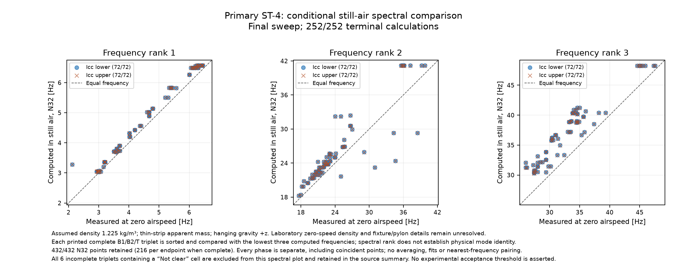

# ISAE ST4 hanging wing modal comparison

OpenSwing has completed conditional numerical and experimental comparisons for
the concentrated-weight wing in ISAE ST4. The first three frequencies agree
closely with independent structural and strip-air models. Substantial measured
frequency discrepancies remain, so this study establishes partial coverage,
not full experimental validation or stock-ASWING executable parity.

## Primary measurements and reconstructed setup

The primary source is Runyan and Sewall's [NACA TN 1594](https://ntrs.nasa.gov/citations/19930082244),
*Experimental Investigation of the Effects of Concentrated Weights on Flutter
Characteristics of a Straight Cantilever Wing*. The retained scan has SHA256
`2e63c2ca3b4a50a0c8c3830b5abb3dd887b6acb0b8f0985b25c5042f6cbc95b9`.
Table I specifies the added masses, chordwise centers and polar inertias;
Table II supplies the measurements. The [transcription](st4-primary-observations.json)
preserves 49 run/control records, 42 configurations, 78 zero-speed observations,
original B1/B2/T labels, before/after phases and six “Not clear” cells.
Only the 72 complete triplets enter the spectral comparison.

The wing hangs tip down from a clamped root. Its reported span is 48 inches,
chord 8 inches and weight 3.48 lbf. The reconstruction uses L=1.2192 m,
c=0.2032 m, mass approximately 1.57850 kg, EI=403.783 N m² and
GJ=198.591 N m². Gravity acts toward the tip and supplies tensile preload.
The [setup record](st4-primary-setup.json) retains the original quantities,
units, source locations and conversion assumptions.

The measured distributed polar inertia constrains the sum of two rotary
components. Two conditional endpoints set the chord-axis component to zero
or a nominal airfoil-thickness containment bound, while preserving the
measured sum. Equivalent chordwise point pairs reproduce each added mass,
center and polar inertia. Unreported pylon span offsets and bending inertia
are omitted; in-plane bending, extension and shear use stiff limits. These
endpoints do not bound all physical uncertainty. Removing measured frequencies
from the input data leaves all 84 generated models byte-identical.

The zero-speed observations were made in air, with 0% Freon recorded separately
from each flutter-test mixture. Their density is unspecified. All new still-air
predictions assume **1.225 kg/m³**; this is not a recovered laboratory condition.

## Archive conflicts

The original ISAE files remain pinned to revision
`f62943df20e9e4d7d9f50e070477b22426b5f865`. Their spreadsheet and eigenvalue
exports do not establish the complete historical model and operating setup.
The archived N=16 requests roots, not 16 panels. Distributed rotary inertia
also differs between variants without a resolved physical justification.
The earlier missing-pound-conversion explanation for one value remains an
unproved hypothesis.

Primary-table values supersede conflicting spreadsheet cells for this separate
reconstruction. For example, 7a at 45 inches reports B1=2.12, B2=31.4 and
T=18.0 Hz, while the CSV puts 31.4 under B1. The 7e/35-inch torsion readings
are 23.9 and 24.0 Hz rather than CSV 29.95. Original files, questionable cells
and before/after differences are retained in the evidence archive. No frequency
was fitted, averaged or silently corrected to improve agreement.

## Numerical verification

There are **252 native vacuum states and 252 native still-air states**:
42 configurations, two inertia endpoints and 8/16/32 nominal mesh intervals.
The independent study contains 672 energy/continuous solutions, covering
vacuum and assumed-density air at 64/128/256 energy elements plus continuous
boundary solutions. Every native result retains full matrices and modal
vectors. [Vacuum results](st4-primary-vacuum.json), [still-air results](st4-primary-air.json).

| At 32 nominal intervals | Maximum frequency error | Minimum kinetic modal assurance |
|---|---:|---:|
| Vacuum, first three modes | 0.4675% | 0.99992388 |
| Still air, first three modes | 0.4711% | 0.99991347 |
| Still air, all six modes | 2.3372% | 0.35227950 |

Modal assurance compares the shapes using structural and, where applicable,
fluid kinetic energy. Frequency order is retained. The full still-air report
contains 0 refinement groups with a nonmonotonic frequency-error
sequence; each flag remains explicit. Small matrix residuals are numerical
controls, not an experimental acceptance tolerance.

The independent energy solver originally lost precision in low frequencies
on fine meshes. Solving the reciprocal generalized problem with the same
stiffness and mass matrices reduced the maximum FE256 reference discrepancy
to 0.003135%. Both original and corrected runs are retained. Nearby sixth
and seventh modes can mix substantially: in the 7f/48-inch upper-endpoint air
control, individual mode-six assurance is about 0.352 while the pair subspace
agrees above 0.9998. Its individual shapes and frequency splitting remain
unconverged. This diagnosis does not replace the ordered six-mode results.

## Experimental agreement

Each complete measured triplet is sorted and compared with the lowest three
computed frequencies. This assumes those measured modes comprise the first
three modes of the reduced model; it does not establish physical mode identity.
All 72 observations remain separate, including repeat readings. At each mesh
there are 216 scalar observations per inertia endpoint.

| Rotary inertia endpoint | Mean absolute vacuum discrepancy | Mean absolute still-air discrepancy | Maximum still-air discrepancy |
|---|---:|---:|---:|
| Lower | 10.1698% | 9.2958% | 54.8669% |
| Upper | 10.1367% | 9.2639% | 54.8608% |

These are descriptive discrepancies at 32 intervals, not pass/fail statistics.
Air inertia reduces some differences but does not resolve the experimental
disagreement. Unknown density, sectional mass distribution, pylon/support
geometry, fixture compliance and measurement identification remain material.
Thin-strip air also omits finite-span fluid coupling, thickness, viscosity,
fluid damping and tunnel-wall corrections.

[PDF figure](st4-primary-comparison.pdf), [ordered numerical results CSV](st4-primary-air-modes.csv),
[individual experimental residuals CSV](st4-primary-air-experimental.csv).

## Browser implementation and reproduction

The new still-air mode uses exactly zero mean flow and adds directional
thin-strip inertia through the existing apparent-load and full mass-matrix
assembly. Apparent mass contributes inertia, not gravitational weight. The
option currently supports stationary fixed-frame modes of lifting beams.
Its density is explicit; unsupported follow-on analyses are rejected.

The reviewed source passes 176 selected Python checks, a focused JavaScript
check, three [native/WASM matrix comparisons](st4-primary-wasm.json) and three
[built offline browser comparisons](st4-primary-browser.json), including
mode plots, mobile rendering and frame-setting restoration. All 279 original
ASW inputs were rechecked: 177 parse and 102 remain rejected.

For a browser replay, load the [unloaded model](st4-primary-unloaded-none-lower-p8.asw),
select Coupled eigenmodes, Still air, density 1.225, 8 intervals, 12 roots,
dense solution and shift (-0.1, 0). Set custom gravity 9.80665 and bank 180°
with elevation/heading zero to reproduce positive body-z gravity. The other
checked inputs are [7a/11 inches](st4-primary-7a-11-lower-p16.asw) and
[7f/48 inches](st4-primary-7f-48-upper-p16.asw), both at 16 intervals.
The model comments retain the earlier vacuum-study context; the modal medium
and gravity are analysis settings.

The [source and evidence audit](st4-primary-transition.json) records separate
97-module vacuum and 98-module still-air sources. The
[evidence archive](st4-primary-evidence.zip) preserves inputs, matrices,
references, original failures, scripts and runtime evidence, with an
independent extraction/replay recipe. Historical studies retain their original
source hashes. Completing this conditional study does not establish full
ISAE validation or ASWING feature parity.
