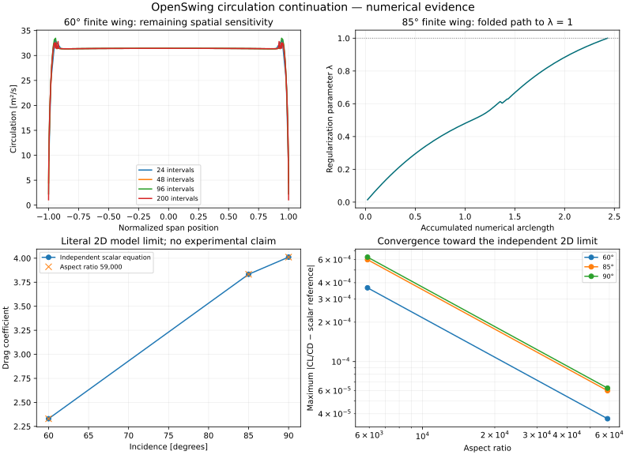

# Circulation continuation: evidence and remaining limits

The nonlinear circulation initializer now follows a dimensionless arclength
continuation path. The section stall, pressure-drag and vortex equations are
unchanged. Only a solution of the complete, unregularized equations is returned;
a partially continued solution is an error. The result contains the path and
states explicitly that root uniqueness and aircraft stability are not established.

Since 2026-10-28, automatic mode can make one direct Newton attempt after a
failed auxiliary path, when the original linear seed is valid and direct Newton
has not already been tried. The original equations and acceptance gates remain
in force; a successful fallback records the preceding failure. Explicit
continuation requests still return that failure. The historical study below
retains its generating kernel and outcomes; see the current
[numerical description](../NUMERICS.md#circulation-branch-continuation).

This numerical study uses the original `examples/stall-branch.asw`, a rigid
rectangular wing with aspect ratio 5.9, chord 1 m, section slope 6.2832,
CL limits ±1.2, friction/pressure coefficients 0.00352562/0.00771413, speed
47.9 m/s and density 1.2256 kg/m³. Its numerical section parameters match the
archived SA-1 example, but no external input text or measured data is distributed
with this model. The historical [SA-1 experiment comparison](sa1.md) retains its
original solver hashes and measured discrepancies.

## Checks

The source-hashed native study contains 49 successful cases, plus three separate
finite-wing diagnostic attempts. It covers:

- Positive/negative 60° incidence, fixed-zero and speed-derived PG Mach,
  and 24/48/96/200 intervals. Lift/pitch reverse and drag is preserved.
- Complete Fourier/pointwise equivalence and two non-SI input-unit systems.
- Direct versus continuation solutions at 0°, 8°, 18.091° and 25°.
- Independent scalar 2D references at ±60°, ±85° and ±90°, approached by
  aspect ratios 5,900 and 59,000 at 16 intervals.
- Arclength steps 0.04/0.02/0.01 at 75° for both PG choices and at 85° for
  speed-derived PG. The sampled roots agree after this refinement.
- Physical residual re-evaluation with circulation prescribed, independent strip
  wrench summation and dimensional coefficient normalization.

Separate tests verify a known cubic root behind two continuation folds,
rejection of a fold with no real endpoint, finite-difference directional checks
of the analytical flow tangent (including Fourier coordinates and circulation
rates), and refined physical-wing continuation paths.

Native/WASM comparisons use coefficients and physically nondimensionalized
forces, moments and circulation. This is essential for the deliberately long
2D-reference wings, whose nearly zero rolling/yawing moments cancel very large
opposing dimensional terms. It does not alter any physical result.

The targeted native regression passed **147 tests** across circulation,
aerodynamics, ground/self influence, propulsion, volume, coupled structures,
time integration, feedback and the JSON bridge. Both offline browser workflows
passed, and desktop/mobile/geometry screenshots were inspected.

The packaged WebAssembly replay passed all **49 cases**, comparing **3,692**
physical values after this nondimensionalization. Its maximum scaled native/WASM
difference is **2.693e-12** against a **2e-9** tolerance. It also reproduces the
two successful finite-wing diagnostics and the unresolved 90° diagnostic.
The record pins all **54 kernel modules**, **58 source hashes**, the native report
and the numerical runtime. The maximum scalar-reference error at aspect ratio
59,000 is bounded by **6.272e-5** in CL/CD over the sampled angles. Native
0.04/0.02/0.01 continuation-step differences are at most **2.722e-15** after
physical nondimensionalization.

## What this establishes—and what remains open

At 60°, automatic-PG results on the four tested meshes are:

| Intervals | CL | CD |
|---:|---:|---:|
| 24 | 1.1788146625 | 2.0834953787 |
| 48 | 1.1757171583 | 2.0878076045 |
| 96 | 1.1794788113 | 2.0950920729 |
| 200 | 1.1812982248 | 2.1050266549 |

Reflection and residual checks pass, but these values do **not** establish
spatial convergence in deep stall. Resolved tip circulation remains sensitive
to discretization. Continuation-step refinement is a separate check from mesh
refinement, and neither establishes experimental accuracy or physical stability.

The 96-interval, automatic-PG cases now reach complete solutions at 75° and 85°.
The 90° case remains unresolved after the bounded path search. Coarser arclength
limits selected other 75/85° roots during development; the final smaller default
is supported by the recorded step study, not a uniqueness theorem. No root has
been averaged, symmetrized or selected by fitting experimental data.

The literal wind-aligned infinite-wing equations give
`a0*sin(alpha) - cl*cos(alpha) - Ks*fstall(cl) = 0`. The independently bracketed
solution gives `CD = Cdf+Cdp+4` at 90°, while the formulation's approximate
high-incidence discussion gives about 2. This discrepancy is retained. The
extreme-angle model extrapolation and exact ASWING executable behavior remain
unverified. The native 90° finite-wing failure does not imply a universal angle
limit: the long-wing 90° reference cases solve and converge to the scalar model.



The [PDF figure](stall-circulation.pdf) is also available. The formulation and
algorithm are described in [the numerical notes](../NUMERICS.md#circulation-branch-continuation).

## Reproduce

```sh
OPENBLAS_NUM_THREADS=1 OMP_NUM_THREADS=1 .venv/bin/python scripts/verify-stall-circulation.py
OPENBLAS_NUM_THREADS=1 .venv/bin/python scripts/plot-stall-circulation.py
npm run build
node scripts/test-stall-circulation-wasm.mjs
npm run test:browser -- tests/browser/stall-circulation.spec.js tests/browser/sa1.spec.js
```

`stall-circulation.json` pins the numerical sources and stores all native results,
physical/reference checks and unresolved diagnostics. The packaged replay writes
`stall-circulation-wasm.json` with runtime/module provenance. Browser checks use the
actual worker offline, exercise the new example and ±60°/75°/85° results, inspect
continuation reports and exports, retain stale-result invalidation, and revisit
the historical SA-1 measured-angle workflow. Earlier studies remain historical
when their recorded source hashes differ from the current kernel.
