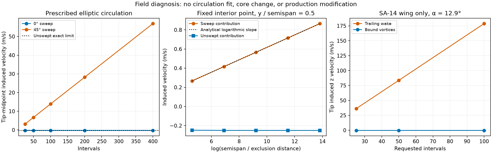

# Swept lifting-line force-velocity diagnosis

**The swept bound-line force velocity does not have a converged limit in the tested formulation.** This is an unresolved physical-model issue. The new checks identify its mechanism; they do not certify ASWING parity or implement a remedy. Production modules and the verified release remain unchanged.

[Reproducible calculations](../../scripts/verify-swept-lifting-line-limit.py) and [pinned results](swept-lifting-line-limit.json) separate three questions: whether the vortex integrals are evaluated correctly, whether their refined limit exists, and whether the experimental aircraft is reproduced.



## Source interpretation

Drela's steady description evaluates the Kutta–Joukowski force using velocity at the bound vortex (equation 67), places that vortex upstream of the tangency control point (155–157), and represents circulation using sampled horseshoes (150–153). The same-surface influence uses equation 160; a finite core is introduced for other surfaces in equation 161. Fourier testing constrains the control-point residual (201). These are distinct from evaluating the force-point field. [Drela, steady formulation, sections 3.1, 4.2 and 5.6](https://web.mit.edu/drela/Public/web/aswing/asw_theory.pdf).

The formulas and Figure 16 on printed pages 32–33 were visually checked. They do not establish an additional finite-part rule used by any particular ASWING executable. A convergent alternative must therefore be assessed separately for physical validity and compatibility with Drela's implementation.

## A circulation solve is not needed to reproduce the issue

Use a straight bound line `(y tan Λ, y, 0)`, unit semispan, unit peak circulation, zero PG Mach, and trailing vortices along positive x. Prescribe the smooth elliptic distribution `Γ(y) = sqrt(1 − y²)`, exactly one sine mode in the Glauert coordinate. Sample it at the documented angular midpoints. No nonlinear solver, stall law, or experimental fit enters this test.

For a unit trailing ray starting at span coordinate η, its z velocity on this line is

\[
K(y,\eta)=\frac{1}{4\pi}\left[\frac{1}{y-\eta}
 +\frac{\sin\Lambda}{|y-\eta|}\right].
\]

Adjacent horseshoes give nodal circulation jumps, so this expression provides a separate implementation of the complete trailing field. Adaptive integration of the rays checks it independently. Bound segments are collinear with the receiver and contribute zero principal-value velocity.

The unswept contribution tends to the exact uniform downwash −0.25 m/s. Its maximum error decreases from 0.00016446 m/s at N25 to approximately 0.000000643 m/s at N400. The sampled 45°-sweep tip velocity instead grows from 3.15457 to 56.88907 m/s over that refinement. Production horseshoe velocities agree with the independent expression.

This is also an interior-point problem. For continuous circulation, the wake density is `−Γ′(η)`. With symmetric spanwise exclusion distance ε around a fixed interior point, the sweep term contains

\[
w_{\rm sweep}(y;\epsilon)
= -\frac{\sin\Lambda\,\Gamma'(y)}{2\pi}
   \log(1/\epsilon)+O(1)
\]

in the stated unit-semispan convention. At `y=0.5`, `Λ=45°`, the predicted logarithmic slope is 0.0649747334361 m/s; independent quadrature gives 0.0649747334400 m/s. The ordinary odd-kernel principal value converges while the sweep term grows. The exclusions are diagnostic integration bounds, not a chosen production core or an accepted flow state.

Because the prescribed distribution is already one smooth Fourier mode, selecting fewer circulation modes alone cannot generally remove this mechanism. Published work also identifies swept lifting-line singularities and describes modified near-wake geometry to recover grid convergence. That is corroborating context, not evidence that those modifications are ASWING's method. [Goates and Hunsaker, 2021](https://digitalcommons.usu.edu/mae_stures/26/); [Reid and Hunsaker, author publication description](https://aerolab.usu.edu/publications/journal).

## Independent check of the SA-14 field

At the original wing-only input's 12.9° state, 70 m/s and zero PG Mach, adaptive integration checks three force points on each of the N25/50/100 meshes. This check shares the geometry and computed circulation with production, but implements the velocity integrals independently. Across all nine points, the largest component difference is **1.26e−11 m/s**.

| Requested intervals | Positive-tip wake z velocity, m/s | Bound z velocity, m/s | Total local normal Mach |
|---:|---:|---:|---:|
| 25 | 36.2415 | −0.314790 | 0.185566 |
| 50 | 83.7093 | −0.312920 | 0.297577 |
| 100 | 178.7342 | −0.312460 | 0.571097 |

The growing component comes from the trailing wake. This explains why stable integrated lift and a small control-point tangency residual did not establish local-flow convergence in the [SA-14 pilot](isae-sa14-pilot.md). Original-speed N200 and N400 attempts reach local normal Mach 1.14844 and 2.31848 and are rejected by the unchanged subsonic-validity guard. These are invalid model states, not predictions that the physical experiment contains such speeds.

## Finite-chord force-accounting follow-up

The subsequent [independent diagnostic](swept-finite-chord-diagnostic.json)
compares flat unswept and 45° sheared-parallelogram wings at 5° incidence,
1 m/s and density 1 kg/m³. It varies span and chord resolution separately:
16 direct linear solves, at most 256 panels, plus six prescribed-circulation
controls. All 103 declared equation/algebra checks pass; the largest tangency
residual is 1.58e−15 m/s. A separate audit passes 1,090 saved-array checks
without recomputing the aerodynamic fields.

For this planar geometry, a chordwise edge has force only along y and moment
only about z. Adding its load therefore cannot directly repair lift, drag or
pitching moment. The saved arrays verify these zero components exactly.
With multiple chord rows, full minus front-row loading also includes additional
spanwise rows; those changes must not be attributed to chordwise forces alone.

For the one-chord 45° case, stable integrated lift accompanies growing local
velocity and continuing yaw-moment changes:

| Span panels | CL | Largest absolute induced-velocity component at a material point, m/s | Yaw moment Mz, N·m |
|---:|---:|---:|---:|
| 16 | 0.29638319 | 0.150543 | 0.003034699 |
| 32 | 0.29634178 | 0.347851 | 0.003329121 |
| 64 | 0.29633563 | 0.763629 | 0.003617885 |

Successive yaw increments are 2.94422e−4 and 2.88764e−4 N·m. The positive-half
force changes also grow while total-force changes shrink. Material Glauert
samples and arithmetic segment midpoints approach one another, but their
maximum induced-velocity difference grows from 0.1012 to 0.4312 m/s. Merely
changing the sampling location does not establish a common refined limit.

Chord refinement produces smaller successive integrated-load changes, but
these short ladders do not prove convergence. This reference fixes wakes along
x, whereas ASWING's documented wake follows the relative freestream. Its last
ring extends one quarter final-panel chord beyond the physical trailing edge;
the reported forces belong to that declared discrete ring construction. It is
not an original-ASWING comparison, a stall-model check or a new equilibrium.
No production solver source or physical-validation coverage changes.

The [optional raw archive](swept-finite-chord-evidence.zip) contains the frozen
driver, plan, review, all saved operators/fields and complete process records.
Two failed reviewer-helper attempts are retained; the single scientific run
had no rejected cases. Every archive member was read back and checked against
its SHA-256 manifest. The name-compatibility build includes this follow-up
summary; the optional raw archive remains separate.

## Consequence for completion

The field arithmetic passes the independent checks, but the refined force-velocity model remains unresolved. Before claiming physical or ASWING parity, establish the reference implementation's force-velocity treatment and verify a justified formulation across unswept, swept, interacting-surface, structural, transient and frequency-response cases. Any such change must propagate through forces, moments, stall evaluation and their derivatives. Increasing a core, lowering the mesh count, or accepting a Mach rejection would not establish completion.

Reproduce with:

```sh
OPENBLAS_NUM_THREADS=1 OMP_NUM_THREADS=1 .venv/bin/python scripts/verify-swept-lifting-line-limit.py
OPENBLAS_NUM_THREADS=1 OMP_NUM_THREADS=1 .venv/bin/python scripts/plot-swept-lifting-line-limit.py
```
